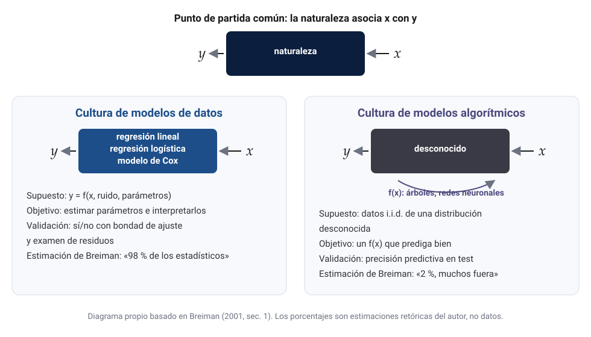
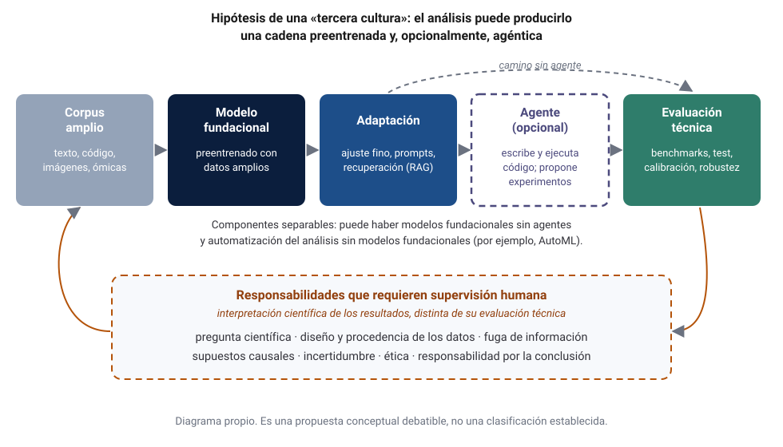

::: {.dc-download}
<a class="lf-btn lf-btn--primary" href="paper.pdf" download="Laverde-Chunza-2026-Mas-alla-de-las-dos-culturas.pdf">Descargar artículo en PDF</a>
Versión en LaTeX (A4), con el mismo contenido que esta página.
:::

::: {.callout-note title="Tipo de texto"}
Esta es una **revisión crítica y un ensayo argumentativo**, no una investigación empírica: no presenta experimentos ni datos propios. El ensayo distingue entre lo que **Breiman afirmó en 2001**, lo que **sostuvieron sus comentaristas** y las **lecturas posteriores**. Las posiciones que defiende son **propuestas argumentativas del ensayo**. La «tercera cultura» de la sección 7 es una hipótesis conceptual, no una clasificación establecida.
:::

::: {.dc-abstract}
**Resumen.** En 2001, Leo Breiman sostuvo que la Estadística se había comprometido casi en exclusiva con una «cultura de modelos de datos», que supone un mecanismo estocástico conocido salvo por sus parámetros, y que debía abrirse a una «cultura algorítmica», que trata ese mecanismo como desconocido y juzga los modelos por su precisión predictiva fuera de la muestra. Este ensayo reconstruye su argumento y la discusión con Cox, Efron, Hoadley y Parzen. Sostiene que Breiman acertó en la centralidad de la validación fuera de la muestra, en la multiplicidad de modelos casi igual de buenos y en el valor de la alta dimensionalidad, y que sus límites aparecen en la causalidad, el cambio de distribución y la noción de importancia de variables. El deep learning, los modelos fundacionales y los agentes de programación desplazan el centro del debate: la pregunta ya no es solo qué modelo usar, sino quién o qué construye el análisis y cómo se verifica. Se propone, como hipótesis debatible, una «tercera cultura» cuyo rasgo definitorio sería una nueva división del trabajo, no una nueva epistemología. En oncología y genómica se distingue la utilidad predictiva de la evidencia clínica suficiente, y se defiende que la inferencia estadística sigue siendo indispensable para pasar de una a otra.

**Palabras clave:** dos culturas; Breiman; inferencia estadística; aprendizaje automático; modelos fundacionales; agentes de programación; validación; causalidad; oncología; genómica.
:::

# Introducción y contexto histórico {#sec-intro}

*Statistical Modeling: The Two Cultures* apareció en *Statistical Science* en 2001 como artículo de discusión, con comentarios de D. R. Cox, Bradley Efron, Bruce Hoadley y Emanuel Parzen y una réplica del autor [@breiman2001]. Fue escrito para provocar. El propio Efron esperaba que se hubiera escrito más como recurso de defensa de una postura que como la confesión de un converso a las cajas negras [@breiman2001, p. 219].

Breiman escribe desde su biografía. Tras siete años como probabilista, trabajó trece como consultor antes de volver a Berkeley en 1980, donde encontró una investigación en la que los artículos «empiezan y terminan con modelos de datos» [@breiman2001, p. 200]. Sus proyectos de consultoría eran de predicción. El del ozono en Los Ángeles, con más de 450 variables, lo describe como un fracaso por su tasa de falsas alarmas. El de detección de cloro en espectros de masas, con 30.000 compuestos, se resolvió con un árbol de decisión que incorporaba conocimiento químico en 1.500 preguntas y alcanzó un 95 % de acierto [@breiman2001, pp. 200–201]. De ahí extrae su programa: buscar una buena solución, convivir con los datos, usar el modelo que funcione y juzgarlo por su precisión en datos de prueba [@breiman2001, p. 201].

La validación cruzada tenía antecedentes estadísticos [@stone1974]. Breiman ya había desarrollado *bagging* y ese mismo año publicó los bosques aleatorios [@breiman1996bagging; @breiman2001rf], y Vapnik había formulado cotas de generalización [@vapnik1995]. Lo nuevo fue la tesis sociológica: la Estadística académica se aislaba de los problemas más interesantes, mientras una comunidad joven de informáticos, físicos e ingenieros, el *machine learning*, los resolvía [@breiman2001, p. 205].

# Las dos culturas {#sec-culturas}

Breiman imagina la naturaleza como una caja negra que transforma entradas $\mathbf{x}$ en respuestas $y$. Analizar datos persigue dos fines: la **predicción** y la **información** sobre esa asociación [@breiman2001, p. 199]. Las culturas difieren en cómo llenan la caja (@fig-culturas).

{#fig-culturas fig-alt="La caja negra de la naturaleza y las dos formas de llenarla: un modelo de datos validado con bondad de ajuste o un algoritmo validado con precisión predictiva."}

La **cultura de modelos de datos** supone que los datos provienen de un modelo estocástico, *respuesta = f(predictores, ruido, parámetros)*, cuyos parámetros se estiman e interpretan. Se valida con pruebas de bondad de ajuste y residuos, y Breiman la atribuye, sin datos, al «98 % de los estadísticos». Su ejemplo canónico es

$$
y = b_0 + \sum_{m=1}^{M} b_m x_m + \varepsilon, \qquad \varepsilon \sim N(0,\sigma^2),
$$ {#eq-lineal}

que permite derivar pruebas e intervalos *siempre que* los datos se hayan generado así [@breiman2001, p. 202]. La **cultura algorítmica** considera el interior de la caja desconocido y busca una función $f(\mathbf{x})$ (un árbol, una red, un bosque, una SVM) que prediga bien. Su único supuesto es que los datos son i.i.d. de una distribución desconocida [@breiman2001, p. 205]. La primera confía en que el modelo **representa** el mecanismo; la segunda solo pide que lo **emule** (@tbl-culturas).

| Dimensión | Modelos de datos | Cultura algorítmica |
|---|---|---|
| Pregunta típica | ¿Cuál es el efecto de $x_j$ y con qué incertidumbre? | ¿Qué $y$ cabe esperar para un $\mathbf{x}$ nuevo? |
| Supuestos | Forma funcional y error especificados | Datos i.i.d. de una distribución desconocida |
| Validación | Bondad de ajuste y residuos | Error en prueba o validación cruzada |
| Interpretabilidad | Directa, por los coeficientes | Indirecta: importancia, dependencia parcial |
| Riesgo característico | Conclusiones sobre el modelo, no sobre la naturaleza | Predicción sin comprensión del mecanismo |

: Contraste entre las dos culturas según Breiman (2001). Síntesis propia. {#tbl-culturas}

# Las principales aportaciones de Breiman {#sec-aportes}

## Precisión predictiva y validación fuera de la muestra

El punto de partida es una advertencia: cuando se ajusta un modelo, **las conclusiones son sobre el mecanismo del modelo, no sobre el de la naturaleza** [@breiman2001, p. 202]. Su ejemplo es un estudio de discriminación salarial en el que un coeficiente significativo al 5 % se aceptó como prueba sin cuestionar el diseño. Las herramientas habituales no detectan el problema: las pruebas ómnibus de bondad de ajuste tienen poca potencia, y Breiman cuenta que William Cleveland admitió que el análisis de residuos no detecta falta de ajuste por encima de cuatro o cinco dimensiones [@breiman2001, p. 203]. La alternativa es medir el error en datos no usados para ajustar:

$$
R(f) = \mathbb{E}\big[L\big(Y, f(\mathbf{X})\big)\big],
\qquad
\widehat{R}_{\text{test}}(f) = \frac{1}{m}\sum_{i=1}^{m} L\big(y_i, f(\mathbf{x}_i)\big),
$$ {#eq-riesgo}

que se estima con datos de prueba reservados o mediante validación cruzada [@breiman2001, pp. 204, 214; @stone1974].

## Modelos algorítmicos y complejidad de los datos

Breiman sostiene que imponer modelos paramétricos simples a datos de sistemas complejos, como los médicos o los financieros, cuesta precisión *e* información [@breiman2001, p. 204]. Como evidencia, compara un árbol único con un bosque aleatorio en diez conjuntos de datos: el bosque reduce el error en todos, por ejemplo del 5,9 % al 2,9 % en cáncer de mama [@breiman2001, p. 207].

## Rashomon: la multiplicidad de buenos modelos

Con el nombre de la película de Kurosawa, Breiman llama **efecto Rashomon** a la existencia de muchas funciones distintas con aproximadamente el mismo error mínimo [@breiman2001, p. 206]. Con 30 variables hay unos 140.000 subconjuntos de cinco, y muchos quedan a menos de un 1 % de la suma de cuadrados residual mínima contando historias distintas. Quitar un 2–3 % de los datos cambia el árbol resultante. Cien ejecuciones de una red pequeña dieron 32 mínimos con error similar. El fenómeno se conecta con la inestabilidad [@breiman1996instab] y se mitiga agregando modelos [@breiman1996bagging]. La formalización actual es posterior:

$$
\mathcal{R}(\epsilon) = \big\{ f \in \mathcal{F} : \widehat{R}(f) \le \widehat{R}(f^{\ast}) + \epsilon \big\}.
$$ {#eq-rashomon}

Este **conjunto de Rashomon** se usa para medir la importancia de una variable en toda una clase de modelos casi óptimos [@fisher2019] o para mostrar que, si es grande, suele contener modelos simples [@semenova2022]. La **subespecificación** muestra que predictores equivalentes en validación pueden divergir al desplegarse [@damour2022]. Breiman no usó esos términos.

## Occam y Bellman

Para Breiman, en predicción **precisión e interpretabilidad entran en conflicto**. Los árboles merecen A+ en interpretabilidad y B en predicción, y los bosques al revés, A+ y F [@breiman2001, pp. 206–208]. Recomienda buscar primero la precisión y luego entender por qué funciona el modelo. Respecto de la «maldición de la dimensionalidad», atribuida a Bellman [@bellman1957], invierte la receta clásica: propone *añadir* funciones de los predictores y extraer la información dispersa entre ellas [@breiman2001, p. 208]. Para las SVM cita una cota de Vapnik [@breiman2001, p. 209; @vapnik1995]:

$$
\mathbb{E}[\text{GE}] \;\le\; \frac{\mathbb{E}[\text{número de vectores de soporte}]}{N-1}.
$$ {#eq-vapnik}

## Información de una caja negra

La sección 11 de Breiman suele malinterpretarse. No dice que la interpretación no importe, sino que **«el objetivo no es la interpretabilidad, sino la información precisa»**, y que un modelo que predice mejor puede dar información más fiable que uno simple que predice mal [@breiman2001, p. 210]. Su herramienta es la importancia por permutación:

$$
\mathrm{VI}_j = \widehat{R}\big(f;\, \mathbf{X}^{(\pi_j)}\big) - \widehat{R}\big(f;\, \mathbf{X}\big),
$$ {#eq-vi}

con la columna $j$ permutada [@breiman2001, p. 211; @breiman2001rf]. Con datos de hepatitis (155 pacientes, 19 covariables), la regresión logística erraba un 17,4 %, apenas por debajo de la tasa de base de 20,6 %, y señalaba las variables 7 y 11. El bosque bajaba al 12,3 % y señalaba las variables 12 y 17, sustitutas entre sí, lo que explica la inestabilidad que había encontrado un análisis *bootstrap* previo [@breiman2001, pp. 210–213]. Breiman añade un ejemplo con *microarrays* (81 muestras, 4.682 genes) [@breiman2001, p. 213].

## Qué dijo Breiman y qué leemos hoy

| Tema | Lo que Breiman afirmó en 2001 | Lecturas posteriores (no atribuibles al texto) |
|---|---|---|
| Validación | El error en prueba es el criterio preferible | Estándar en ML; se discuten la fuga de información y el cambio de distribución [@kapoor2023; @damour2022] |
| Rashomon | Muchos modelos casi igual de buenos cuentan historias distintas | Conjuntos de Rashomon y subespecificación [@fisher2019; @semenova2022; @damour2022] |
| Occam | Precisión e interpretabilidad suelen chocar | En decisiones de alto riesgo, el conflicto es a menudo aparente [@rudin2019] |
| Dimensionalidad | Más variables pueden ser una bendición | Sobreparametrización y doble descenso [@belkin2019; @zhang2017] |
| Cajas negras | Se puede extraer información fiable | Explicaciones *post hoc* y sus límites [@lundberg2017; @ribeiro2016; @rudin2019] |
| Bosques | «Random forests does not overfit» [@breiman2001, p. 213] | Añadir árboles no sobreajusta, pero el límite del bosque sí puede hacerlo [@hastie2009, pp. 596–597] |
| Modelos de datos | No está contra ellos «per se» [@breiman2001, p. 214] | Se le lee a menudo, erróneamente, como un rechazo de la inferencia |

: Afirmaciones explícitas frente a interpretaciones posteriores. {#tbl-lecturas}

# Reflexión crítica {#sec-critica}

## Las objeciones de 2001

**Cox** acepta que a veces el enfoque empírico es mejor, pero hace tres objeciones [@breiman2001, pp. 216–218]. Prefiere partir de una pregunta y no de los datos. Recuerda que los sesgos de selección, los errores de medición y los datos faltantes requieren algún modelo probabilístico. Y, sobre todo, señala que mucha predicción ocurre **en condiciones distintas de las de los datos**, como el efecto de reducir el uso médico de rayos X sobre la incidencia de cáncer, y que ahí predecir sin comprender el proceso es cada vez más especulativo. **Efron** observa que los nuevos algoritmos funcionan porque introducen sesgo, que «tiene que estar escondido en algún lugar de la teoría». Advierte además que los métodos nuevos siempre parecen mejores y que los complicados son más difíciles de criticar [@breiman2001, pp. 218–219]. **Hoadley**, desde el *credit scoring*, señala que el rendimiento en prueba no garantiza el futuro, que ajustar mirando la muestra de prueba sesga el error estimado y que la importancia de variables es ambigua cuando otro conjunto de variables predice igual de bien [@breiman2001, pp. 220–224]. **Parzen** sostiene que hay muchas culturas [@breiman2001, pp. 224–226]. En la réplica, Breiman concede que los modelos de datos son útiles cuando se conoce el mecanismo, que los modelos deben rehacerse en contextos nuevos y que la «importancia» carece de una definición teórica satisfactoria [@breiman2001, pp. 226–231].

## ¿En qué acertó y qué limitaciones tiene?

Desde la perspectiva de este ensayo, Breiman acertó en cuatro cosas. Primero, la **validación fuera de la muestra** se volvió norma, y las guías clínicas la exigen [@collins2024]. Segundo, el **efecto Rashomon** anticipó la subespecificación [@damour2022]. Tercero, la **alta dimensionalidad** resultó ser una ventaja, como muestran las redes sobreparametrizadas que interpolan y aun así generalizan [@belkin2019; @zhang2017]. Cuarto, su **diagnóstico sociológico**: la ciencia de datos creció en buena parte fuera de los departamentos de Estadística [@donoho2017].

Sus limitaciones también son cuatro:

- **La causalidad queda en segundo plano.** En su réplica a Efron, Breiman sugiere que cuanto más preciso es un modelo, más confianza merecen las variables que señala como importantes [@breiman2001, p. 229]. Conviene distinguir tres cosas: la **importancia predictiva**, es decir, cuánto depende la predicción de una variable, que es lo que mide la importancia por permutación (@eq-vi); la **asociación estadística** entre la variable y el desenlace; y la **interpretación causal**, es decir, qué ocurriría si se interviniera sobre ella. Las dos primeras no implican la tercera. En la notación de Pearl, son cantidades distintas,

  $$
  \mathbb{E}[Y \mid X = x] \qquad \text{y} \qquad \mathbb{E}[Y \mid \mathrm{do}(X = x)],
  $$ {#eq-do}

  y ninguna precisión predictiva convierte la primera en la segunda sin supuestos causales [@pearl2009; @hernan2020].
- **El supuesto i.i.d. es el talón de Aquiles de su propia cultura.** Es justamente el que falla al desplegar un modelo en otro hospital, con otro escáner o en otra época. Hoadley y Cox lo advirtieron, y la literatura sobre fuga de información lo confirma [@kapoor2023; @damour2022].
- **La importancia de variables es frágil.** Si el conjunto de Rashomon es grande, la importancia depende del modelo elegido [@fisher2019].
- **El dilema de Occam no es universal.** En datos tabulares bien construidos suele haber modelos interpretables igual de precisos [@rudin2019].

Además, la «cultura del 98 %» es retórica. Cox la llamó una caricatura [@breiman2001, p. 216].

## ¿Qué papel conserva la inferencia y puede la predicción sustituir a la causalidad?

Este ensayo plantea que la inferencia tiene hoy un papel **mayor**, no menor. La predicción a gran escala multiplica las preguntas inferenciales: la incertidumbre del error estimado, la significación de las diferencias entre modelos o la estabilidad entre cohortes. Efron examinó después las discrepancias entre predicción, estimación y atribución, y mostró que el éxito predictivo no se traslada automáticamente a esas tareas [@efron2020]. Shmueli mostró que explicar y predecir exigen criterios distintos [@shmueli2010].

Que la predicción baste depende del uso. Para un uso en apariencia **pasivo**, como clasificar o priorizar, una predicción bien validada en la población de uso puede bastar para afirmar que el modelo discrimina. Pero incluso una predicción utilizada para priorizar pacientes modifica decisiones y tiene consecuencias causales, de modo que su efecto sobre los pacientes vuelve a ser una pregunta causal. Para un uso **intervencionista**, como decidir un tratamiento, la afirmación causal es necesaria desde el principio. Hernán, Hsu y Healy distinguen entre descripción, predicción y predicción contrafactual, que incluye la inferencia causal, y argumentan que el análisis causal requiere, además de datos y algoritmos, conocimiento experto del dominio [@hernan2019]. El algoritmo estudiado por Obermeyer y colaboradores predecía el **coste** sanitario y se usó como medida de **necesidad**, lo que produjo un sesgo racial porque el coste refleja un acceso desigual a la atención [@obermeyer2019]. La predicción era buena y la decisión, mala.

## Incertidumbre, calibración, robustez y generalización

Conviene separar cuatro conceptos. La **generalización** es el rendimiento en nuevos datos de la *misma* distribución (@eq-riesgo). La **robustez** es su estabilidad cuando la distribución cambia. La **calibración** es la concordancia entre probabilidad predicha y frecuencia observada, $\Pr(Y=1 \mid \hat p(\mathbf{X})=p)=p$, cuya violación se resume con

$$
\mathrm{ECE} = \sum_{b=1}^{B} \frac{n_b}{n}\,\big|\,\bar y_b - \bar p_b\,\big|.
$$ {#eq-ece}

Las redes modernas pueden discriminar bien y estar mal calibradas [@guo2017], y en medicina la calibración es «el talón de Aquiles» de la analítica predictiva [@vancalster2019]. La **incertidumbre** puede cuantificarse sin suponer un modelo correcto mediante la predicción conformal:

$$
\widehat{C}(\mathbf{x}) = \{\, y : s(\mathbf{x}, y) \le \hat q \,\},
\qquad
\Pr\big(Y_{n+1} \in \widehat{C}(\mathbf{X}_{n+1})\big) \ge 1-\alpha,
$$ {#eq-conformal}

con $\hat q$ el cuantil empírico de orden $\lceil (n+1)(1-\alpha) \rceil / n$ de las puntuaciones de no conformidad $s$ en un conjunto de calibración. La garantía solo exige intercambiabilidad [@angelopoulos2023]. Es una síntesis notable de las dos culturas, un procedimiento algorítmico con garantía inferencial, pero falla cuando falla la intercambiabilidad, que es lo que suele pasar al desplegar un modelo.

# La era de la inteligencia artificial {#sec-ia}

Breiman escribió antes del *deep learning* moderno, así que atribuirle opiniones sobre lo posterior sería anacrónico. Sí puede preguntarse cómo afecta cada desarrollo a su argumento.

- **Deep learning.** Confirmó la tesis algorítmica en percepción y lenguaje [@lecun2015], pero planteó un enigma teórico: modelos con más parámetros que datos que generalizan [@zhang2017; @belkin2019]. La intuición de Efron, que ese sesgo está escondido en la teoría, sigue siendo la mejor guía.
- **Transformers y modelos fundacionales.** El *transformer* [@vaswani2017] permitió preentrenar sobre corpus enormes. Bommasani y colaboradores llamaron **modelos fundacionales** a los modelos entrenados con datos amplios y adaptables a muchas tareas, y advirtieron sobre la **homogeneización**: los defectos del modelo base los heredan todos sus derivados [@bommasani2021]. Esto tensiona un supuesto de ambas culturas, que el modelo se estima a partir de los datos del problema: un modelo fundacional se preentrena con otros datos y después puede adaptarse a ellos, por ejemplo mediante ajuste fino.
- **LLM e IA generativa.** Un mismo modelo resuelve tareas con pocos ejemplos [@brown2020]. La salida es una distribución sobre textos o código, no siempre hay una respuesta correcta única y los conjuntos de evaluación pueden estar contaminados.
- **AlphaFold.** Es un caso límite: un modelo algorítmico produjo conocimiento científico de primer orden, validado contra estructuras experimentales [@jumper2021]. Muestra que la predicción puede ser ciencia cuando existen un criterio externo de verdad y una evaluación ciega.
- **AutoML.** Automatiza la búsqueda de modelos [@hutter2019] y amplifica el dilema de Hoadley: cuantas más configuraciones se prueban, más fácil es sobreajustar la propia validación.

# Los agentes de programación {#sec-agentes}

Un **agente de programación** es un sistema basado en un LLM que, además de generar texto, ejecuta acciones: edita archivos, corre código y pruebas e itera sobre los errores. La evidencia sobre su utilidad es reciente, heterogénea y cambia rápido. Cada cifra corresponde a un modelo, una fecha y un diseño concretos, y no debe extrapolarse.

| Año | Estudio | Diseño | Hallazgo principal | Alcance |
|---|---|---|---|---|
| 2021 | @chen2021 | *Benchmark* HumanEval | Codex resolvió el 28,8 % con una muestra y el 70,2 % con 100 muestras | Funciones cortas en Python |
| 2023 | @peng2023 | Experimento controlado | El grupo con Copilot terminó un 55,8 % más rápido | Una sola tarea en JavaScript |
| 2023 | @perry2023 | Estudio con usuarios | Con asistente se escribió código menos seguro, con más confianza en su seguridad | Tareas de seguridad |
| 2024 | @jimenez2024 | *Benchmark* SWE-bench | En 2.294 problemas reales, el mejor modelo de entonces resolvió el 1,96 % | Python; estado del arte de 2023 |
| 2025 | @becker2025 | Ensayo aleatorizado | 16 desarrolladores expertos tardaron un 19 % **más** con IA, aunque esperaban ir un 24 % más rápido | 246 tareas en proyectos maduros |
| 2025 | @spracklen2025 | 576.000 muestras de código | Proporción media de paquetes inexistentes: al menos 5,2 % (comerciales) y 21,7 % (abiertos) | 16 LLM; Python y JavaScript |
| 2023 | @walters2023 | Auditoría de citas | Inventadas: 55 % (GPT-3.5) y 18 % (GPT-4) | 84 revisiones en 42 temas |

: Evidencia empírica seleccionada sobre asistentes y agentes de programación. {#tbl-agentes}

Con esa cautela, los agentes pueden **crear y depurar código**, y SWE-agent mostró que la interfaz con el entorno importa tanto como el modelo [@yang2024]. También pueden **construir *pipelines***, **proponer y ejecutar experimentos** y **redactar manuscritos**. *The AI Scientist* produce un artículo completo por menos de 15 dólares, evaluado por un revisor automático [@lu2024], y su segunda versión informa que uno de tres manuscritos enviados a un taller de ICLR superó el umbral medio de aceptación [@yamada2025]. El *co-scientist* de Google propuso candidatos de reposicionamiento de fármacos para la leucemia mieloide aguda que se validaron *in vitro* [@gottweis2025], y otros sistemas se presentan como asistentes para revisión de literatura y redacción [@schmidgall2025]. Son resultados informados por los propios desarrolladores, con evaluaciones en parte automáticas.

Los riesgos son concretos:

1. **Código incorrecto pero plausible.** El error más peligroso en análisis de datos es el resultado silenciosamente equivocado: una unión que duplica pacientes o una normalización calculada antes de partir los datos.
2. **Alucinaciones** [@ji2023], incluidos paquetes inexistentes que abren un riesgo en la cadena de suministro de software [@spracklen2025].
3. **Referencias inventadas** [@walters2023], que obligan a verificar cada cita.
4. **Fuga de información**, estadística, cuando se usa el conjunto de prueba sin advertirlo [@kapoor2023], y de seguridad, cuando instrucciones incrustadas en el contenido procesado llevan al agente a exfiltrar datos [@greshake2023]. Con datos clínicos o genómicos, ambas son inaceptables.
5. **Validaciones deficientes**, con pruebas débiles o escritas por el propio agente.
6. **Sesgos heredados y homogeneizados** [@bommasani2021].
7. **Dependencia excesiva.** Se observa más confianza con código menos seguro [@perry2023] y una brecha entre la productividad percibida y la medida [@becker2025]. Messeri y Crockett advierten sobre **ilusiones de comprensión**, es decir, producir más y entender menos [@messeri2024].

# ¿Existe una tercera cultura? Una hipótesis debatible {#sec-tercera}

::: {.callout-important title="Hipótesis conceptual"}
Lo que sigue es una **propuesta conceptual** del ensayo, formulada para discutirla, no una clasificación establecida.
:::

**La hipótesis.** Este ensayo plantea, como hipótesis de trabajo, que podría estar emergiendo una **tercera cultura de modelado**, para la que propone la etiqueta conceptual provisional *fundacional-agéntica*. Es una conjetura conceptual, no un fenómeno sociológico demostrado empíricamente. Su unidad de trabajo ya no sería solo un modelo estimado desde cero con los datos del problema, sino una **cadena** que puede combinar un modelo preentrenado con datos amplios, su adaptación a los datos específicos (por ejemplo, mediante ajuste fino) y, en algunos casos, un agente que escribe, ejecuta y verifica el análisis (@fig-tercera). Los dos componentes son separables: no todo modelo fundacional se usa a través de un agente, ni toda automatización del análisis depende de un modelo fundacional, como muestra el AutoML [@hutter2019]. La hipótesis admite dos versiones. La **versión fuerte** plantea la posibilidad de una nueva epistemología científica: los modelos fundacionales y los agentes cambiarían el criterio de validez, porque buena parte de lo que el modelo aprende procedería de otros datos, aunque después se adapte a los del problema, y se evaluaría con criterios nuevos. La **versión débil** plantea, en cambio, que los modelos fundacionales y los agentes de IA transforman la división del trabajo científico y los procesos de investigación, automatización, construcción, ejecución y verificación de modelos, pero no demuestran por sí mismos la existencia de una nueva epistemología científica.

{#fig-tercera fig-alt="Cadena de corpus amplio, modelo fundacional, adaptación, agente opcional y evaluación técnica, con un camino alternativo sin agente y un recuadro punteado de responsabilidades que requieren supervisión humana."}

**A favor.**

- *Cambia lo que se ajusta*: el modelo se preentrena con otros datos y luego se adapta a los del problema, lo que tensiona el supuesto i.i.d. entre entrenamiento y uso.
- *Cambia el criterio de validación*: aparecen *benchmarks*, preferencias humanas y revisores automáticos [@lu2024], con riesgos de contaminación y circularidad.
- *Cambia quién analiza*: la búsqueda de modelos puede ejecutarla un sistema automatizado o un agente [@hutter2019; @yang2024], y el investigador pasa a supervisar.
- *Cambia la independencia de los errores*: si muchos grupos usan el mismo modelo base, sus errores se correlacionan [@bommasani2021; @messeri2024].
- *Cambia lo que significa validar*: algunas tareas de un LLM admiten respuestas comprobables con pruebas automáticas, como el código evaluado con pruebas unitarias en HumanEval o SWE-bench [@chen2021; @jimenez2024]; otras, como una síntesis bibliográfica o una interpretación, no tienen una única respuesta correcta y requieren evaluación contextual, humana o basada en múltiples criterios [@ji2023].

**En contra.**

- *El criterio epistémico no cambia*: Breiman distinguía las culturas por si se modela el interior de la caja [@breiman2001, p. 231]. Un modelo fundacional emula, así que sería la segunda cultura a mayor escala.
- *Un agente es una herramienta, no una epistemología*: un análisis es correcto por razones estadísticas, no por quién lo escribió.
- *«Cultura» es una categoría sociológica*: aún no hay una comunidad estable con valores propios en torno a los agentes.
- *Ya hay nombres para este cambio*, como la «ciencia de datos» de Donoho [@donoho2017].

**Interpretación más defendible en este ensayo.** Con la evidencia disponible, la versión débil parece la más defendible, y la razón puede expresarse con dos ejes. El **primer eje** es el de Breiman: modelar el mecanismo que genera los datos o usar modelos algorítmicos para predecir [@breiman2001, p. 231]. El **segundo eje** no procede de Breiman, sino que es una propuesta conceptual de este ensayo: quién o qué construye, ejecuta y verifica el análisis. Un agente de IA podría implementar tanto una regresión de Cox como un bosque aleatorio; por eso la automatización no constituye necesariamente una tercera posición dentro de la clasificación original de Breiman, sino un desplazamiento en el segundo eje. Del mismo modo, los *benchmarks*, las evaluaciones humanas y los verificadores automáticos amplían los mecanismos de evaluación, pero eso no implica necesariamente que hayan cambiado los criterios fundamentales de validez científica. Lo que cambia no es el criterio de verdad, sino el lugar donde puede fallar el análisis, que se traslada de la elección del modelo a la construcción y la verificación del *pipeline*. De ahí que, si esta cultura tiene un valor propio, deba ser la **verificación** (sección 9): cada resultado producido por un agente debe poder auditarse, reproducirse y defenderse por alguien que responda por él.

# Aplicación a la oncología y la genómica {#sec-oncologia}

**Rashomon genómico.** En genómica del cáncer, el efecto Rashomon está documentado. Ein-Dor y colaboradores mostraron que la lista de genes pronósticos del cáncer de mama no es única y que muchas listas igual de predictivas dependen de qué pacientes se usan para seleccionarlas [@eindor2005]. Michiels y colaboradores encontraron firmas inestables, y en cinco de siete estudios la clasificación no superaba al azar [@michiels2005]. Venet y colaboradores mostraron que la mayoría de las firmas *aleatorias* se asociaban con el desenlace, en gran parte a través de la proliferación [@venet2011]. La alta dimensión puede ser una bendición para predecir y una trampa para interpretar.

**Dos sentidos de «predictivo».** En oncología, un biomarcador **pronóstico** informa sobre la evolución de la enfermedad, y uno **predictivo** informa sobre el beneficio de un tratamiento, es decir, sobre una interacción entre tratamiento y biomarcador. Lo segundo es una afirmación causal. Un clasificador puede predecir muy bien el desenlace y no decir nada sobre quién se beneficia de la quimioterapia.

| Etapa | Firma de 70 genes | Firma de 21 genes |
|---|---|---|
| Asociación pronóstica | @vantveer2002 | — |
| Validación con muestras de archivo de un ensayo | — | @paik2004, con el ensayo NSABP B-14; diseño prospectivo-retrospectivo [@simon2009] |
| Ensayo prospectivo aleatorizado | Ensayo MINDACT [@cardoso2016] | Ensayo TAILORx [@sparano2018] |

: Distancia entre una firma predictiva y la evidencia para decidir tratamientos en cáncer de mama. {#tbl-firmas}

Entre la primera publicación y el ensayo que respalda la decisión clínica pasaron más de diez años. Ninguna validación cruzada sustituyó a la aleatorización.

**Multimodalidad, validación y explicabilidad.** La integración de histopatología, radiología, genómica y datos clínicos es una promesa central de la IA en oncología [@lipkova2022]. Kather y colaboradores predijeron la inestabilidad de microsatélites directamente a partir de láminas teñidas con hematoxilina y eosina [@kather2019], lo que deja pendiente si el resultado se mantiene con otros centros, escáneres y tinciones, porque los modelos pueden aprender la señal del hospital en lugar de la de la enfermedad [@zech2018]. TRIPOD+AI [@collins2024] y CONSORT-AI [@liu2020] son la respuesta institucional a las objeciones de Cox y Hoadley. Y, siguiendo a Rudin [@rudin2019], si un modelo interpretable rinde igual, la carga de la prueba recae en la caja negra.

**De la utilidad predictiva a la evidencia clínica.** Como síntesis conceptual basada en principios existentes de validación predictiva, evaluación clínica y diseño de estudios [@collins2024; @liu2020], este ensayo propone distinguir cuatro niveles de evidencia:

1. **Rendimiento predictivo interno**, con partición por paciente.
2. **Generalización y calibración externa** en otras cohortes.
3. **Utilidad clínica** frente a la práctica estándar.
4. **Evidencia de impacto** en estudios prospectivos, idealmente aleatorizados.

No son una secuencia universal estricta ni un modelo obligatorio, sino dimensiones de evidencia relacionadas: no toda investigación tiene que recorrerlas en un único orden, aunque la evidencia de impacto difícilmente se sostiene sin las demás. La cuantificación de la incertidumbre es relevante desde el primer nivel, con intervalos para las métricas, evaluación de la calibración y comparación entre cohortes. La evaluación de efectos causales y del impacto clínico exige, además, diseños y supuestos adicionales.

# Posición académica {#sec-posicion}

::: {.callout-important title="Propuesta argumentativa"}
Los principios siguientes son una **propuesta argumentativa** del ensayo para el debate académico.
:::

Leído veinticinco años después, el artículo de Breiman puede entenderse como un **alegato por la pluralidad metodológica**: el truco para ser científico, escribe, es estar abierto a una gran variedad de herramientas [@breiman2001, p. 214]. Este ensayo propone cinco principios:

1. **La precisión predictiva es fundamental cuando el objetivo es predecir, pero no es suficiente.** Un modelo predictivo que no predice bien fuera de la muestra difícilmente justifica su interpretación. Sin embargo, la exactitud predictiva no es una condición universal para toda investigación explicativa o causal, y predecir bien no prueba causalidad ni utilidad clínica.
2. **La incertidumbre forma parte del resultado**: variabilidad, calibración y, cuando sea posible, garantías de cobertura, que en la predicción conformal dependen de sus supuestos, como la intercambiabilidad en sus formulaciones habituales [@angelopoulos2023].
3. **La población de aplicación es una condición decisiva para la generalización.** No es el único supuesto relevante, pero ningún enfoque predictivo puede prescindir de él. La validación externa no equivale a la bondad de ajuste: esta evalúa el modelo frente a los datos con que se ajustó, mientras que aquella evalúa su comportamiento en poblaciones o contextos distintos. Junto con la monitorización, es la comprobación más directa de ese supuesto.
4. **La automatización amplía también lo que hay que verificar.** Algunas comprobaciones pueden automatizarse, como las pruebas de código o el contraste de referencias, y otras requieren revisión humana. En ambos casos, cada resultado que sostenga una afirmación debe ser trazable y auditable, con una supervisión proporcional al riesgo.
5. **En medicina, el diseño del estudio y la evidencia clínica deben pesar más que las métricas algorítmicas.** Una métrica de rendimiento no sustituye la evidencia sobre el efecto en los pacientes.

Desde esta perspectiva, la investigación interdisciplinaria en IA aplicada a la oncología podría orientarse por lo que este ensayo propone llamar una **cultura de la verificación**. Se trata de una propuesta normativa que complementa, sin sustituirla, la evaluación científica habitual; no es una corriente científica establecida ni pretende recuperar el verificacionismo del positivismo lógico. Consiste en verificar de forma sistemática seis aspectos: (1) la procedencia y la calidad de los datos; (2) la corrección y la reproducibilidad del código; (3) los supuestos estadísticos y metodológicos; (4) la incertidumbre, la robustez y la generalización; (5) la validez de las fuentes bibliográficas, y (6) la responsabilidad humana sobre los resultados. En un campo donde convergen estadísticos, especialistas en IA, biólogos y clínicos, y donde las decisiones afectan a pacientes, esa verificación es lo que permite que la automatización contribuya a una aplicación responsable de la IA en lugar de añadir nuevas fuentes de error.

::: {.callout-note title="Declaración sobre el uso de inteligencia artificial"}
Este artículo y su versión PDF se elaboraron con el apoyo de Claude (Anthropic), un asistente de IA generativa, en la organización del contenido; la redacción de borradores de todas las secciones; el desarrollo inicial de la hipótesis conceptual de la tercera cultura, de los niveles de evidencia y de los principios argumentativos; la consulta y verificación de referencias y cifras con Crossref, arXiv, PubMed o las fuentes originales; la revisión editorial; la elaboración de las figuras y del código LaTeX, y la generación y validación de las versiones HTML y PDF. El autor definió el encargo y los criterios, e indicó y aprobó las correcciones de los apartados revisados. El autor expresó su conformidad con la versión final y aprobó su contenido para publicación. La responsabilidad final del contenido corresponde al autor, y esta declaración queda sujeta a las políticas académicas aplicables.
:::

# Referencias {.unnumbered}

::: {#refs}
:::
