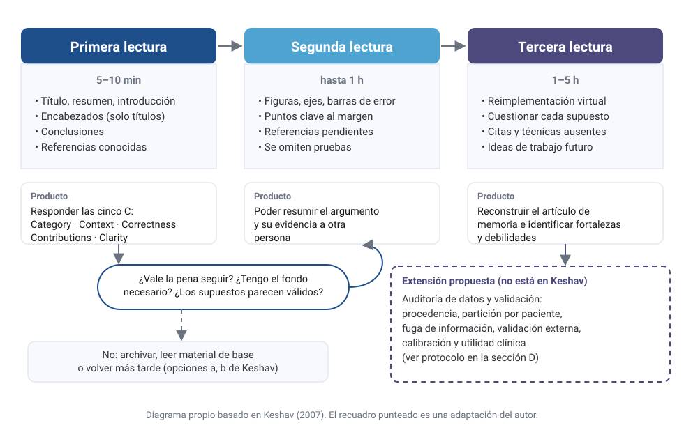

::: {.callout-note appearance="simple"}
## Tipo de texto

Este artículo es una **revisión crítica y un ensayo metodológico** sobre *How to Read a Paper*, de S. Keshav [@keshav2007], no una investigación empírica. Las evaluaciones, las adaptaciones y el protocolo de la sección D son **propuestas del autor** y se señalan como tales.
:::

## A. Introducción: leer también es investigar

En un doctorado, leer artículos forma parte de la investigación: una pregunta se delimita frente a lo que ya se sabe y una contribución solo lo es frente al estado del arte. Keshav parte de un diagnóstico: los investigadores dedican cientos de horas al año a leer, pero esa habilidad casi nunca se enseña [@keshav2007].

En la investigación interdisciplinaria el problema se agrava. Quien estudia IA aplicada al cáncer lee teoremas estadísticos, artículos de *machine learning*, estudios genómicos y guías clínicas, cada uno con sus estándares de evidencia. Incluso los términos cambian: en oncología, un *biomarcador predictivo* anticipa la respuesta a un tratamiento; en *machine learning*, *predecir* es estimar una salida. El lector arriesga perderse en detalles o aceptar conclusiones que no sabe evaluar, y el método de las tres lecturas responde a ese problema de atención.

## B. El método de las tres lecturas

Keshav propone leer un artículo en un máximo de tres pasadas con objetivos distintos, cada una construida sobre la anterior [@keshav2007] (@fig-tres-lecturas).

{#fig-tres-lecturas fig-alt="Tres columnas para la primera, segunda y tercera lectura con su duración, sus pasos y su producto, una decisión de continuar y un recuadro punteado con la extensión propuesta."}

**Primera lectura (*first pass*).** En cinco a diez minutos se leen el título, el resumen, la introducción, los títulos de sección, las conclusiones y las referencias [@keshav2007]. Su producto son las **cinco C**:

1. **Category**: qué tipo de artículo es; Keshav cita el de medición, el análisis de un sistema y la descripción de un prototipo.
2. **Context**: con qué trabajos y bases teóricas se relaciona.
3. **Correctness**: si los supuestos *parecen* válidos; tras cinco minutos solo cabe una impresión.
4. **Contributions**: cuáles son las contribuciones principales.
5. **Clarity**: si está bien escrito.

Con esas respuestas se puede dejar de leer. Keshav añade que la mayoría de los revisores harán una sola pasada, así que los títulos y el resumen deben bastar [@keshav2007], idea que desarrolla el [artículo hermano sobre la estructura de los artículos científicos](../estructura-articulos-cientificos/index.qmd).

**Segunda lectura (*second pass*).** Dura hasta una hora: se lee con más cuidado, se omiten las demostraciones y se anota al margen. Keshav pide comprobar si las figuras tienen ejes rotulados y barras de error que permitan juzgar la significación estadística. Al terminar, el lector debería poder resumir el argumento y su evidencia; si no, puede dejar el artículo, leer material de base o pasar a la tercera lectura [@keshav2007], con lo que la incomprensión se vuelve una decisión explícita.

**Tercera lectura (*third pass*).** Su clave es **reimplementar virtualmente** el artículo: recrear el trabajo con los mismos supuestos que los autores y comparar esa recreación con el texto, para que aparezcan las innovaciones, las fallas y los supuestos ocultos. Keshav estima de cuatro a cinco horas para un principiante y una para un lector experimentado, que al final debería reconstruir el artículo de memoria y señalar supuestos implícitos, citas ausentes y problemas de técnica [@keshav2007]. El texto cierra aplicándolo a la revisión bibliográfica: partir de pocos artículos recientes y buscar citas, autores y congresos recurrentes.

| | Primera lectura | Segunda lectura | Tercera lectura |
|---|---|---|---|
| **Objetivo** | Decidir si seguir | Comprender argumento y evidencia | Comprender a fondo y criticar |
| **Tiempo** | 5–10 min | Hasta 1 h | 4–5 h (principiante); ~1 h (experto) |
| **Qué se lee** | Título, resumen, introducción, encabezados, conclusiones, referencias | Todo salvo las demostraciones; figuras con atención | Todo, incluidos supuestos y detalles |
| **Acción clave** | Responder las cinco C | Anotar; marcar referencias pendientes | Reimplementar virtualmente |
| **Producto** | Clasificación y decisión | Resumen defendible | Reconstrucción, fortalezas y debilidades |

: Comparación de las tres lecturas propuestas por Keshav (2007). Síntesis propia. {#tbl-lecturas}

## C. Evaluación crítica

### Fortalezas

En mi lectura, el método tiene tres fortalezas. La primera es que **convierte la lectura en un proceso de decisión secuencial**: cada pasada aporta más información a un coste mayor y termina en la decisión de parar o continuar, algo cercano, por analogía, a una regla de parada. La segunda es que **la tercera lectura funciona como una prueba de reproducibilidad mental**, porque obliga a explicitar lo que el texto deja implícito; en un artículo de *machine learning*, por ejemplo, cómo se dividieron los datos o qué se ajustó y con qué criterio. La tercera es su **economía**: cabe en dos páginas y deja abiertas las técnicas de cada disciplina.

### Limitaciones

1. **Nace en un campo concreto**, redes y sistemas. El esquema general parece transferible, pero qué cuenta como *Correctness* lo define cada disciplina.
2. **La única herramienta estadística que el texto menciona de forma explícita son las barras de error.** No revela si la partición fue independiente ni si se informó la mejor de muchas configuraciones. Kapoor y Narayanan documentaron fuga de información (*data leakage*) en 294 artículos de 17 campos que usan *machine learning* [@kapoor2023]. Ese tipo de falla difícilmente se detecta en una figura, por bien rotulada que esté.
3. **Supone que el artículo trae lo necesario para reimplementarlo.** Con frecuencia no es así. Haibe-Kains y colaboradores señalaron que un estudio de IA para el cribado de cáncer de mama no ofrecía detalles ni código suficientes para verificarlo [@haibekains2020]; en esos casos, la imposibilidad de completar la tercera lectura es en sí un hallazgo crítico.
4. **Las cinco C no mencionan la ética, la procedencia de los datos ni los conflictos de interés**, aspectos centrales en la investigación biomédica.

Estas limitaciones no restan valor a una guía breve que no pretende evaluar la evidencia; guías posteriores la complementan con prácticas como fijar el objetivo de lectura o discutir el artículo con otros [@carey2020].

### ¿Funciona igual en Estadística teórica y en *deep learning* experimental?

No del todo. En un artículo **teórico de Estadística**, la contribución suele estar en los supuestos de los teoremas y en las demostraciones, justo lo que la segunda lectura omite. Propongo que la primera pasada identifique el modelo, el estimador y los resultados; la segunda, las hipótesis de cada teorema (independencia, regularidad, régimen asintótico, relación entre *n* y *p*) y su plausibilidad en datos reales; y la tercera rehaga la demostración central o la ponga a prueba con una simulación.

En un artículo **experimental de *deep learning***, el riesgo principal suele estar en el protocolo empírico: si los modelos de referencia tuvieron el mismo presupuesto de ajuste, si se informa la variabilidad entre semillas, si hay ablaciones y si el conjunto de prueba se usó una sola vez, cuestiones sobre las que la lista de verificación de NeurIPS pide informar [@pineau2021]. Aquí la tercera lectura suele consistir en ejecutar el código publicado.

### ¿Qué cambios requiere para Genómica, Biología Computacional y medicina?

Aquí el artículo es la superficie de una cadena que va de la muestra a la interpretación, lo que sugiere tres cambios:

- **Una «pasada 1,5» de diseño** antes de los resultados: quiénes son las muestras, cómo se seleccionaron, cuál es la unidad de análisis y si hay efectos de lote confundidos con la variable de interés.
- **Leer *Methods* y el suplemento como texto principal**, porque de ellos depende buena parte de la validez.
- **Verificar la disponibilidad real** de números de acceso, versiones de genoma y software, y código.

En aplicaciones médicas conviene, además, contrastar el artículo con las guías de reporte y de riesgo de sesgo, cuyos ámbitos se detallan en el punto 8 del protocolo de la sección D.

### ¿Cómo evaluar reproducibilidad, calidad de datos y sesgos?

Conviene separar tres preguntas:

- **¿Es reproducible?** Con los mismos datos y el mismo código, ¿se obtiene el mismo número?
- **¿Es replicable?** Con datos nuevos y el mismo diseño, ¿se obtiene el mismo hallazgo? Al repetir 50 experimentos de 23 artículos de biología preclínica del cáncer, la mediana del efecto replicado fue un 85 % menor que la original en los efectos positivos [@errington2021].
- **¿Es generalizable?** ¿Se mantiene en otra población u otro hospital? En el estudio de Zech y colaboradores, ordenar las radiografías solo por hospital de origen ya daba un AUC de 0,861 en una combinación de datos, por la diferencia de prevalencias entre centros [@zech2018].

Sobre los sesgos, la pregunta útil es **por dónde pueden entrar**: selección, definición de la etiqueta, medición, partición o análisis. Ioannidis recuerda que los estudios y efectos pequeños, las muchas hipótesis probadas y la flexibilidad analítica reducen la probabilidad de que un hallazgo sea cierto [@ioannidis2005], condiciones frecuentes en la investigación ómica.

## D. Aplicación doctoral: un protocolo de lectura para IA en oncología

::: {.callout-note appearance="simple"}
## Propuesta metodológica

Este protocolo es una **propuesta construida a partir de Keshav y de las guías citadas**, no un estándar validado ni una práctica ya implementada. Los tiempos indicados son estimaciones de esta propuesta, más amplios que los de Keshav por la carga metodológica de estos artículos; no se atribuyen a su texto.
:::

**Pasada 1 (10–15 min).** Las cinco C, más una sexta: la **pregunta clínica**, es decir, qué decisión apoya el modelo (cribado, diagnóstico, pronóstico, respuesta a un tratamiento), qué evidencia aporta (desarrollo, validación interna o externa, estudio prospectivo, ensayo) y si hay datos y código disponibles.

**Pasada 2 (1–2 h): auditoría metodológica.**

1. **Cohorte y tamaño muestral**: centros, periodo, criterios de selección, prevalencia, unidad de análisis, estándar de referencia y número de pacientes y de eventos disponibles en relación con la complejidad del modelo.
2. **Partición y fuga**: si se dividió por paciente o por imagen, parche o muestra, si la normalización y la selección de variables precedieron a la división y si hay pacientes repetidos.
3. **Validación**: cruzada anidada si hubo ajuste, y externa en otro centro, periodo o equipo.
4. **Métricas**: AUROC con intervalo de confianza; con clases desbalanceadas, también AUPRC [@saito2015]; sensibilidad, especificidad y valores predictivos en un umbral justificado clínicamente. Los valores predictivos positivo y negativo dependen de la prevalencia, por lo que los obtenidos en una cohorte enriquecida no se trasladan sin más a la práctica.
5. **Calibración**: curva, pendiente e intercepto. Un buen AUROC no garantiza probabilidades útiles [@vancalster2019].
6. **Robustez**: rendimiento por subgrupos y por centro, y análisis de sensibilidad.
7. **Utilidad clínica**: curva de decisión o beneficio neto [@vickers2006], frente a la práctica estándar y a modelos clínicos simples.
8. **Reporte y riesgo de sesgo**, según el tipo de estudio: TRIPOD+AI para el desarrollo y la validación de modelos de predicción [@collins2024], CLAIM para estudios de imagen médica [@mongan2020], DECIDE-AI para la evaluación clínica temprana de sistemas de apoyo a la decisión [@vasey2022] y CONSORT-AI para ensayos clínicos aleatorizados con intervenciones de IA [@liu2020]; el riesgo de sesgo, con PROBAST [@wolff2019].

**Pasada 3 (2–5 h): reconstrucción.** Reimplementar virtualmente el *pipeline*, reproducir una métrica si hay artefactos públicos y buscar explicaciones alternativas: ¿el modelo aprende biología o artefactos de tinción, escáner o centro? Cerrar con una ficha de fortalezas, debilidades y preguntas abiertas.

::: {.callout-tip appearance="simple"}
## Señal de alarma

Un AUROC muy alto de un solo centro, sin partición por paciente, calibración ni validación externa, puede ser real, pero aún no es evidencia suficiente. Al reanalizar los siete estudios más grandes de pronóstico del cáncer con *microarrays*, Michiels y colaboradores encontraron firmas muy dependientes de los pacientes de entrenamiento, y cinco de los siete estudios no clasificaban mejor que el azar [@michiels2005].
:::

## E. Reflexión personal

Soy estadístico y magíster en Estadística Aplicada y Ciencia de Datos, y curso el Doctorado en Ciencia de Datos e Inteligencia Artificial en la Universidad El Bosque. Mi interés doctoral se orienta hacia las aplicaciones de la inteligencia artificial en oncología, como explico en [otra entrada de este blog](../estudiar-cancer-phd/index.qmd), aunque mi proyecto de investigación todavía está en definición. Desde esa posición, el texto de Keshav me interesa menos como técnica de eficiencia que como disciplina de lectura: antes de entrar en los métodos, obliga a decidir si un artículo responde a una pregunta pertinente y qué tipo de evidencia ofrece.

Lo que más me interesa del método es que la tercera lectura cambia de naturaleza según la literatura. En un artículo de Estadística, reimplementar significa reconstruir una demostración o poner a prueba sus supuestos con una simulación. En uno de *machine learning*, significa reconstruir el protocolo empírico y preguntarse dónde podría haberse filtrado información entre entrenamiento y prueba [@kapoor2023]. En uno de IA aplicada a la oncología, significa algo más exigente: preguntarse si un buen rendimiento se mantendría en otra cohorte, otro centro u otro equipo, y recordar que una firma molecular puede depender de qué pacientes quedaron en el conjunto de entrenamiento [@michiels2005]. Ese tránsito entre las tres literaturas me parece el núcleo de la lectura interdisciplinaria: la misma pregunta de Keshav sobre la validez de los supuestos exige criterios distintos en cada comunidad.

Esa diferencia tiene una consecuencia práctica. En un artículo biomédico, la validez de los hallazgos depende también de decisiones que no son estadísticas: cómo se obtuvo y se etiquetó una muestra, qué protocolo de laboratorio se siguió o qué significa clínicamente un desenlace. Interpretar esos elementos con rigor requiere colaboración interdisciplinaria con especialistas clínicos y biológicos. Por eso, una lectura crítica honesta debe identificar también qué preguntas necesitan ese diálogo antes de aceptar o rechazar una conclusión.

En ese marco entiendo el protocolo de la sección D: como una propuesta metodológica que podría utilizar durante mi investigación doctoral, no como un procedimiento ya probado. Su valor solo podrá juzgarse al aplicarlo y corregirlo. Mientras tanto, lo considero una hipótesis de trabajo sobre cómo leer con criterio una literatura que cruza la Estadística, el *machine learning* y la oncología.

## Conclusión

El método de las tres lecturas es una regla de asignación de atención sencilla y transferible. Su acierto principal es tratar la lectura como una secuencia de decisiones, y su idea más potente, la reimplementación virtual, convierte la lectura crítica en un ejercicio de evaluación de supuestos y en una forma de comprobar la reproducibilidad. Sus límites aparecen en disciplinas donde la validez depende del diseño de los datos y de detalles que el texto no siempre informa. En la IA aplicada a la oncología, el método necesita complementarse con una auditoría explícita de cohorte, partición, validación, calibración y utilidad clínica, y con el diálogo con especialistas que permita interpretar los hallazgos biomédicos. Para una investigación que cruza Estadística, *machine learning* y oncología, su mayor utilidad es que una misma pregunta, la de si los supuestos son válidos, obliga a aplicar criterios distintos en cada comunidad.

::: {.callout-note appearance="simple" collapse="false"}
## Declaración sobre el uso de inteligencia artificial

Este artículo se elaboró con el apoyo de Claude (Anthropic), un asistente de IA generativa, en la organización del texto, la redacción de borradores de todas las secciones (incluida la reflexión de la sección E, redactada a partir de las indicaciones del autor sobre su formación e intereses), la revisión editorial, la verificación bibliográfica con Crossref, PubMed o las fuentes originales, el diagrama y las comprobaciones técnicas. El autor definió el encargo y los criterios, e indicó y aprobó las correcciones de los apartados revisados. El autor expresó su conformidad con la versión final y aprobó su contenido para publicación. La responsabilidad final del contenido corresponde al autor, y esta declaración queda sujeta a las políticas académicas aplicables.
:::

## Referencias

::: {#refs}
:::
