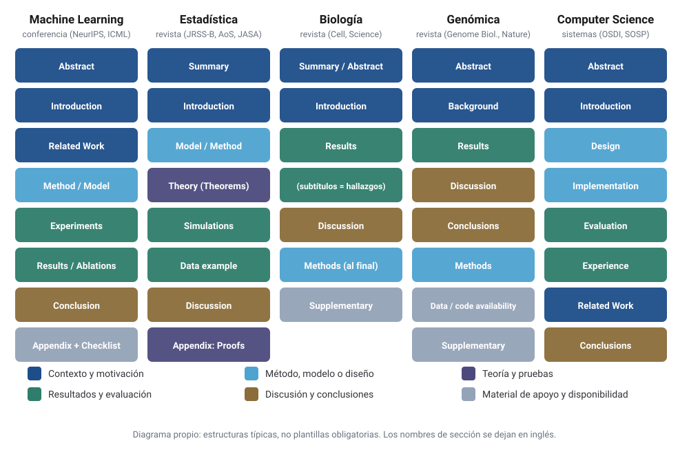

::: {.callout-note appearance="simple"}
## Tipo de texto y método

Este artículo es una **revisión comparativa**, no un estudio bibliométrico. Las afirmaciones sobre la estructura típica de cada disciplina son generalizaciones apoyadas en las guías de las revistas y conferencias citadas y en diez ejemplos. No proceden de una muestra aleatoria de artículos. Los encabezados de los ejemplos **se transcribieron del texto completo** de cada artículo, en la fuente que se indica, y se dejan en inglés.
:::

## A. Introducción: qué es un artículo y para qué sirven sus secciones

Un artículo científico es el registro público y verificable de una contribución. Sus secciones son funcionales: la **introducción** justifica por qué la pregunta importa, los **métodos** permiten evaluar y repetir el trabajo, los **resultados** separan la evidencia de su interpretación y la **discusión** delimita el alcance de las conclusiones.

La forma canónica de esa división es **IMRaD** (*Introduction, Methods, Results and Discussion*), cuyo dominio es más reciente de lo que suele creerse. Sollaci y Pereira midieron su frecuencia en cuatro revistas de medicina interna (*BMJ*, *JAMA*, *The Lancet* y *NEJM*) entre 1935 y 1985. La estructura empezó a usarse en la década de 1940, alcanzó el 80 % en la de 1970 y en la de 1980 era el único patrón de los artículos originales [@sollaci2004]. IMRaD es, por tanto, una convención de las ciencias de la salud consolidada en el siglo XX, no una ley universal.

En otras disciplinas la estructura sigue otra lógica: un artículo teórico de Estadística se organiza en torno a teoremas, uno de *machine learning* (ML) en torno a un método y su evaluación en *benchmarks*, y uno de sistemas en torno al diseño y la evaluación de un artefacto. El **medio** pesa casi tanto como la disciplina. Las conferencias de ML y de Computer Science (CS) imponen límites de páginas y listas de verificación, *Cell*, *Nature* o *Science* desplazan los métodos al final y las revistas de Estadística admiten apéndices extensos con demostraciones.

Conviene distinguir además el **tipo de estudio**, porque la estructura cambia con él dentro de una misma disciplina:

- **Experimental**: se manipula una condición y se mide su efecto, en el laboratorio o en un *benchmark*.
- **Metodológico**: se propone un método nuevo y se evalúan sus propiedades.
- **Teórico**: se demuestran resultados formales.
- **Observacional**: se analizan datos no generados por intervención, como una cohorte o un consorcio genómico.
- **De revisión o conceptual**: se sintetiza o reorganiza conocimiento existente.

## B. Análisis por disciplina

### Machine Learning

**Objetivos habituales.** Proponer modelos, algoritmos o métodos de entrenamiento que mejoren el rendimiento en tareas definidas.

**Estructura y encabezados típicos.** *Abstract*, *Introduction* (que suele cerrar con una lista explícita de contribuciones), *Related Work* o *Background*, *Method* o *Model*, *Experiments* (*Datasets*, *Baselines*, *Implementation details*), *Results*, *Ablation study*, *Conclusion* o *Limitations*, *References* y *Appendix*. En NeurIPS se suma la lista de verificación del artículo, que es obligatoria: los envíos sin ella se rechazan de entrada [@neuripschecklist].

**Metodologías y resultados.** Comparaciones empíricas en datos públicos, ablaciones y, a veces, resultados teóricos en un apéndice. Predominan las tablas de métricas frente a modelos de referencia y las curvas de entrenamiento.

**Evaluación y reproducibilidad.** El estándar de facto es superar a los modelos de referencia en *benchmarks* reconocidos. La lista de NeurIPS pregunta por la reproducibilidad, el acceso a código y datos y las barras de error, y pide declarar qué variabilidad capturan [@neuripschecklist]. El programa de reproducibilidad de NeurIPS 2019 documentó los efectos de introducir esa lista [@pineau2021].

**Rasgo diferencial.** Mandan las conferencias y la contribución suele medirse como mejora sobre el estado del arte. Sus debilidades documentadas incluyen una validación estadística a menudo escasa y la fuga de información [@kapoor2023].

### Estadística

**Objetivos habituales.** Desarrollar métodos de inferencia, estimación o predicción con propiedades demostrables y entender cuándo funcionan.

**Estructura y encabezados típicos.** *Summary* o *Abstract*, *Introduction*, *Model* o *Methodology*, *Theoretical properties* o *Main results* (con *Theorems*, *Lemmas* y *Assumptions*), *Simulation study*, *Real data example* o *Application*, *Discussion* y *Appendix* con *Proofs*. Las revistas de referencia son *Annals of Statistics*, *JRSS-B*, *JASA*, *Biometrika* y *Statistical Science*.

**Metodologías y resultados.** Derivaciones analíticas, simulaciones controladas y una aplicación a datos reales, con teoremas y tablas de sesgo, varianza, error cuadrático medio o cobertura.

**Evaluación y reproducibilidad.** Cuentan la corrección formal y la utilidad frente a las alternativas. *JASA*, por ejemplo, exige que todas las revisiones invitadas incluyan el código, los datos y el flujo de trabajo para reproducir lo presentado [@jasarepro].

**Rasgo diferencial.** Los **supuestos** se explicitan y la incertidumbre se cuantifica de forma sistemática; la aplicación a datos reales suele ser ilustrativa.

### Biología

**Objetivos habituales.** Descubrir y explicar mecanismos biológicos: qué molécula, célula o proceso causa un fenómeno y cómo.

**Estructura y encabezados típicos.** IMRaD con variantes: *Abstract* o *Summary*, *Introduction*, *Results* (con subtítulos que a menudo **enuncian el hallazgo** en forma de oración), *Discussion* y *Methods*, que en *Cell*, *Nature* o *Science* van al final o en el suplemento. *Cell* introdujo en 2016 los *STAR Methods* (*Structured, Transparent, Accessible Reporting*) para estandarizar esa sección [@marcus2016].

**Metodologías y resultados.** Experimentos con controles y réplicas, modelos celulares o animales e imagen, que se presentan en geles, micrografías, curvas dosis-respuesta y esquemas de mecanismo.

**Evaluación y reproducibilidad.** Cuentan la coherencia de los experimentos y la exclusión de explicaciones alternativas. La replicación es costosa: al repetir 50 experimentos de 23 artículos de biología preclínica del cáncer, la mediana del efecto replicado fue un 85 % menor que la original en los efectos positivos [@errington2021].

**Rasgo diferencial.** *Results* se lee como una **narración de experimentos**, cada uno respondiendo a la pregunta que dejó abierta el anterior, con figuras de varios paneles como núcleo del argumento.

### Genómica

**Objetivos habituales.** Medir y analizar capas ómicas para describir poblaciones de muestras, desarrollar métodos de análisis o asociar perfiles moleculares con fenotipos.

**Estructura y encabezados típicos.** IMRaD con *Methods* al final: *Abstract*, *Background* o *Introduction*, *Results* (a veces *Results and discussion* fusionados), *Discussion* o *Conclusions*, *Methods*, *Data availability* o *Accession codes*, *Code availability* y *Supplementary information*.

**Metodologías y resultados.** Secuenciación masiva, *pipelines* bioinformáticos, modelos para datos de conteo o de alta dimensión, corrección por pruebas múltiples y enriquecimiento de vías, presentados en *heatmaps*, *volcano plots*, gráficos de Manhattan y *oncoplots*.

**Evaluación y reproducibilidad.** Existen estándares de información mínima desde 2001 (MIAME para *microarrays*) [@brazma2001], principios FAIR para la gestión de datos [@wilkinson2016] y la expectativa de depositar los datos crudos en repositorios públicos, con acceso controlado cuando son datos humanos.

**Rasgo diferencial.** Biología, Estadística y Computación se mezclan de forma visible: un artículo puede tener un núcleo estadístico (el modelo), uno computacional (el software) y uno biológico (la interpretación). A menudo lo firma un consorcio.

### Computer Science

CS no es una sola comunidad; aquí se distinguen **sistemas** y **teoría**.

**Objetivos habituales.** En sistemas, construir y evaluar artefactos (sistemas operativos, bases de datos, redes) que resuelvan un problema a escala; en teoría, demostrar propiedades de algoritmos o protocolos.

**Estructura y encabezados típicos.** En sistemas: *Abstract*, *Introduction*, *Background* o *Motivation*, *Design*, *Implementation*, *Evaluation*, *Experience* o *Lessons learned*, *Related Work* (a menudo **al final**) y *Conclusion*. En teoría: *Introduction*, *Preliminaries* o *Model*, secciones con definiciones, lemas y teoremas, *Conclusion* y apéndices con pruebas.

**Metodologías y resultados.** En sistemas, mediciones de latencia, escalabilidad o tolerancia a fallos; en teoría, demostraciones y cotas de complejidad.

**Evaluación y reproducibilidad.** Muchas conferencias de sistemas tienen comités de evaluación de artefactos que otorgan insignias, como las de ACM aplicadas en SOSP, según si el artefacto está disponible, es funcional o permite reproducir los resultados [@sosp2023badges].

**Rasgo diferencial.** La contribución puede ser un **artefacto que funciona**, y la sección *Experience* sobre su uso en producción no tiene equivalente en IMRaD.

{#fig-estructuras fig-alt="Cinco columnas con la secuencia típica de secciones en Machine Learning, Estadística, Biología, Genómica y Computer Science, coloreadas según su función."}

## C. Diez ejemplos reales

Para cada disciplina se eligieron dos artículos de tipos distintos. Los encabezados se transcribieron del texto completo, y se indica cuándo la fuente fue arXiv o PubMed Central.

| # | Disciplina | Artículo | Venue | Tipo |
|---|---|---|---|---|
| 1 | ML | @vaswani2017, *Attention Is All You Need* | NeurIPS 2017 | Metodológico-experimental |
| 2 | ML | @he2016, *Deep Residual Learning for Image Recognition* | CVPR 2016 | Experimental |
| 3 | Estadística | @tibshirani1996, *Regression Shrinkage and Selection via the Lasso* | JRSS-B | Metodológico |
| 4 | Estadística | @shmueli2010, *To Explain or to Predict?* | *Statistical Science* | Conceptual / revisión |
| 5 | Biología | @jinek2012, *A Programmable Dual-RNA–Guided DNA Endonuclease in Adaptive Bacterial Immunity* | *Science* | Experimental |
| 6 | Biología | @errington2021, *Investigating the replicability of preclinical cancer biology* | *eLife* | Metainvestigación (replicación) |
| 7 | Genómica | @love2014, *Moderated estimation of fold change and dispersion for RNA-seq data with DESeq2* | *Genome Biology* | Metodológico (software) |
| 8 | Genómica | @tcga2012, *Comprehensive molecular characterization of human colon and rectal cancer* | *Nature* | Observacional (caracterización) |
| 9 | CS (sistemas) | @dean2004, *MapReduce: Simplified Data Processing on Large Clusters* | OSDI 2004 | Sistemas (diseño y evaluación) |
| 10 | CS (teoría) | @lamport1978, *Time, Clocks, and the Ordering of Events in a Distributed System* | *Communications of the ACM* | Teórico |

: Los diez ejemplos analizados. Los DOI y enlaces están en las referencias. {#tbl-ejemplos}

### Machine Learning

**1. Vaswani et al. (2017).** Encabezados (arXiv:1706.03762): *1 Introduction; 2 Background; 3 Model Architecture* (3.1 *Encoder and Decoder Stacks*, 3.2 *Attention*, 3.3 *Position-wise Feed-Forward Networks*, 3.4 *Embeddings and Softmax*, 3.5 *Positional Encoding*); *4 Why Self-Attention; 5 Training; 6 Results* (6.1 *Machine Translation*, 6.2 *Model Variations*, 6.3 *English Constituency Parsing*); *7 Conclusion*, más un apéndice de visualizaciones de atención. **Por qué es representativo:** sigue la secuencia método–entrenamiento–resultados y la sección 6.2 funciona como estudio de ablación. **Por qué es particular:** la sección 4 justifica la arquitectura con un análisis de complejidad por capa y de longitud de caminos, en lugar de teoremas o solo de resultados empíricos.

**2. He et al. (2016).** Encabezados (arXiv:1512.03385): *1 Introduction; 2 Related Work; 3 Deep Residual Learning* (3.1 *Residual Learning*, 3.2 *Identity Mapping by Shortcuts*, 3.3 *Network Architectures*, 3.4 *Implementation*); *4 Experiments* (4.1 *ImageNet Classification*, 4.2 *CIFAR-10 and Analysis*, 4.3 *Object Detection on PASCAL and MS COCO*), y apéndices A–C. **Por qué es representativo:** es el arquetipo del artículo empírico de visión por computador, con trabajo relacionado separado y una evaluación dominada por tablas de error en varios *benchmarks*. La sección 3.4 de detalles de implementación es la que permite reproducirlo.

### Estadística

**3. Tibshirani (1996).** Encabezados: *Summary; 1 Introduction; 2 The Lasso* (2.1 *Definition*, 2.2 *Orthonormal Design Case*, 2.3 *Geometry of Lasso*, 2.4 *More on Two-predictor Case*, 2.5 *Standard Errors*); *3 Example—Prostate Cancer Data; 4 Prediction Error and Estimation of t; 5 Lasso as Bayes Estimate; 6 Algorithms for Finding Lasso Solutions; 7 Simulations* (7.1 *Outline*, 7.2–7.5 *Example 1–4*); *8 Application to Generalized Regression Models; 9 Some Further Extensions; 10 Results on Soft Thresholding; 11 Discussion; 12 Software*. **Por qué es representativo:** reúne los componentes clásicos de un artículo metodológico de JRSS-B, a saber, definición, propiedades, aplicación a datos reales, estimación del parámetro de ajuste, algoritmo, simulaciones y discusión. **Por qué es particular:** el ejemplo con datos reales (sección 3) aparece *antes* de las simulaciones, y el artículo cierra con una sección de software.

**4. Shmueli (2010).** Encabezados (arXiv:1101.0891): *1 Introduction* (1.1 *Explanatory Modeling*, 1.2 *Predictive Modeling*, 1.3 *Descriptive Modeling*, 1.4 *The Scientific Value of Predictive Modeling*, 1.5 *Explaining and Predicting Are Different*, 1.6 *A Void in the Statistics Literature*); *2 Two Modeling Paths* (2.1 *Study Design and Data Collection* … 2.7 *Model Use and Reporting*); *3 Two Examples* (3.1 *Netflix Prize*, 3.2 *Online Auction Research*); *4 Implications, Conclusions and Suggestions*, y un apéndice con un ejemplo de regresión lineal. **Por qué es particular:** no tiene *Methods* ni *Results*; su estructura es argumentativa y recorre las etapas del modelado para mostrar en cada una la diferencia entre explicar y predecir.

### Biología

**5. Jinek et al. (2012).** Encabezados (versión de autor en PMC): tras el *Abstract*, el texto principal se organiza en encabezados breves que enuncian hallazgos: *Cas9 is a DNA endonuclease guided by two RNAs*; *Each Cas9 nuclease domain cleaves one DNA strand*; *Dual-RNA requirements for target DNA binding and cleavage*; *A short sequence motif dictates R-loop formation*; *Cas9 can be programmed with a single chimeric RNA*; *Conclusions*. Los materiales y métodos están en el material suplementario. **Por qué es representativo:** muestra el formato compacto de *Science*, donde los métodos salen del texto principal. **Por qué es particular:** los encabezados *son* las conclusiones de cada bloque experimental, de modo que leer solo los títulos da el argumento completo, como en la primera lectura de Keshav [@keshav2007].

**6. Errington et al. (2021).** Encabezados: *Abstract; Introduction; Results* (subsecciones por criterio de replicación, como *Evaluating replications with the 'same direction' criterion* o *Comparing animal vs. non-animal experiments*); *Discussion* (con subtítulos en forma de pregunta, como *What does a failure to replicate mean?*, y además *Limitations* y *Conclusion*); *Materials and methods*. **Por qué es representativo:** sigue el IMRaD de *eLife*, con los métodos al final. **Por qué es particular:** es metainvestigación: su «experimento» es replicar otros, y sus resultados se organizan por criterio estadístico de éxito, no por hallazgo biológico.

### Genómica

**7. Love, Huber y Anders (2014).** Encabezados (PMC): *Abstract; Background; Results and discussion* (con subsecciones como *Model and normalization*, *Empirical Bayes shrinkage for dispersion estimation*, *Hypothesis tests for differential expression*, *Regularized logarithm transformation*, *Comparative benchmarks*); *Conclusions; Materials and methods* (que incluye *R/Bioconductor package* y *Reproducible code*). **Por qué es representativo:** es el formato de *Genome Biology*, con *Background* en lugar de *Introduction* y métodos al final. **Por qué es particular:** fusiona resultados y discusión, y su contribución es a la vez un modelo estadístico (estimadores bayesianos empíricos para datos de conteo) y un paquete de software con código para reproducir todas las figuras.

**8. The Cancer Genome Atlas Network (2012).** Encabezados (versión en PMC): tras el *Abstract* y una introducción sin título (etiquetada *Main* en PMC), una sección *Results* con las subsecciones *Exome-sequence analysis*, *Gene mutations*, *Mutation rate and methylation patterns*, *Chromosomal and sub-chromosomal changes*, *Translocations* y *Altered pathways in CRC*; luego *Discussion*, *Methods Summary*, *Accession codes* (con *Data deposits*) y un amplio material suplementario. **Por qué es representativo:** es el artículo de consorcio en *Nature*, con autoría colectiva, una sección por capa molecular y la mayor parte de los métodos fuera del texto. **Por qué es particular:** es observacional y descriptivo; caracteriza una población de tumores en lugar de poner a prueba una hipótesis única, y su producto principal son los datos depositados.

### Computer Science

**9. Dean y Ghemawat (2004).** Encabezados (versión de USENIX): *1 Introduction; 2 Programming Model; 3 Implementation* (con *Execution Overview*, *Fault Tolerance*, *Locality*, *Backup Tasks*); *4 Refinements; 5 Performance* (con *Grep*, *Sort*, *Effect of Backup Tasks*, *Machine Failures*); *6 Experience* (6.1 *Large-Scale Indexing*); *7 Related Work; 8 Conclusions*, y un apéndice con un programa de ejemplo. **Por qué es representativo:** es el arquetipo del artículo de sistemas, con la secuencia modelo de programación–implementación–rendimiento–experiencia y el trabajo relacionado casi al final.

**10. Lamport (1978).** Encabezados (sin numerar): *Introduction; The Partial Ordering; Logical Clocks; Ordering the Events Totally; Anomalous Behavior; Physical Clocks; Conclusion; Appendix: Proof of the Theorem*. **Por qué es particular:** no hay experimentos. Cada sección introduce un concepto (la relación *happened before*, los relojes lógicos), lo formaliza con definiciones y condiciones, y la demostración del teorema principal va en un apéndice. Frente a MapReduce, muestra que dentro de CS conviven estructuras casi opuestas.

## D. Tabla comparativa

::: {.lf-wide-table}

| Dimensión | Machine Learning | Estadística | Biología | Genómica | Computer Science |
|---|---|---|---|---|---|
| **Estructura habitual** | *Intro–Related Work–Method–Experiments–Conclusion* + apéndice y *checklist* | *Intro–Method–Theory–Simulations–Data example–Discussion* + pruebas | IMRaD con *Methods* al final o en el suplemento | IMRaD con *Methods* al final + disponibilidad de datos y código | Sistemas: *Design–Implementation–Evaluation*; teoría: definiciones y teoremas |
| **Importancia de la teoría** | Variable; a menudo secundaria frente a lo empírico | Central | Marco mecanístico, rara vez formal | Moderada (modelos estadísticos) | Central en teoría; secundaria en sistemas |
| **Papel de la experimentación** | *Benchmarks* y ablaciones | Simulaciones controladas | Experimentos de laboratorio con controles | Ensayos de secuenciación y análisis computacional | Mediciones de rendimiento; ninguna en teoría |
| **Validación estadística** | Desigual; barras de error y semillas aún no siempre presentes | Núcleo de la disciplina | Pruebas de hipótesis y réplicas | Corrección por pruebas múltiples (FDR) | Variable; distribuciones de latencia o rendimiento |
| **Reproducibilidad** | *Checklist* obligatorio en NeurIPS | Exigida en revisiones de JASA | Replicación costosa y a menudo parcial | Estándares de información mínima (MIAME) | Evaluación de artefactos con insignias |
| **Código y datos** | Código frecuente; *datasets* públicos | Paquetes de software cada vez más comunes | Protocolos y reactivos; datos menos estandarizados | Depósito de datos crudos; acceso controlado si son humanos | Artefactos opcionales pero evaluados |
| **Interpretabilidad** | Secundaria; métodos *post hoc* | Parámetros con significado inferencial | El mecanismo es el objetivo | Interpretación biológica de genes y vías | En general no aplica |
| **Consideraciones éticas** | Impacto social en el *checklist* | Sobre todo con datos humanos | Bioética, experimentación animal, bioseguridad | Consentimiento, privacidad y reidentificación genómica | Seguridad, privacidad, uso dual |

: Comparación de las cinco disciplinas. Síntesis propia basada en las guías y los ejemplos citados. {#tbl-comparacion}

:::

Mi lectura de la tabla es doble. Primero, en los ejemplos y guías analizados, las disciplinas difieren menos en el **contenido** de las secciones que en el **lugar donde está la evidencia**: los teoremas y las simulaciones en Estadística, las figuras experimentales en Biología, los datos depositados en Genómica y el artefacto en sistemas. Segundo, cada comunidad institucionalizó la reproducibilidad de una manera distinta (listas de verificación, revisión de código, metadatos, evaluación de artefactos), y ningún modelo lo cubre todo.

## E. Escribir investigación interdisciplinaria: Estadística + ML + Genómica + Oncología

Un artículo que combine estas cuatro áreas tiene un problema de audiencias: el oncólogo busca una pregunta clínica y un nivel de evidencia; el estadístico, supuestos e incertidumbre; el especialista en ML, comparaciones justas y ablaciones; y el genetista, calidad de datos e interpretación biológica. Satisfacer a todos en el texto principal lo vuelve ilegible. Mi propuesta es **adoptar el esqueleto IMRaD clínico**, que es el que siguen las guías de reporte del área, como TRIPOD+AI [@collins2024], y **llevar al suplemento lo que cada comunidad necesita verificar**.

::: {.callout-note appearance="simple"}
## Propuesta metodológica

La estructura siguiente es **hipotética**: ilustra cómo podría organizarse un manuscrito interdisciplinario, no describe un proyecto doctoral aprobado, unos datos disponibles ni unos resultados.
:::

A continuación propongo la estructura de un manuscrito para una **futura** investigación doctoral sobre aplicaciones de inteligencia artificial en oncología, como el diagnóstico, la clasificación, la predicción de riesgo o el pronóstico. Los corchetes indican decisiones aún por tomar.

1. **Title.** Debe incluir la población, el tipo de dato, la tarea y el tipo de estudio (desarrollo, validación externa), como recomienda TRIPOD+AI.
2. **Structured Abstract.** *Background, Methods, Results, Conclusions*.
3. **Introduction.** El problema clínico y la decisión que se quiere apoyar, la base biológica o clínica de que [los datos clínicos, genómicos, de imagen o su combinación] contengan información sobre [el desenlace], y el vacío metodológico concreto.
4. **Methods.**
   - *Study design and data sources*: [cohorte retrospectiva / prospectiva], centros, periodo y criterios de selección.
   - *Ethics and data governance*: aprobación ética, consentimiento, protección de datos personales, anonimización o seudonimización y normativa aplicable.
   - *Reference standard and outcome definition*: cómo se define la clase verdadera (histopatología, seguimiento).
   - *Data acquisition and preprocessing*: según el tipo de dato (clínico, genómico, de imagen o multimodal), adquisición, control de calidad, normalización y corrección de efectos de lote o de escáner, siempre ajustados **dentro** de cada partición de entrenamiento.
   - *Statistical and machine learning methods*: modelos candidatos, modelos de referencia simples (por ejemplo, regresión logística penalizada), ajuste de hiperparámetros con validación cruzada anidada y manejo de datos faltantes.
   - *Validation strategy*: partición por paciente, validación externa y temporal cuando sea posible.
   - *Performance measures*: discriminación (AUROC, AUPRC), calibración y utilidad clínica, con intervalos de confianza.
   - *Interpretability and biological interpretation*: métodos de importancia, su estabilidad bajo remuestreo cuando corresponda y análisis de vías, sin presentar la importancia de variables o biomarcadores como evidencia causal.
   - *Sample size and statistical analysis plan*: justificación del tamaño muestral con criterios para modelos de predicción clínica [@riley2020] y análisis especificados de antemano.
   - *Data and code availability*: código y metadatos públicos; datos sensibles solo mediante acceso controlado, porque la reproducibilidad no exige publicar abiertamente datos de pacientes.
5. **Results.** Diagrama de flujo de la cohorte, características basales, rendimiento interno y externo, calibración, análisis por subgrupos y hallazgos biológicos.
6. **Discussion.** Hallazgos principales, comparación con la literatura, implicaciones clínicas y su límite (qué evidencia faltaría para un uso clínico), limitaciones y trabajo futuro.
7. **Declarations.** Ética, contribución de los autores, conflictos de interés y financiación.
8. **Supplementary material.** Lista de verificación TRIPOD+AI completada, detalles de arquitectura e hiperparámetros, ablaciones, simulaciones o resultados teóricos del método estadístico (con sus demostraciones), análisis de sensibilidad y una ficha del modelo.

Si la contribución principal fuera metodológica, como desarrollar, adaptar o evaluar un método estadístico o de IA, la teoría y las simulaciones pasarían al cuerpo del artículo y la aplicación oncológica sería el escenario de evaluación.

Esta estructura sigue una regla sencilla: **cada afirmación del texto principal debe poder verificarse en algún lugar del manuscrito o de sus artefactos**. Para la parte de Genómica, eso implica depositar los datos según los principios FAIR [@wilkinson2016], con acceso controlado si son sensibles. Para la de ML, publicar el código con versiones y semillas [@sandve2013]. Para la clínica, evaluar el riesgo de sesgo con PROBAST [@wolff2019]. Y cuando el modelo use imágenes, cotejar CLAIM [@mongan2020].

## F. Conclusiones

**Lo que conviene mantener.** La separación entre métodos y resultados, que permite evaluar la evidencia sin la interpretación del autor. La declaración explícita de contribuciones al final de la introducción, característica de los artículos de ML. Los supuestos explícitos y la cuantificación de la incertidumbre, de la Estadística. La disponibilidad de datos con metadatos estandarizados, de la Genómica. Y la honestidad de una sección de limitaciones.

**Lo que conviene adaptar.** Primero, los **títulos de los subtítulos de resultados**: el estilo de la Biología de enunciar el hallazgo en el encabezado es muy útil para lectores de otras disciplinas. Segundo, el **lugar de la teoría**, que depende del tipo de investigación y de la revista: en un manuscrito clínico suele ir al suplemento, pero sus supuestos deben resumirse en *Methods*. Tercero, la **evaluación**: si el modelo se orienta a decisiones clínicas, las métricas de discriminación deben complementarse con calibración y utilidad clínica. Y cuarto, el **vocabulario**: términos como *predictivo*, *validación* o *significativo* cambian de sentido entre comunidades y conviene definirlos al usarlos por primera vez.

En suma, IMRaD no es universal ni la única estructura válida, pero es un punto de partida útil para muchos trabajos interdisciplinarios con componente clínico. Como la mayoría de los lectores harán una sola pasada [@keshav2007], la estructura debe permitir que esa pasada baste para entender qué se hizo y con cuánta confianza creerlo.

::: {.callout-note appearance="simple"}
## Declaración sobre el uso de inteligencia artificial

Este artículo se elaboró con el apoyo de Claude (Anthropic), un asistente de IA generativa, en la organización del artículo, la redacción de borradores de todas las secciones (incluidas la propuesta de manuscrito y las conclusiones), la consulta y comprobación bibliográfica (incluidos los encabezados de los diez ejemplos, consultados en sus textos completos y contrastados con Crossref, arXiv, PubMed o las fuentes originales), la elaboración de las figuras, la revisión editorial y las validaciones técnicas. El autor definió el encargo y los criterios, e indicó y aprobó las correcciones de los apartados revisados. El autor expresó su conformidad con la versión final y aprobó su contenido para publicación. La responsabilidad final del contenido corresponde al autor, y esta declaración queda sujeta a las políticas académicas aplicables.
:::

## Referencias

::: {#refs}
:::
