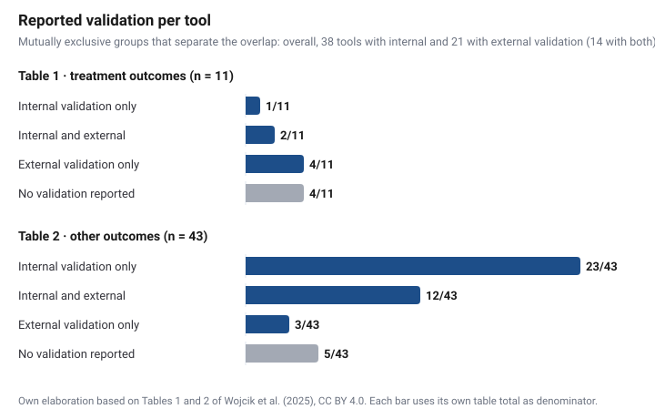
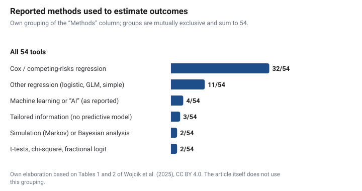

<nav class="dst-lang" aria-label="Article language">
<a href="../" lang="es" hreflang="es">Español</a>
<span class="dst-lang__sep" aria-hidden="true">|</span>
<a href="./" lang="en" hreflang="en" aria-current="page">English</a>
</nav>

<section class="dst-hero">
<div class="dst-hero__eyebrow">Scientific review · Oncology and decision support</div>
<h1 class="dst-hero__title">Digital Decision-Support Tools in Breast Cancer</h1>
<p class="dst-hero__subtitle">What Wojcik and colleagues investigated, what they found, where the evidence falls short, and why it matters for AI in oncology.</p>
<div class="dst-hero__meta">Juan Sebastián Laverde Chunza · November 19, 2026 · 6-minute read</div>
<div class="dst-stats">
<div class="dst-stat"><div class="dst-stat__value">54</div><div class="dst-stat__label">personalized web tools (11 for treatment, 43 for other outcomes)</div></div>
<div class="dst-stat"><div class="dst-stat__value">45</div><div class="dst-stat__label">with some reported validation (internal and/or external)</div></div>
<div class="dst-stat"><div class="dst-stat__value">9</div><div class="dst-stat__label">with usability, feasibility or acceptability testing (2 still in progress)</div></div>
<div class="dst-stat"><div class="dst-stat__value">16<span class="dst-stat__unit">/63</span></div><div class="dst-stat__label">mean IPDAS score (51 tools assessed)</div></div>
</div>
</section>

::: {.dst-callout}
**Disclaimer.** This is an academic review. It does not recommend any tool and is no substitute for consultation with the oncology team.
:::

## 1. What is the article about?

Breast cancer treatment involves many decisions with no single right answer, such as whether to add chemotherapy or whether an older patient should receive radiotherapy. A growing number of **web tools** promise to personalize them: given age, tumor characteristics or other data, they return a probability of recurrence or survival, or help people weigh their preferences.

According to the authors, physicians and patients know little about these tools and even less about their validity. Wojcik and colleagues (NIH, Georgetown and Stanford) set out to **map** them for breast cancer treatment and survivorship: what data they use, how they were validated, whether they were tested with users and how good they are.

This matters because a tool that misestimates a benefit, or works only in some groups, can steer decisions the wrong way or widen inequities.

## 2. How was the research carried out?

It is a **scoping review**: it maps what exists, without estimating whether an intervention works. It followed **PRISMA-ScR** (Tricco et al., 2018) and was registered on the Open Science Framework.

- **Search:** PubMed, PsycInfo, Embase, Scopus, Web of Science and Cochrane, plus reference lists; English-language tools from 2013 to 2023, with the last search on May 12, 2023.
- **Selection:** four team members screened titles and abstracts in Covidence; a second round applied the same criteria to full texts, and disagreements were resolved by discussion. The article does not report how many people reviewed each record.
- **Extraction:** the authors tested each tool on its website with fictitious patients; without public access, they used screenshots, the published methods or contact with the authors.
- **Quality:** they applied the **IPDAS** checklist (*International Patient Decision Aid Standards*; Elwyn et al., 2006), awarding one point per item present, up to 63. It measures the quality of the decision aid, **not the accuracy of the predictive model**.

<figure class="dst-figure dst-figure--prisma">
<a href="../images/prisma-en.svg" class="dst-figure__zoom" title="Open the figure at full size"></a>
<figcaption><strong>Figure 1.</strong> Article identification process. Redrawn from Figure 1 of Wojcik et al. (2025), <a href="https://doi.org/10.1007/s11764-024-01567-6">doi:10.1007/s11764-024-01567-6</a>, licensed <a href="https://creativecommons.org/licenses/by/4.0/">CC BY 4.0</a>; the original template is from Page et al., <em>BMJ</em> 2021;372:n71 (PRISMA 2020). Changes: vector redrawing and a bullet added to "Web of Science", which has none in the original. All numbers, boxes and arrows are kept. The asterisks (<code>*</code> and <code>**</code>) are call-outs from the PRISMA 2020 template whose notes are not reproduced in the original caption. Tap or click the figure to view it at full size.</figcaption>
</figure>

After removing duplicates and screening, 371 full-text reports were assessed and **46 studies plus 8 validation studies** were included; 24 reports were excluded because the tool was inaccessible, broken or had no link.

## 3. What were the main results?

The articles described **54 tools** in two groups:

- **11 for personalized treatment outcomes** (Table 1): they estimate what would happen *with and without* a treatment, such as adjuvant chemotherapy or radiotherapy.
- **43 for other outcomes** (Table 2): mostly prognoses of survival, metastasis or complications, largely nomograms for physicians.

**Validation.** **45** tools report some validation: 38 internal and only **21** external (14 both). So 24 of the 45 "validated" tools have internal validation only, and 9 report none.

<figure class="dst-figure">
<a href="../images/fig-validacion-en.svg" class="dst-figure__zoom" title="Open the figure at full size"></a>
<figcaption><strong>Figure 2.</strong> Type of validation reported per tool. Own elaboration based on Tables 1 and 2 of Wojcik et al. (2025). Tools with both internal and external validation are shown separately so the two categories are not presented as mutually exclusive.</figcaption>
</figure>

**Usability.** Only **9 of 54** report usability, feasibility or acceptability testing, with non-comparable instruments; for two of them (BTxChoice and Radiotherapy for Older Women) testing was still in progress, with no results.

**Quality.** The mean IPDAS score was **16 out of 63** (15.6 unrounded, over 51 tools; three could not be assessed for lack of full access). None reaches half the scale (maximum 46, BreastCHOICE). Treatment tools score higher (mean 25.7) than other-outcome tools (13.1), many of which are physician calculators without options or values.

<figure class="dst-figure">
<a href="../images/fig-ipdas-en.svg" class="dst-figure__zoom" title="Open the figure at full size"></a>
<figcaption><strong>Figure 3.</strong> Distribution of IPDAS scores for the 51 assessed tools. Own elaboration based on Tables 1 and 2 of Wojcik et al. (2025). RSClin, Graetz et al. 2018 and REACH were excluded from the assessment because the authors could not access the full tool.</figcaption>
</figure>

**Methods.** "Personalization" is almost always classical statistics: 32 tools use Cox regression and only 4 report machine learning or AI. The dominant source is the US **SEER** registry (28 of 54).

<figure class="dst-figure">
<a href="../images/fig-metodos-en.svg" class="dst-figure__zoom" title="Open the figure at full size"></a>
<figcaption><strong>Figure 4.</strong> Methods reported to estimate outcomes, using my own grouping of the "Methods" column of Tables 1 and 2 of Wojcik et al. (2025). The article itself does not use this grouping.</figcaption>
</figure>

The original tables, in full:





## 4. What limitations did they find?

- **Little external validation.** Only 21 of 54 were tested on independent data, and many rely on the same registry, SEER.
- **Low and uneven quality.** With a mean IPDAS score of 16/63, most tools present options and values poorly; only six disclose funding or conflicts of interest.
- **Representativeness.** Validation and testing samples were mostly White, married and insured people (68.2–83.9% White for the treatment tools); for 18 tools no sample data were available. No treatment tool incorporates contextual factors such as insurance.
- **Clinical application.** Little testing with real users, 24 tools with limited availability and no documented evidence that using them improves health outcomes.

The authors also acknowledge that they included only English-language tools from 2013 onward, and that 23 could not be fully assessed because of paywalls or incomplete information.

## 5. What can we learn for artificial intelligence in oncology?

Each conclusion separates what the study shows from my interpretation as a researcher.

```{=html}
<div class="dst-lessons">
<div class="dst-lesson">
<h3>1. "Validated" does not mean "ready for the clinic"</h3>
<p><span class="dst-tag dst-tag--study">The study</span> 45 tools report validation, but only 21 external, and the review does not collect performance metrics.</p>
<p><span class="dst-tag dst-tag--mine">My interpretation</span> A model can rank risks well (discrimination) and still give wrong probabilities in another population (calibration; Van Calster et al., 2019). Before use, it needs external validation, local recalibration and an assessment of clinical utility, for example with decision curves (Vickers &amp; Elkin, 2006).</p>
</div>
<div class="dst-lesson">
<h3>2. The bottleneck is not the algorithm</h3>
<p><span class="dst-tag dst-tag--study">The study</span> Only 4 of the 54 tools report machine learning or AI; the rest are mostly regressions.</p>
<p><span class="dst-tag dst-tag--mine">My interpretation</span> What is missing is evidence of transportability, usability and implementation, not algorithmic complexity; in clinical models, machine learning has shown no systematic advantage over logistic regression (Christodoulou et al., 2019). Reporting with TRIPOD+AI (Collins et al., 2024) and assessing bias with PROBAST (Wolff et al., 2019) contributes more than switching algorithms.</p>
</div>
<div class="dst-lesson">
<h3>3. Predicting is not estimating a treatment effect</h3>
<p><span class="dst-tag dst-tag--study">The study</span> According to the tables, 28 of the 54 tools use data from SEER, a population registry.</p>
<p><span class="dst-tag dst-tag--mine">My interpretation</span> A prognostic model estimates the risk of people who received a given treatment in practice, not what would happen if the decision changed, and SEER treatment data have known limitations (Noone et al., 2016). Comparing options requires explicit causal assumptions.</p>
</div>
<div class="dst-lesson">
<h3>4. Whoever is missing from the data is missing from the prediction</h3>
<p><span class="dst-tag dst-tag--study">The study</span> Samples were not diverse, and the authors warn that these tools could perpetuate disparities.</p>
<p><span class="dst-tag dst-tag--mine">My interpretation</span> No tool comes from Latin America or Africa. Applying them in other health systems requires external validation in those populations (Ramspek et al., 2021) and performance reported by subgroup.</p>
</div>
</div>
```

In short, the review does not show that these tools are harmful or useless: it shows that **we do not yet know enough** to recommend their widespread use without prior critical appraisal.

```{=html}
<details class="dst-details dst-details--note">
<summary>Verification note: discrepancies documented in the article</summary>
<p>Every figure was checked against the published PDF, and Tables 1 and 2 were audited character by character against the original. The points below are documented <strong>without correcting the study</strong>; several differences are explained by definitions or denominators and are not scientific errors.</p>
<div class="dst-table-scroll" role="region" aria-label="Discrepancies and documented points, with their classification" tabindex="0">
<table class="dst-table dst-table--disc"><caption>Discrepancies and documented points, with their classification</caption>
<thead><tr><th scope="col">#</th><th scope="col">Point</th><th scope="col">What the article says</th><th scope="col">What its own data show</th><th scope="col">Classification</th></tr></thead><tbody>
<tr><th scope="row" class="dst-num">1</th><td data-label="Point">Figure 1</td><td data-label="What the article says">371 reports assessed, 319 excluded; 46 studies included (+ 8 validation)</td><td data-label="What its own data show">371 − 319 = 52 reports. PRISMA 2020 distinguishes reports from studies, but the article documents neither that correspondence nor the source of the 8 validation studies</td><td data-label="Classification">Needs further verification</td></tr>
<tr><th scope="row" class="dst-num">2</th><td data-label="Point">Users, Table 1 (text)</td><td data-label="What the article says">2 patients only, 4 physicians only and "nine" for both</td><td data-label="What its own data show">Table 1 indicates 5 for both; the text's sum (15) exceeds the 11 tools</td><td data-label="Classification">Demonstrable inconsistency (likely typo: "nine" for "five")</td></tr>
<tr><th scope="row" class="dst-num">3</th><td data-label="Point">No validation, Table 1 (text)</td><td data-label="What the article says">"Three tools" [17, 45, 49]</td><td data-label="What its own data show">Table 1 shows four: reference 49 describes two tools</td><td data-label="Classification">Explainable difference (counted by reference)</td></tr>
<tr><th scope="row" class="dst-num">4</th><td data-label="Point">Inputs, Table 1 (text)</td><td data-label="What the article says">All tools used individual and clinical characteristics</td><td data-label="What its own data show">BRECONDA has "—" in that column</td><td data-label="Classification">Minor inconsistency; needs verification</td></tr>
<tr><th scope="row" class="dst-num">5</th><td data-label="Point">Usability</td><td data-label="What the article says">"Yes" for BTxChoice and Radiotherapy for Older Women</td><td data-label="What its own data show">The text clarifies that they reported no results (testing in progress)</td><td data-label="Classification">Explainable by criterion: records that testing exists</td></tr>
<tr><th scope="row" class="dst-num">6</th><td data-label="Point">Accessibility</td><td data-label="What the article says">23 tools not assessable because of payment barriers or incomplete screenshots</td><td data-label="What its own data show">24 are listed with "limited availability", a broader category</td><td data-label="Classification">Explainable by criteria; not a discrepancy</td></tr>
<tr><th scope="row" class="dst-num">7</th><td data-label="Point">Countries</td><td data-label="What the article says">US, Europe, Australia, Japan and Korea</td><td data-label="What its own data show">Table 2 includes a tool with data from Harbin (China)</td><td data-label="Classification">Needs further verification</td></tr>
<tr><th scope="row" class="dst-num">8</th><td data-label="Point">Abbreviations, Table 2</td><td data-label="What the article says">"AT aromatase inhibitor"</td><td data-label="What its own data show">The table uses "AI"</td><td data-label="Classification">Possible editorial typo</td></tr>
<tr><th scope="row" class="dst-num">9</th><td data-label="Point">Table cells</td><td data-label="What the article says">"PMR", "breast reduction", "Rocket Mountain", "2 of more", "mellitus"</td><td data-label="What its own data show">Apparent typographical errors, kept and flagged</td><td data-label="Classification">Possible editorial typo</td></tr>
<tr><th scope="row" class="dst-num">10</th><td data-label="Point">Figure 1</td><td data-label="What the article says"><span>Asterisks <code>*</code> and <code>**</code></span></td><td data-label="What its own data show">Call-outs from the PRISMA 2020 template whose notes are not reproduced</td><td data-label="Classification">Possible editorial typo</td></tr>
</tbody></table></div>
<p><strong>Not discrepancies:</strong> the mean IPDAS score of 15.57 over 51 tools correctly rounds to 16; the 20 overall-survival tools in Table 2 add up once references 85 and 86 are included; the validation, user, race and contextual-factor counts for Table 2 match the table.</p>
</details>
```

## References

<div class="dst-references">

<p class="dst-reference dst-reference--main">Wojcik, K. M., Kamil, D., Zhang, J., Wilson, O. W. A., Smith, L., Butera, G., Isaacs, C., Kurian, A., &amp; Jayasekera, J. (2025). A scoping review of web-based, interactive, personalized decision-making tools available to support breast cancer treatment and survivorship care. <em>Journal of Cancer Survivorship, 19</em>, 1496–1524. <a href="https://doi.org/10.1007/s11764-024-01567-6">https://doi.org/10.1007/s11764-024-01567-6</a> (published online March 28, 2024).</p>

<p class="dst-reference">Christodoulou, E., Ma, J., Collins, G. S., Steyerberg, E. W., Verbakel, J. Y., &amp; Van Calster, B. (2019). A systematic review shows no performance benefit of machine learning over logistic regression for clinical prediction models. <em>Journal of Clinical Epidemiology, 110</em>, 12–22. <a href="https://doi.org/10.1016/j.jclinepi.2019.02.004">https://doi.org/10.1016/j.jclinepi.2019.02.004</a></p>

<p class="dst-reference">Collins, G. S., Moons, K. G. M., Dhiman, P., et al. (2024). TRIPOD+AI statement: updated guidance for reporting clinical prediction models that use regression or machine learning methods. <em>BMJ, 385</em>, e078378. <a href="https://doi.org/10.1136/bmj-2023-078378">https://doi.org/10.1136/bmj-2023-078378</a></p>

<p class="dst-reference">Elwyn, G., O'Connor, A., Stacey, D., et al. (2006). Developing a quality criteria framework for patient decision aids: online international Delphi consensus process. <em>BMJ, 333</em>(7565), 417. <a href="https://doi.org/10.1136/bmj.38926.629329.AE">https://doi.org/10.1136/bmj.38926.629329.AE</a></p>

<p class="dst-reference">Noone, A.-M., Lund, J. L., Mariotto, A., Cronin, K., McNeel, T., Deapen, D., &amp; Warren, J. L. (2016). Comparison of SEER treatment data with Medicare claims. <em>Medical Care, 54</em>(9), e55–e64. <a href="https://doi.org/10.1097/MLR.0000000000000073">https://doi.org/10.1097/MLR.0000000000000073</a></p>

<p class="dst-reference">Page, M. J., McKenzie, J. E., Bossuyt, P. M., et al. (2021). The PRISMA 2020 statement: an updated guideline for reporting systematic reviews. <em>BMJ, 372</em>, n71. <a href="https://doi.org/10.1136/bmj.n71">https://doi.org/10.1136/bmj.n71</a></p>

<p class="dst-reference">Ramspek, C. L., Jager, K. J., Dekker, F. W., Zoccali, C., &amp; van Diepen, M. (2021). External validation of prognostic models: what, why, how, when and where? <em>Clinical Kidney Journal, 14</em>(1), 49–58. <a href="https://doi.org/10.1093/ckj/sfaa188">https://doi.org/10.1093/ckj/sfaa188</a></p>

<p class="dst-reference">Tricco, A. C., Lillie, E., Zarin, W., et al. (2018). PRISMA Extension for Scoping Reviews (PRISMA-ScR): checklist and explanation. <em>Annals of Internal Medicine, 169</em>(7), 467–473. <a href="https://doi.org/10.7326/M18-0850">https://doi.org/10.7326/M18-0850</a></p>

<p class="dst-reference">Van Calster, B., McLernon, D. J., van Smeden, M., Wynants, L., &amp; Steyerberg, E. W. (2019). Calibration: the Achilles heel of predictive analytics. <em>BMC Medicine, 17</em>, 230. <a href="https://doi.org/10.1186/s12916-019-1466-7">https://doi.org/10.1186/s12916-019-1466-7</a></p>

<p class="dst-reference">Vickers, A. J., &amp; Elkin, E. B. (2006). Decision curve analysis: a novel method for evaluating prediction models. <em>Medical Decision Making, 26</em>(6), 565–574. <a href="https://doi.org/10.1177/0272989X06295361">https://doi.org/10.1177/0272989X06295361</a></p>

<p class="dst-reference">Wolff, R. F., Moons, K. G. M., Riley, R. D., Whiting, P. F., Westwood, M., Collins, G. S., Reitsma, J. B., Kleijnen, J., Mallett, S., &amp; PROBAST Group. (2019). PROBAST: a tool to assess the risk of bias and applicability of prediction model studies. <em>Annals of Internal Medicine, 170</em>(1), 51–58. <a href="https://doi.org/10.7326/M18-1376">https://doi.org/10.7326/M18-1376</a></p>

</div>

<p class="dst-note">DOIs were checked on Crossref. Bracketed numbers in the tables point to the original article's list of 156 references. The works by Christodoulou, Collins, Noone, Ramspek, Van Calster, Vickers and Wolff are not part of the review; they are cited only in support of my own interpretation in section 5.</p>

<div class="dst-links">
<a class="dst-links__primary" href="https://doi.org/10.1007/s11764-024-01567-6">Read the original article (DOI)</a>
<a href="https://osf.io/6kdsv">Open Science Framework registration</a>
<a href="../">Leer esta reseña en español</a>
</div>

::: {.dst-credits}
**Credits and license.** The article by Wojcik et al. is open access under a [CC BY 4.0](https://creativecommons.org/licenses/by/4.0/) license. It is also a US Government work, not subject to copyright in the United States. Figure 1 and Tables 1 and 2 are adaptations (redrawing and re-layout) of the originals; Figure 1 is itself based on the PRISMA 2020 template by Page et al. (*BMJ*, CC BY 4.0). Figures 2 to 4 and the cover image are my own elaboration from the table data. None of these adaptations implies endorsement by the original authors.

**Use of artificial intelligence.** This review was prepared with the support of Claude (Anthropic), a generative AI assistant, for extracting and verifying the tables and figures from the PDF, checking references on Crossref, drafting the Spanish and English texts, producing the figures and tables, a verification audit, and condensing an earlier long version into this short review. The author defined the brief, the standards of rigor and the structure of the short version. Final responsibility for the content lies with the author.
:::
