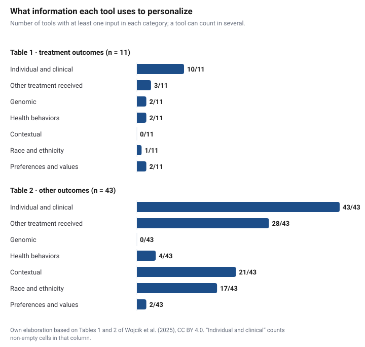
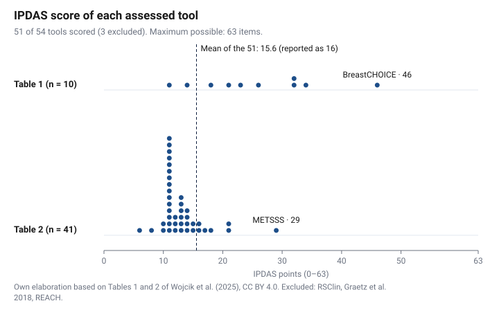

<nav class="dst-lang" aria-label="Article language">
<a href="../" lang="es" hreflang="es">Español</a>
<span class="dst-lang__sep" aria-hidden="true">|</span>
<a href="./" lang="en" hreflang="en" aria-current="page">English</a>
</nav>

<section class="dst-hero">
<div class="dst-hero__eyebrow">Critical review · Oncology and decision support</div>
<h1 class="dst-hero__title">Digital Decision-Support Tools in Breast Cancer</h1>
<p class="dst-hero__subtitle">Evidence, validation, and challenges in personalized medicine: a critical reading of the scoping review by Wojcik and colleagues.</p>
<div class="dst-hero__meta">Juan Sebastián Laverde Chunza · November 19, 2026 · 35-minute read</div>
<div class="dst-stats">
<div class="dst-stat"><div class="dst-stat__value">54</div><div class="dst-stat__label">personalized web tools (11 for treatment, 43 for other outcomes)</div></div>
<div class="dst-stat"><div class="dst-stat__value">45</div><div class="dst-stat__label">with some reported validation (internal and/or external)</div></div>
<div class="dst-stat"><div class="dst-stat__value">9</div><div class="dst-stat__label">with reported usability, feasibility or acceptability testing (2 still in progress)</div></div>
<div class="dst-stat"><div class="dst-stat__value">16<span class="dst-stat__unit">/63</span></div><div class="dst-stat__label">mean IPDAS score (range 6–46; 51 assessed)</div></div>
</div>
</section>

::: {.dst-abstract}
[Abstract]{.dst-label}

Wojcik and colleagues, at the NIH's National Institute on Minority Health and Health Disparities with co-authors from Georgetown and Stanford, searched the 2013–2023 literature for web-based, interactive, personalized tools that support treatment and survivorship decisions in breast cancer. They found **54 tools**. Almost all are statistical prognostic models, mostly Cox regressions trained on the US SEER registry. **45** report some validation, but only **21** were tested in an external cohort. **9** underwent usability, feasibility or acceptability testing, and the mean quality score on the IPDAS checklist was **16 out of 63**. Validation and testing samples were mostly White, married and insured. This review reconstructs the methods and results, reproduces both of the article's tables in full, flags internal discrepancies in the text, and explains why a tool with good statistical performance may still not be ready to guide clinical decisions.
:::

::: {.dst-callout}
**Notice.** This is an academic review. It does not recommend any tool and is no substitute for a consultation with the oncology team. None of the tools described here should be used to make personal treatment decisions without professional guidance.
:::

## 1. Introduction: deciding under uncertainty

Breast cancer treatment is full of decisions without a single right answer. Should chemotherapy be added to endocrine therapy for a hormone receptor-positive, node-negative tumor? Does a 75-year-old woman gain anything from radiotherapy after breast-conserving surgery? Immediate reconstruction, delayed reconstruction, or none? In each case the expected benefit depends on the tumor, on age and comorbidities, on social context, and on what each patient values most: living longer, avoiding adverse effects, or preserving her body image.

**Personalized medicine** tries to move these decisions away from population averages. Instead of saying "chemotherapy reduces recurrence by X% in this group", it aims to say "for *this* patient, with *this* tumor, the expected absolute benefit is so many percentage points". That requires models that turn individual data into probabilities, and ways of communicating those probabilities that clinicians and patients can understand and discuss.

**Digital decision-support tools** sit exactly at that point. A web calculator in which an oncologist enters age, tumor size, grade and a genomic score and receives the probability of distant recurrence with and without chemotherapy is one example. An interactive site that helps a patient sort out her preferences before deciding on reconstruction is another. Wojcik and colleagues asked how many such tools exist, what they do, what data they were built on and, above all, how much we really know about their validity, usability and quality.

::: {.dst-concept}
[Key concept]{.dst-label}

**Decision-support tool.** Any instrument that helps people make decisions about their health care (the IPDAS collaboration's definition, used in the article). It may **predict** (estimate a probability), **inform** (present options and their consequences) or **clarify values** (help the patient express what matters to her). The three functions are different, and few tools combine them.
:::

## 2. What did Wojcik and colleagues investigate?

### The problem

The authors start from two observations. First, there are web tools that promise to personalize breast cancer care according to demographic, clinical, genomic, behavioral and contextual variables, and, according to the literature they cite, personalized decision tools can increase knowledge, reduce anxiety and improve quality of life. Second, both physicians and patients know little about these tools and their validity, which lowers their motivation to use them. The authors add regulatory context: they note that the US FDA has issued guidance to regulate decision tools as medical devices, citing a commentary in the *New England Journal of Medicine*.

### The question

The stated aim was to **critically review the characteristics of existing English-language, interactive, web-based personalized tools available to support breast cancer care**, with particular attention to their quality, validity, usability, feasibility and acceptability, and to which populations took part in their development and testing.

### What is a scoping review?

A **scoping review** maps the available evidence on a broad topic: what exists, how it has been studied and where the gaps are. It does not ask "does intervention X work?" but "what has been done about X, and with what characteristics?".

<div class="dst-compare" role="table" aria-label="Comparison of review types">
<div class="dst-compare__row dst-compare__head" role="row"><div role="columnheader">Type</div><div role="columnheader">Typical question</div><div role="columnheader">Risk-of-bias assessment</div><div role="columnheader">Quantitative synthesis</div></div>
<div class="dst-compare__row" role="row"><div role="cell"><strong>Scoping review</strong></div><div role="cell" data-label="Typical question">What exists and how has it been studied?</div><div role="cell" data-label="Risk-of-bias assessment">Optional (here, quality was assessed with IPDAS)</div><div role="cell" data-label="Quantitative synthesis">No; counts and descriptions</div></div>
<div class="dst-compare__row" role="row"><div role="cell"><strong>Systematic review</strong></div><div role="cell" data-label="Typical question">What is the effect of X on Y?</div><div role="cell" data-label="Risk-of-bias assessment">Required, per study</div><div role="cell" data-label="Quantitative synthesis">Optional</div></div>
<div class="dst-compare__row" role="row"><div role="cell"><strong>Meta-analysis</strong></div><div role="cell" data-label="Typical question">What is the pooled effect and how precise is it?</div><div role="cell" data-label="Risk-of-bias assessment">Required</div><div role="cell" data-label="Quantitative synthesis">Yes; combines estimates with statistical models</div></div>
</div>
<p class="dst-figcaption">Conceptual comparison prepared for this review.</p>

The distinction matters when reading the results. A scoping review can say that 45 tools report validation, but it does not compare their accuracy or conclude which one works best. Asking it to would mean asking for something its design does not promise.

### The contribution

According to the authors, earlier reviews had examined up to 21 tools for treatment decisions. This one extends the inventory to 54, includes the survivorship phase and adds two little-studied dimensions: **which behavioral and contextual factors** the tools use for personalization, and **which populations** took part in their validation and user testing.

## 3. How was the review conducted?

### Framework and registration

The review followed the framework of Arksey and O'Malley, extended by Levac and colleagues and by the Joanna Briggs Institute, with six stages: defining the question, identifying literature, selecting studies, charting the data, synthesizing the results and consulting experts. It was reported according to the **PRISMA-ScR** checklist (the PRISMA extension for scoping reviews) and registered on the Open Science Framework. Because it used no individual-level data, it required no ethics approval.

### Search

- **Databases:** PubMed, PsycInfo, Embase, Scopus, Web of Science and the Cochrane Database of Systematic Reviews, plus screening of the reference lists of included articles.
- **Strategy:** a combination of keywords, synonyms, MeSH and Emtree terms on clinical decision tools, survivorship, treatment, web-based, personalization and breast cancer. A trained NIH librarian pilot-tested it on 50 articles and refined it. The full strategy is in Supplemental Table 2, which was not reviewed for this article.
- **Period:** tools developed between 2013 and 2023; the most recent search was on **May 12, 2023**.

### Inclusion criteria

Articles had to meet five conditions: (1) adults (≥ 18 years), female or male, diagnosed with breast cancer; (2) treatment or survivorship; (3) online risk prediction models or interactive personalized tools developed between 2013 and 2023; (4) primary empirical research; and (5) written in English. Detailed criteria are in Supplemental Table 3.

### Selection and extraction

Four team members (KW, DK, JZ, LS) screened titles and abstracts in Covidence; a second round applied the same criteria to the full texts, and disagreements were resolved by discussion. The article does not report how many reviewers assessed each record or any measure of agreement. One valuable methodological detail: **the authors visited each website and tested the tools with pseudo-patient characteristics** to identify which inputs they used and which outcomes they returned. When there was no public site, they used screenshots and the methods sections of the articles, and they contacted corresponding authors for missing information.

For each tool they extracted the name and purpose, target population, intervention, data source and methods, input factors (individual, clinical, genomic, behavioral, contextual), outcomes, target users and date of last update. From the validation and testing studies they extracted the distribution of race and ethnicity, education, income, marital status and insurance.

### Operational definitions

<div class="dst-defs">
<dl>
<dt>External validation</dt><dd>Testing the model in independent samples, different from the development samples, to assess performance and generalizability. This is the only form of validation explicitly defined in the text.</dd>
<dt>Internal validation</dt><dd>Reported in the tables but not defined in the article. In the methodological literature it usually means resampling (bootstrap, cross-validation) or a split of the same data source.</dd>
<dt>Usability</dt><dd>The user's experience and understanding when operating the tool.</dd>
<dt>Feasibility</dt><dd>The likelihood that the tool will actually be used to enhance the patient–physician interaction.</dd>
<dt>Acceptability</dt><dd>User satisfaction with the tool.</dd>
</dl>
</div>

### Quality assessment with IPDAS

The authors applied the **International Patient Decision Aid Standards (IPDAS)** checklist, an internationally agreed framework for judging decision aids. It assesses how information and probabilities are presented, whether patient values are clarified, how the tool was developed, the use of stories, and the effect on the decision process and on decision quality. Each tool received **one point for every item present, up to a maximum of 63**. It is important to understand what this scale measures: **how many checklist items a tool satisfies, not its predictive accuracy or its clinical benefit**. The article also does not report whether the scoring was done by one person or by two independently.

### Figure 1. Study selection

<figure class="dst-figure dst-figure--prisma">
<a href="../images/prisma-en.svg" class="dst-figure__zoom" title="Open the figure at full size"></a>
<figcaption><strong>Figure 1.</strong> Article identification process. Redrawn from Figure 1 of Wojcik et al. (2025), <a href="https://doi.org/10.1007/s11764-024-01567-6">doi:10.1007/s11764-024-01567-6</a>, licensed <a href="https://creativecommons.org/licenses/by/4.0/">CC BY 4.0</a>; the original template is from Page et al., <em>BMJ</em> 2021;372:n71 (PRISMA 2020). Changes: vector redrawing and a bullet added to "Web of Science", which has none in the original. All numbers, boxes and arrows are kept. The asterisks (* and **) are call-outs from the PRISMA 2020 template whose notes are not reproduced in the original caption. Tap or click the figure to view it at full size.</figcaption>
</figure>

::: {.dst-interpret}
[How to read the figure]{.dst-label}

The funnel is huge: of more than 5,000 records, only 46 articles (plus 8 validation studies) made it to the end. The largest source of full-text exclusion was "inapplicable setting" (98), and 24 reports were dropped because the online tool was **inaccessible, broken or had no link**. That last figure already says something about the problem the review sets out to illuminate: many published tools disappear or are not maintained.

The arithmetic holds for almost the whole diagram: 5,237 + 72 − 2,292 = 3,017, and 3,017 − 2,646 = 371. The last step needs careful reading: 371 − 319 = **52 eligible reports**, while the final box counts **46 studies** (and the text, "46 articles") plus 8 validation studies. PRISMA 2020 distinguishes *records* (what databases return), *reports* (documents assessed) and *studies* (investigations, which may have several reports). That 52 reports correspond to 46 studies is therefore possible, but the article neither documents it nor explains where the 8 validation studies come from. This difference is therefore **presented not as an error but as a point that needs further verification** with the authors or the supplementary material.

It also helps to separate three units the article uses at once: **articles** (46 included), **validation studies** (8 additional) and **tools** (54). One article can describe several tools (reference 73, for example, describes three nomograms), and a tool can be validated in a different article.
:::

## 4. What did they find?

The 46 articles described **54 tools**, which the authors divided into two groups:

- **11 tools for personalized treatment outcomes** (Table 1): they estimate what would happen *with and without* a specific treatment, for example the risk of recurrence with and without post-mastectomy radiotherapy.
- **43 tools for other outcomes** (Table 2): they estimate prognosis (overall survival, cancer-specific survival, metastasis) or surgical risks, or support follow-up, but without treatment-specific results.

### Tools for treatment outcomes (N = 11)

All were developed for adult women with early-stage breast cancer or ductal carcinoma *in situ* (DCIS). The decisions they address are adjuvant chemotherapy (BTxChoice, RSClin, Age Gap 2), primary endocrine therapy versus surgery (Age Gap 1), radiotherapy (Radiotherapy for Older Women, the N1 post-mastectomy predictor), axillary surgery (LinfoNeo), reconstruction (BreastCHOICE, BRECONDA), persistent pain after surgery (Meretoja et al.) and DCIS options. Two tools were designed specifically for older women.

According to the table, all but BRECONDA use individual and clinical inputs. **Only two use genomic information** (the 21-gene recurrence score, in BTxChoice and RSClin), two include health behaviors, **none incorporates contextual factors** such as insurance or access to a treatment facility, one considers race (the DCIS tool) and two clarify preferences (BreastCHOICE and BRECONDA).



### Tools for other outcomes (N = 43)

Here the pattern changes. **31 of the 43 tools are aimed at physicians only**, 8 at physicians and patients, and 4 at patients only. The most common outcomes are overall survival (20 tools, according to the text), breast cancer-specific survival (7) and risk of bone metastasis (3). Some subgroups rarely seen in the literature appear: ten tools for patients with bone or lung metastases, four for young patients, three for older patients and three specifically for **men** with breast cancer and bone metastases. Only one, ACESO, was designed for the survivorship phase: it generates health alerts and follow-up care recommendations.

This group does incorporate context: **21 tools** use contextual factors (marital status in 20, insurance in 4, and education, employment and financial status in one, YES). **17 consider race**, and one distinguishes Hispanic ethnicity. Only two include preferences or values.



### What they use to personalize

<figure class="dst-figure">
<a href="../images/fig-variables-en.svg" class="dst-figure__zoom" title="Open the figure at full size"></a>
<figcaption><strong>Figure 2.</strong> Input categories by group of tools. Own elaboration based on Tables 1 and 2 of Wojcik et al. (2025). The panels use different denominators (11 and 43), and a tool can count in several categories.</figcaption>
</figure>

The chart shows an asymmetry the article only mentions in passing. The tools that estimate **treatment benefits** incorporate the least context (0 of 11), while the **prognostic** tools, many built on SEER, incorporate the most (21 of 43), mainly through marital status, a variable available in that registry. Whether a tool "includes context" may depend more on which columns the database provides than on a deliberate design choice.

### Validation

<figure class="dst-figure">
<a href="../images/fig-validacion-en.svg" class="dst-figure__zoom" title="Open the figure at full size"></a>
<figcaption><strong>Figure 3.</strong> Type of validation reported per tool. Own elaboration based on Tables 1 and 2 of Wojcik et al. (2025). To avoid presenting "internal" and "external" as mutually exclusive, the chart separates out the tools that have both.</figcaption>
</figure>

| | Table 1 (n = 11) | Table 2 (n = 43) | Total (n = 54) |
|---|---:|---:|---:|
| Internal validation (with or without external) | 3 | 35 | 38 |
| External validation (with or without internal) | 6 | 15 | 21 |
| Both | 2 | 12 | 14 |
| Any validation | 7 | 38 | **45** |
| No validation reported | 4 | 5 | 9 |

: Reported validation, counted directly from Tables 1 and 2 of the article. {.dst-small-table}

The abstract's figure, **45 validated tools**, matches the tables. It needs careful reading, though: **24 of those 45 have internal validation only**. Put differently, fewer than half of the 54 tools (21) were tested on data independent of their development data. The article does not report performance metrics (discrimination, calibration) or how each validation was done; the field only records whether one took place.

### Usability, feasibility and acceptability

Only **9 of 54** tools underwent this kind of testing (5 in Table 1, 4 in Table 2), with instruments so heterogeneous that the authors could not compare them:

- **BreastCHOICE**: mean usability score of 6.3 out of 7 on the *Computer System Usability Questionnaire*.
- **"Which treatment for DCIS is right for you?"**: mean of 3.7 out of 5 using the *System Usability Scale* and the *Preparation for Decision-Making Scale*.
- **BRECONDA**: usefulness 4.8 and relevance 4.4 on 1–5 Likert scales; follow-up studies confirmed its acceptability.
- **ACESO**: consistency 1.2, stressfulness 1.2 and simplicity 1.4 on a scale where 1 is most positive and 7 most negative.
- **REACH**: exceeded its feasibility targets (85.4% enrollment and 83.7% of participants completing at least one session, against 80% targets), with mean acceptability of 3.0 (1–4 scale) and 3.4 (1–5 scale).
- **Graetz et al. 2018**: providers reported that it was easy to implement and did not significantly affect workflow.
- **BTxChoice** and **Radiotherapy for Older Women** are marked "Yes" in the table and are included in the count of 9, but according to the text they **did not report results**: their authors stated that testing was under way. The column therefore records the *existence* of testing (including testing in progress), not published results. The abstract's statement that "nine had undergone usability testing" should be read with that caveat.
- **YES** is marked "Yes" in Table 2, but the text does not describe its results.

### IPDAS quality

<figure class="dst-figure">
<a href="../images/fig-ipdas-en.svg" class="dst-figure__zoom" title="Open the figure at full size"></a>
<figcaption><strong>Figure 4.</strong> Distribution of IPDAS scores for the 51 assessed tools. Own elaboration based on Tables 1 and 2 of Wojcik et al. (2025). RSClin, Graetz et al. 2018 and REACH were excluded from the assessment because the authors could not access the full tool.</figcaption>
</figure>

The mean across the 51 scored tools is **15.6** (rounded to 16 in the article), with a median of 13 and a range of 6 to 46. **No tool reaches half of the possible score**, and BreastCHOICE (46) is the only one that comes close. The gap between groups is marked: a mean of 25.7 for the treatment tools versus 13.1 for the other-outcome tools. That is consistent with their design: many of the 43 are physician-facing nomograms that compute a probability without presenting options, values or a development process, which is precisely what IPDAS rewards.

The authors note that most tools present options (48) and outcome probabilities (48), use plain language (49) and are easy to navigate (51). By contrast, **only six disclose funding or conflicts of interest**, and only two use patient stories.

### Who took part in testing

According to Supplemental Table 5, which this review knows only through the text, most people included in validation and user testing of the treatment tools were White (68.2–83.9%) and married (71.1–86.0%). For the other-outcome tools, the share of White participants ranged from 0 to 93.0%, of married participants from 41.4 to 94.0%, and of insured participants from 93.7 to 94.9%. For 18 tools no sample data were available. BTxChoice, for instance, was validated in two populations with a White majority (73.0–83.9%).

## 5. Representative tools and how they work

The 54 tools cannot be ranked from best to worst: they assess different outcomes, in different populations, with non-comparable validations. What can be done is to pick examples that show **different approaches** to turning a patient's data into information for a decision. Everything below comes from the article's tables; no tool was evaluated directly.

<div class="dst-cards">

<article class="dst-card">
<h3>BTxChoice</h3>
<p class="dst-card__kind">Simulation + Bayesian analysis · chemotherapy benefit</p>
<p><strong>For whom:</strong> women aged 40–74 with node-negative, hormone receptor-positive, HER2-negative invasive breast cancer.</p>
<p><strong>How it works:</strong> it integrates meta-analysis, clinical trial and observational data in a simulation model. From age, comorbidities, grade, size and the 21-gene score, it estimates the 10-year risk of distant recurrence and the life-years gained with and without chemotherapy, and it even predicts the genomic score if it is not yet known.</p>
<p><strong>Evidence:</strong> internal and external validation; usability testing "in progress"; IPDAS 14.</p>
<p class="dst-card__lesson">Lesson: a sophisticated, validated model can score low on IPDAS if it neither presents options nor clarifies values.</p>
</article>

<article class="dst-card">
<h3>RSClin</h3>
<p class="dst-card__kind">Cox regression · chemotherapy benefit</p>
<p><strong>For whom:</strong> patients with hormone receptor-positive, HER2-negative, node-negative disease.</p>
<p><strong>How it works:</strong> it combines the 21-gene recurrence score with age, grade and tumor size, and takes into account planned endocrine therapy, radiotherapy and type of surgery. Using NSABP and TAILORx trial data, it estimates the 10-year risk of distant recurrence.</p>
<p><strong>Evidence:</strong> internal and external validation; <strong>excluded from IPDAS</strong> because a paywall prevented a full assessment.</p>
<p class="dst-card__lesson">Lesson: limited access restricts independent evaluation, even for tools built on high-quality trials.</p>
</article>

<article class="dst-card">
<h3>BreastCHOICE</h3>
<p class="dst-card__kind">Generalized linear models + values clarification · reconstruction</p>
<p><strong>For whom:</strong> women with stage 0–3 breast cancer considering post-mastectomy reconstruction.</p>
<p><strong>How it works:</strong> it estimates complication risk from height, weight, medical history, smoking and prior radiotherapy, and asks the patient what matters to her, what worries her and how she feels about each option.</p>
<p><strong>Evidence:</strong> external validation; usability 6.3/7; <strong>IPDAS 46, the highest score</strong>.</p>
<p class="dst-card__lesson">Lesson: it combines prediction and deliberation, which is what IPDAS measures.</p>
</article>

<article class="dst-card">
<h3>BRECONDA</h3>
<p class="dst-card__kind">Tailored information · reconstruction</p>
<p><strong>For whom:</strong> women with invasive cancer or DCIS eligible for reconstruction, literate in English and with computer access.</p>
<p><strong>How it works:</strong> it does not predict risk; it offers information tailored to individual preferences to help decide whether, and how, to reconstruct.</p>
<p><strong>Evidence:</strong> no validation (there is no predictive model to validate); high acceptability (4.8 and 4.4 out of 5); IPDAS 34.</p>
<p class="dst-card__lesson">Lesson: "not validated" does not always mean deficient; it depends on whether the tool predicts anything.</p>
</article>

<article class="dst-card">
<h3>ACESO</h3>
<p class="dst-card__kind">Tailored information · survivorship</p>
<p><strong>For whom:</strong> women who have completed adjuvant therapy and are cancer-free.</p>
<p><strong>How it works:</strong> from symptoms, medications, completed tests, mood, sleep or sexual function, it generates health alerts and follow-up care recommendations. It is the only tool focused on survivorship.</p>
<p><strong>Evidence:</strong> external validation; very positive usability and acceptability; IPDAS 14.</p>
<p class="dst-card__lesson">Lesson: survivorship, the focus of the review's title, is the phase with the fewest tools.</p>
</article>

<article class="dst-card">
<h3>Tools using machine learning</h3>
<p class="dst-card__kind">ADTree (2) · machine learning models (1) · "artificial intelligence" (1)</p>
<p><strong>What they predict:</strong> axillary metastasis and pathological complete response (ADTree models, data from two Japanese hospitals), bone metastases (SEER data) and 5-year survival in stage IV disease from muscle-mass measures (Korean registry).</p>
<p><strong>Evidence:</strong> internal and external validation in three of them; none with usability testing; IPDAS 11–13.</p>
<p class="dst-card__lesson">Lesson: they are only 4 of 54, and they stand out neither for validation nor for communication quality.</p>
</article>

</div>

### What makes a tool suitable to support decisions?

Drawing on the article's criteria and on the methodological literature, I suggest six questions a clinician or researcher can ask of any of these tools (my own synthesis, not a validated instrument):

1. **Does it address a real decision?** Does it estimate outcomes *with and without* a specific option, or only a general prognosis?
2. **Does my patient resemble the development population?** Age, stage, subtype, country, health system, era.
3. **Is there external validation with reported metrics?** Not just "validated", but where, with whom, and with what discrimination and calibration.
4. **Does it communicate uncertainty?** Intervals, scenarios, natural frequencies.
5. **Does it integrate preferences?** Does it help the patient deliberate, or does it just hand over a number?
6. **Is it accessible, maintained and transparent?** Working link, update date, authorship, funding and conflicts of interest.

## 6. The role of statistics and machine learning

One finding the article does not emphasize, but which follows from its tables, is that **almost all of the "personalization" described is classical statistics**.

<figure class="dst-figure">
<a href="../images/fig-metodos-en.svg" class="dst-figure__zoom" title="Open the figure at full size"></a>
<figcaption><strong>Figure 5.</strong> Methods reported to estimate outcomes, using my own grouping of the "Methods" column of Tables 1 and 2 of Wojcik et al. (2025). The article itself does not use this grouping.</figcaption>
</figure>

- **Cox regression and variants (32 tools).** It models time to an event (death, recurrence) and assumes that each variable multiplies the hazard by a factor that is constant over time. The many "nomograms" in Table 2 are mostly graphical representations of such models. Six use LASSO for variable selection, and two model competing risks, that is, the possibility that a patient dies of another cause before recurring.
- **Logistic regression and generalized linear models (11).** They estimate the probability of a binary event (complication, nodal metastasis, high genomic score).
- **Simulation (2).** BTxChoice integrates evidence from several sources with Bayesian methods, and Radiotherapy for Older Women uses a Markov model. They simulate trajectories instead of fitting a direct regression.
- **Machine learning or "AI" as reported (4).** Two alternating decision trees (ADTree), a study that compares machine learning models with logistic regression, and a model described as "artificial intelligence".
- **No predictive model (5).** Tools that tailor information (BRECONDA, ACESO, YES) or that were evaluated with group-comparison tests (Graetz, REACH).

### What this difference means (and what it does not)

The predominance of statistical methods **is not a flaw**. For tabular data with a dozen clinical variables, a systematic review found no performance benefit of machine learning over logistic regression for clinical prediction models (Christodoulou et al., 2019). Well-specified regression also offers advantages in interpretability and in stability at moderate sample sizes. The risks that matter lie elsewhere and affect both approaches:

- **Overfitting and optimism.** Selecting variables and estimating coefficients on the same data inflates apparent performance. LASSO mitigates it, internal validation corrects part of the optimism, and only external validation really puts it to the test.
- **Dependence on one source.** 28 of the 54 tools use SEER. A large population registry provides power, but it also passes on shared biases: it does not capture detailed comorbidities, its chemotherapy and radiotherapy variables have limited sensitivity compared with other sources (Noone et al., 2016), and it reflects US practice.
- **Interpretability.** A nomogram shows how much each variable weighs, and an ADTree is also fairly readable. An opaque model requires explaining to the patient why her risk is what it is, and the table does not indicate that any machine-learning tool does so.
- **Causality.** The Table 1 tools estimate outcomes "with and without treatment". If those contrasts come from observational data rather than trials, they may reflect who received the treatment rather than its effect. The article does not discuss this point.

::: {.dst-callout}
**What comes from the article and what does not.** The review describes each tool's methods, but it does not evaluate their performance or compare approaches. The grouping in Figure 5 and the risks listed above are my analysis. Later developments, such as language models or multimodal integration of imaging and genomics, **were not part of the review**.
:::

## 7. Validation, quality and usability

### Concepts for appraising a predictive model

This section is explanatory: it summarizes standard methodological concepts that **Wojcik et al. neither apply nor report**, but which are needed to understand what it means for a tool to be "validated".

<div class="dst-defs">
<dl>
<dt>Discrimination</dt><dd>Does the model rank patients correctly? It is measured with the C-index (or the area under the ROC curve): 0.5 is chance and 1 is perfect separation. It says nothing about whether the probabilities are correct.</dd>
<dt>Calibration</dt><dd>Do the probabilities match what is observed? It is examined through calibration-in-the-large (mean predicted versus observed risk), the calibration slope (a slope &lt; 1 indicates predictions that are too extreme, typical of overfitting) and the calibration curve. It matters most when a number is communicated to a patient (Van Calster et al., 2019).</dd>
<dt>Internal validation</dt><dd>Estimates how optimistic the performance measured on the development data is (bootstrap, cross-validation). It corrects for overfitting but says nothing about how the model will perform elsewhere.</dd>
<dt>External validation</dt><dd>Testing on independent data: from another period (temporal), other centers or countries (geographic) or another clinical setting (domain). It is what informs <em>transportability</em> (Ramspek et al., 2021). If calibration fails, the model can be recalibrated locally before use.</dd>
<dt>Uncertainty</dt><dd>Every individual prediction carries a margin of error that depends on sample size, the number of predictors and how atypical the patient is. A tool that only shows "23%" hides that uncertainty.</dd>
<dt>Interpretability</dt><dd>The ability to explain why the model assigns a given risk. A nomogram provides it by construction; a complex model needs added explanations, which must themselves be validated.</dd>
<dt>Clinical utility</dt><dd>Does it improve decisions? Decision curve analysis computes the net benefit of acting on the model versus treating everyone or no one (Vickers and Elkin, 2006). Impact studies test whether it changes practice and outcomes.</dd>
<dt>Risk of bias</dt><dd>PROBAST systematically assesses the risk of bias and applicability of prediction model studies across participants, predictors, outcome and analysis (Wolff et al., 2019).</dd>
</dl>
</div>

::: {.dst-concept}
[Prediction versus causation]{.dst-label}

A **prognostic** model answers "what is likely to happen to a patient like this?". A **treatment decision** tool aims to answer a different question: "what would happen to her *if* she received treatment A rather than treatment B?". That second question is causal. If the treatment effect is estimated from observational data, such as a registry, those who received chemotherapy may differ systematically from those who did not (younger, with more aggressive tumors, with better access), and the model will attribute to treatment differences that are due to those characteristics. That is why it matters where the "with and without treatment" contrasts come from: randomized trials or meta-analyses, or observational comparisons that require explicit causal methods. According to the tables, RSClin uses trial data (NSABP and TAILORx) and BTxChoice combines meta-analysis, trial and observational data; for the others, the table lists hospital units, clinical databases or registries, and, for Radiotherapy for Older Women, an advisory committee. Wojcik et al. do not distinguish between these cases; **this reading is mine**.
:::

### Why can a tool with good statistical performance still be unready for the clinic?

This is the central question of this review, and the answer has several layers. Each one notes whether the review provides direct evidence.

1. **Discrimination is not calibration.** A model can rank patients well (a high C-index: those who relapse usually have higher risk than those who do not) and still get the absolute probabilities wrong, for example predicting 10% where the true risk is 20%. Clinical decisions depend on the absolute number. *The article reports no metrics, so we do not know how many tools communicate calibration.*
2. **Internal validation measures stability, not transportability.** Checking the model on another part of the same data says little about how it behaves in another hospital, country or decade. *From the article: 24 of the 45 validated tools have internal validation only.*
3. **Performance depends on the population.** The authors say so: sensitivity and specificity change with the distribution of characteristics in a cohort. *From the article: validation samples were mostly White, married and insured.*
4. **Accuracy is not usefulness.** An accurate prediction is only useful if it changes a decision toward a better outcome. Showing that requires clinical utility analyses (such as decision curve analysis) or, ideally, impact studies. *The article reports neither for these tools.*
5. **No usability, no use.** A tool nobody understands, or that does not fit into the consultation, will have no effect. *From the article: only 9 of 54 underwent this kind of testing.*
6. **Communicating is not predicting.** A correct score presented badly can frighten or falsely reassure. *From the article: the mean IPDAS score is 16/63, and only two tools use stories.*
7. **Models age.** Treatments change (new anti-HER2 therapies, CDK4/6 inhibitors), and a model trained on patients from a decade ago may overestimate today's risks. *The article extracted the date of last update but reports it only for METSSS (January 2023).*

::: {.dst-example}
[Hypothetical example]{.dst-label}

Suppose a survival nomogram trained on SEER reaches a C-index of 0.78 in internal validation, and a hospital in Bogotá applies it to its patients. Three things happen. Marital status, which works in the model as a proxy for social support, may mean something else in another society. The distribution of subtypes and stage at diagnosis is different (for example, more late diagnoses). And access to treatment differs from the US. The model could keep ranking patients well and, at the same time, overestimate everyone's survival. Without a local check of calibration, the number the patient sees could be misleadingly optimistic. *This example is illustrative and does not come from the article.*
:::

### IPDAS quality: what it measures and what it does not

IPDAS was designed for **patient-facing decision aids**. Applying it to physician-facing nomograms is useful for showing what they lack (options, values, transparency), but **it penalizes by design tools that never set out to be patient decision aids**. That is why the 16/63 mean should not be read as "the tools are bad". It describes the fact that most are risk calculators, not shared decision-making instruments. Moreover, IPDAS does not assess model accuracy, and the authors themselves note that it does not consider contextual factors either.

::: {.dst-callout}
**Validation ≠ clinical benefit.** None of the 54 tools appears in the review with evidence that using it improves health outcomes. Randomized trials such as those of BREASTChoice or Age Gap are cited as sources for the tools, but the review does not synthesize their clinical results.
:::

## 8. Bias, equity and generalization

### Representativeness

The review documents a known problem: the populations on which tools are validated and tested do not represent all patients. The authors link this to an earlier study reporting that only 14% of decision aids had been tested with significant representation of underserved groups. Their central warning is that, if a tool does not estimate well in certain subgroups, using it **could perpetuate disparities** rather than reduce them.

### Race, ethnicity and context

The article approaches the debate over including race in models with caution: race has a problematic history and its categories change over time. The authors describe a push to use it only when it is directly connected to racism and contextual factors, and they propose incorporating variables such as insurance, income, food insecurity or access to treatment facilities. Among the reviewed tools, race appears in 18, almost always with coarse categories ("Black, White, Other") inherited from SEER.

That marital status is the dominant contextual factor (20 tools) deserves a critical reading. The authors justify it with the "marriage protection theory". In a predictive model, however, marital status is a **marker**, not a mechanism: it may reflect social support, income, insurance or access, and its meaning varies across countries and generations.

### Geographic and linguistic generalization

The review included only English-language tools and, according to the authors, tools developed in the US, Europe, Australia, Japan and Korea. Table 2 also includes a tool built on patients from a hospital in Harbin (China), which that list does not mention. In any case, **no tool comes from Latin America or Africa**, and excluding other languages leaves out, by design, tools developed in Spanish, Portuguese or Chinese. For a Latin American reader the conclusion is direct: none of these tools should be applied locally without external validation and recalibration.

### Access to the technology

There is also a bias in access to the tool itself. BRECONDA's target population required English literacy and computer access. **24 tools** are listed in the tables with limited availability (only through the principal investigator, screenshots or the results section of the article). A tool that cannot be opened can neither be used nor audited.

## 9. What does this mean for AI in oncology?

::: {.dst-two-col}

::: {.dst-col}
[What the study shows]{.dst-label}

- There are many personalized web tools for breast cancer (54), with widely varying quality, validity and usability.
- Most report some validation, few have usability testing, and none reaches half of the IPDAS score.
- Validation and testing samples lack diversity.
- The IPDAS checklist does not consider contextual factors.
- Patients and physicians should weigh a tool's quality, validity and usability before using it.
:::

::: {.dst-col}
[My interpretation]{.dst-label}

- The bottleneck is not the algorithm but the **evidence of transportability, usefulness and implementation**. More algorithmic complexity does not solve it.
- The few machine-learning tools show no visible advantage in validation or communication.
- Communication quality (options, values, uncertainty) separates patient-facing from physician-facing tools, and it should be designed in from the start.
- For middle-income countries, the realistic path is local validation and recalibration rather than development from scratch.
:::

:::

### Proposals for anyone designing clinical AI tools

What follows are **my own proposals**, supported by recognized methodological guidance rather than by the article:

1. **Report according to TRIPOD+AI** (Collins et al., 2024), which extends reporting standards to regression and machine-learning models.
2. **Report discrimination and calibration** for every validation, with confidence intervals and by subgroup (age, race/ethnicity, socioeconomic status, tumor subtype). Calibration, as Van Calster et al. (2019) put it, is the "Achilles heel" of predictive analytics.
3. **Assess clinical utility** with decision curve analysis (Vickers and Elkin, 2006) before claiming that a tool improves decisions.
4. **Validate externally in settings different from development** (Ramspek et al., 2021), including underrepresented populations and other health systems.
5. **Communicate uncertainty**, not just a point estimate.
6. **Design for shared decision-making**: present options, clarify values and apply IPDAS during development, not as an after-the-fact audit.
7. **Maintain the tool**: version it, date it, keep the link working and recalibrate when treatments change.

## 10. Limitations and open questions

### Limitations acknowledged by the authors

- Only tools from 2013 onward and in English, so the search probably did not cover all existing tools.
- Only tools from the US, Europe, Australia, Japan and Korea, with limited generalizability.
- 23 tools were inaccessible because of payment barriers or incomplete information, so their quality could not be fully assessed.
- No sample data for validation or testing of 18 tools.

### Additional limitations (my own assessment)

- **The unit of analysis mixes different things.** A physician-facing risk calculator and a web-based adherence intervention are each counted as one "tool". Aggregate percentages hide that heterogeneity.
- **Validation is recorded as present or absent.** Without metrics or design details, a robust validation cannot be told apart from a minimal one.
- **IPDAS as the only quality measure.** It suits patient decision aids, not the appraisal of predictive models. A complementary risk-of-bias instrument for prediction models, such as PROBAST (Wolff et al., 2019), was missing.
- **Reliability of extraction.** Independent double extraction, inter-rater agreement and the number of IPDAS raters are not reported.
- **Internal inconsistencies** (detailed in the verification note at the end). They do not change the overall conclusions, but they do affect the precision of some statements in the text.
- **Supplementary material.** Search strategies, detailed criteria, the full IPDAS checklist and the demographic tables are in supplements that were not reviewed here.

### Questions the article leaves open

1. How do these tools perform, calibration included, in populations other than those they were developed in?
2. Does their use change decisions and improve clinical or decision-quality outcomes?
3. How many are still available and up to date three years after the search?
4. How should contextual factors be incorporated without turning proxies such as marital status into sources of bias?
5. What quality framework would combine appraisal of the predictive model (accuracy, bias) with appraisal of communication (IPDAS)?
6. What tools exist in other languages and regions, especially Latin America?

## 11. Conclusions

Wojcik and colleagues provide the broadest inventory to date of personalized web tools for breast cancer treatment and survivorship decisions. Their main contribution is **to show the mismatch between abundance and evidence**: there are many tools, but most are prognostic calculators built on the same registry, internally validated, little tested with real users and evaluated in samples that lack diversity. The review does not show that these tools are harmful or useless. It shows that **we do not know enough** to recommend their widespread use without prior critical appraisal.

### Seven key takeaways

1. **54 tools, two families.** 11 estimate outcomes with and without a specific treatment; 43 provide prognosis or other outcomes.
2. **"Validated" usually means internally validated.** 45 report some validation, but only 21 have external validation.
3. **Usability is the big gap.** Only 9 of 54 report usability, feasibility or acceptability testing (two of them still in progress, without results), with non-comparable instruments.
4. **Communication quality is low.** The mean IPDAS score is 16/63; only BreastCHOICE comes close, at 46.
5. **Personalization is mostly classical statistics.** 32 tools use Cox regression; only 4 report machine learning or AI.
6. **Equity is not guaranteed.** Samples were mostly White, married and insured, and no tool comes from Latin America or Africa.
7. **Validation is not clinical benefit.** No tool appears with evidence that its use improves health outcomes.

## 12. Glossary

<div class="dst-defs dst-defs--glossary">
<dl>
<dt>Calibration</dt><dd>Agreement between predicted probabilities and observed frequencies.</dd>
<dt>DCIS</dt><dd>Ductal carcinoma <em>in situ</em>: proliferation of malignant cells within the breast ducts, without invasion of surrounding tissue.</dd>
<dt>Shared decision-making</dt><dd>A process in which clinician and patient deliberate together about options, evidence and preferences.</dd>
<dt>Discrimination (C-index)</dt><dd>The model's ability to assign higher risk to those who experience the event than to those who do not.</dd>
<dt>IPDAS</dt><dd>International Patient Decision Aid Standards: international quality criteria for decision aids, used here as a 63-item checklist.</dd>
<dt>LASSO</dt><dd>Penalized regression that shrinks uninformative coefficients to zero and thereby selects variables.</dd>
<dt>Nomogram</dt><dd>A graphical representation of a regression model that lets one compute a risk by adding points per variable.</dd>
<dt>PRISMA-ScR</dt><dd>Reporting checklist for scoping reviews (Tricco et al., 2018).</dd>
<dt>21-gene recurrence score</dt><dd>A genomic assay (Oncotype DX) that estimates recurrence risk and informs chemotherapy benefit in hormone receptor-positive tumors.</dd>
<dt>Cox regression</dt><dd>A survival model that relates variables to the instantaneous hazard of an event, under the proportional-hazards assumption.</dd>
<dt>Competing risks</dt><dd>A situation in which another event (for example, death from another cause) prevents the event of interest from being observed.</dd>
<dt>SEER</dt><dd>Surveillance, Epidemiology, and End Results Program: a US population-based cancer registry.</dd>
<dt>Usability, feasibility, acceptability</dt><dd>Ease of use and understanding; likelihood of real use in consultations; user satisfaction.</dd>
<dt>Internal / external validation</dt><dd>Evaluation of the model on its own development data (resampling or a split) versus on independent data.</dd>
</dl>
</div>

## Verification note

Every figure in this review was checked against the published PDF (29 pages). Tables 1 and 2 were transcribed cell by cell from the PDF text, compared visually with the original pages and audited character by character: no character of the PDF tables is missing from the transcription. The points below are documented **without correcting the study** and are classified with caution: several differences are explained by definitions, counting units or denominators, and are not scientific errors.

```{=html}
<div class="dst-table-scroll" role="region" aria-label="Documented discrepancies and points, with their classification" tabindex="0">
<table class="dst-table dst-table--disc"><caption>Documented discrepancies and points, with their classification</caption>
<thead><tr><th scope="col">#</th><th scope="col">Point</th><th scope="col">What the article says</th><th scope="col">What its own data show</th><th scope="col">Classification</th></tr></thead><tbody>
<tr><th scope="row" class="dst-num">1</th><td data-label="Point">Figure 1</td><td data-label="What the article says">371 reports assessed, 319 excluded; 46 studies included (+ 8 validation)</td><td data-label="What its own data show">371 − 319 = 52 reports. PRISMA 2020 distinguishes reports from studies, and a study can have several reports, but the article documents neither that correspondence nor the source of the 8 validation studies</td><td data-label="Classification">Needs further verification</td></tr>
<tr><th scope="row" class="dst-num">2</th><td data-label="Point">Users, Table 1 (text)</td><td data-label="What the article says">2 patients only, 4 physicians only and "nine" for both [13, 14, 44–46]</td><td data-label="What its own data show">Table 1 and the five cited references indicate 5 for both; the text's sum (15) exceeds the 11 tools</td><td data-label="Classification">Demonstrable inconsistency (likely typo: "nine" for "five")</td></tr>
<tr><th scope="row" class="dst-num">3</th><td data-label="Point">No validation, Table 1 (text)</td><td data-label="What the article says">"Three tools" [17, 45, 49]</td><td data-label="What its own data show">Table 1 shows four: reference 49 describes two tools (Age Gap 1 and 2). The abstract total (45 validated) agrees with the tables</td><td data-label="Classification">Explainable difference (counted by reference, not by tool)</td></tr>
<tr><th scope="row" class="dst-num">4</th><td data-label="Point">Inputs, Table 1 (text)</td><td data-label="What the article says">All tools used individual and clinical characteristics</td><td data-label="What its own data show">BRECONDA has "—" in that column: it tailors information to preferences</td><td data-label="Classification">Minor text–table inconsistency; needs verification</td></tr>
<tr><th scope="row" class="dst-num">5</th><td data-label="Point">Usability</td><td data-label="What the article says">Table: "Yes" for BTxChoice and Radiotherapy for Older Women; abstract: nine tools "had undergone" testing</td><td data-label="What its own data show">The text clarifies that those two reported no results (testing in progress)</td><td data-label="Classification">Explainable by criterion: the column records that testing exists, not published results</td></tr>
<tr><th scope="row" class="dst-num">6</th><td data-label="Point">Accessibility</td><td data-label="What the article says">23 tools could not be assessed because of payment barriers or incomplete screenshots</td><td data-label="What its own data show">24 are listed with "limited availability", a broader category that includes access through the principal investigator, supplements or the results section</td><td data-label="Classification">Explainable by criteria; not a discrepancy</td></tr>
<tr><th scope="row" class="dst-num">7</th><td data-label="Point">Countries</td><td data-label="What the article says">Tools from the US, Europe, Australia, Japan and Korea</td><td data-label="What its own data show">Table 2 includes a tool with data from Harbin Medical University Cancer Hospital (China)</td><td data-label="Classification">Needs further verification (the "country" criterion is not defined)</td></tr>
<tr><th scope="row" class="dst-num">8</th><td data-label="Point">Abbreviations, Table 2</td><td data-label="What the article says">"AT aromatase inhibitor"</td><td data-label="What its own data show">The table uses "AI"</td><td data-label="Classification">Possible editorial typo</td></tr>
<tr><th scope="row" class="dst-num">9</th><td data-label="Point">Table cells</td><td data-label="What the article says">"PMR", "breast reduction", "Rocket Mountain", "2 of more", "mellitus"</td><td data-label="What its own data show">Apparent typographical errors, kept and flagged</td><td data-label="Classification">Possible editorial typo</td></tr>
<tr><th scope="row" class="dst-num">10</th><td data-label="Point">Figure 1</td><td data-label="What the article says">Asterisks <em> and </em>*</td><td data-label="What its own data show">They are call-outs from the PRISMA 2020 template whose notes are not reproduced in the caption</td><td data-label="Classification">Possible editorial typo</td></tr>
</tbody></table></div>
```

**Verified points that are not discrepancies:**

- **IPDAS mean.** The mean of the 51 scored tools is 15.57; the article reports 16, a correct rounding. The only thing missing is an explicit statement that the denominator is 51, not 54, because three tools were excluded.
- **Overall survival (20 tools in Table 2).** 18 explicitly mention overall survival; the other two cited in the text (references 85 and 86) estimate survival scenarios and 5-year survival. The count is consistent with that criterion.
- **Table 2 validation** (15 external, 35 internal, 5 none), **users** (4, 31 and 8), **race** (17), **contextual factors** (21; marital status 20, insurance 4) and **bone or lung metastases** (10) all match the table.
- **FDA citation.** The statement about FDA regulation is supported by an *NEJM* commentary (reference 26), not by the regulatory document itself. It is an indirect citation, not an error.

## References

<div class="dst-references">

<p class="dst-reference dst-reference--main">Wojcik, K. M., Kamil, D., Zhang, J., Wilson, O. W. A., Smith, L., Butera, G., Isaacs, C., Kurian, A., &amp; Jayasekera, J. (2025). A scoping review of web-based, interactive, personalized decision-making tools available to support breast cancer treatment and survivorship care. <em>Journal of Cancer Survivorship, 19</em>, 1496–1524. <a href="https://doi.org/10.1007/s11764-024-01567-6">https://doi.org/10.1007/s11764-024-01567-6</a> (published online March 28, 2024).</p>

<p class="dst-reference">Christodoulou, E., Ma, J., Collins, G. S., Steyerberg, E. W., Verbakel, J. Y., &amp; Van Calster, B. (2019). A systematic review shows no performance benefit of machine learning over logistic regression for clinical prediction models. <em>Journal of Clinical Epidemiology, 110</em>, 12–22. <a href="https://doi.org/10.1016/j.jclinepi.2019.02.004">https://doi.org/10.1016/j.jclinepi.2019.02.004</a></p>

<p class="dst-reference">Collins, G. S., Moons, K. G. M., Dhiman, P., et al. (2024). TRIPOD+AI statement: updated guidance for reporting clinical prediction models that use regression or machine learning methods. <em>BMJ, 385</em>, e078378. <a href="https://doi.org/10.1136/bmj-2023-078378">https://doi.org/10.1136/bmj-2023-078378</a></p>

<p class="dst-reference">Elwyn, G., O'Connor, A., Stacey, D., et al. (2006). Developing a quality criteria framework for patient decision aids: online international Delphi consensus process. <em>BMJ, 333</em>(7565), 417. <a href="https://doi.org/10.1136/bmj.38926.629329.AE">https://doi.org/10.1136/bmj.38926.629329.AE</a></p>

<p class="dst-reference">Noone, A.-M., Lund, J. L., Mariotto, A., Cronin, K., McNeel, T., Deapen, D., &amp; Warren, J. L. (2016). Comparison of SEER treatment data with Medicare claims. <em>Medical Care, 54</em>(9), e55–e64. <a href="https://doi.org/10.1097/MLR.0000000000000073">https://doi.org/10.1097/MLR.0000000000000073</a></p>

<p class="dst-reference">Page, M. J., McKenzie, J. E., Bossuyt, P. M., et al. (2021). The PRISMA 2020 statement: an updated guideline for reporting systematic reviews. <em>BMJ, 372</em>, n71. <a href="https://doi.org/10.1136/bmj.n71">https://doi.org/10.1136/bmj.n71</a></p>

<p class="dst-reference">Ramspek, C. L., Jager, K. J., Dekker, F. W., Zoccali, C., &amp; van Diepen, M. (2021). External validation of prognostic models: what, why, how, when and where? <em>Clinical Kidney Journal, 14</em>(1), 49–58. <a href="https://doi.org/10.1093/ckj/sfaa188">https://doi.org/10.1093/ckj/sfaa188</a></p>

<p class="dst-reference">Tricco, A. C., Lillie, E., Zarin, W., et al. (2018). PRISMA Extension for Scoping Reviews (PRISMA-ScR): checklist and explanation. <em>Annals of Internal Medicine, 169</em>(7), 467–473. <a href="https://doi.org/10.7326/M18-0850">https://doi.org/10.7326/M18-0850</a></p>

<p class="dst-reference">Van Calster, B., McLernon, D. J., van Smeden, M., Wynants, L., &amp; Steyerberg, E. W. (2019). Calibration: the Achilles heel of predictive analytics. <em>BMC Medicine, 17</em>, 230. <a href="https://doi.org/10.1186/s12916-019-1466-7">https://doi.org/10.1186/s12916-019-1466-7</a></p>

<p class="dst-reference">Vickers, A. J., &amp; Elkin, E. B. (2006). Decision curve analysis: a novel method for evaluating prediction models. <em>Medical Decision Making, 26</em>(6), 565–574. <a href="https://doi.org/10.1177/0272989X06295361">https://doi.org/10.1177/0272989X06295361</a></p>


<p class="dst-reference">Wolff, R. F., Moons, K. G. M., Riley, R. D., Whiting, P. F., Westwood, M., Collins, G. S., Reitsma, J. B., Kleijnen, J., Mallett, S., &amp; PROBAST Group. (2019). PROBAST: a tool to assess the risk of bias and applicability of prediction model studies. <em>Annals of Internal Medicine, 170</em>(1), 51–58. <a href="https://doi.org/10.7326/M18-1376">https://doi.org/10.7326/M18-1376</a></p>

</div>

<p class="dst-note">DOIs were checked on Crossref. Tool references (bracketed numbers in the tables) point to the original article's list of 156 references. The works by Christodoulou, Collins, Noone, Ramspek, Van Calster, Vickers and Wolff are not part of the review; they are cited only as methodological support for my own analysis (sections 6, 7, 9 and 10).</p>

<div class="dst-links">
<a class="dst-links__primary" href="https://doi.org/10.1007/s11764-024-01567-6">Read the original article (DOI)</a>
<a href="https://osf.io/6kdsv">Open Science Framework registration</a>
<a href="../">Leer esta reseña en español</a>
</div>

::: {.dst-credits}
**Credits and license.** The article by Wojcik et al. is open access under a [CC BY 4.0](https://creativecommons.org/licenses/by/4.0/) license. It is also a US Government work, not subject to copyright in the United States. Figure 1 and Tables 1 and 2 are adaptations (redrawing and re-layout) of the originals; Figure 1 is itself based on the PRISMA 2020 template by Page et al. (*BMJ*, CC BY 4.0). Figures 2 to 5 and the cover image are my own elaboration from the table data. None of these adaptations implies endorsement by the original authors.

**Use of artificial intelligence.** This review was prepared with the support of Claude (Anthropic), a generative AI assistant, for extracting and verifying the tables and figures from the PDF, checking references on Crossref, drafting the Spanish and English texts, producing the figures and tables, and a subsequent verification audit (comparison of the tables with the PDF, consistency of the charts and equivalence between languages). The author defined the brief, the standards of rigor and the methodological adjustments, and requested the audit. Final responsibility for the content lies with the author.
:::
