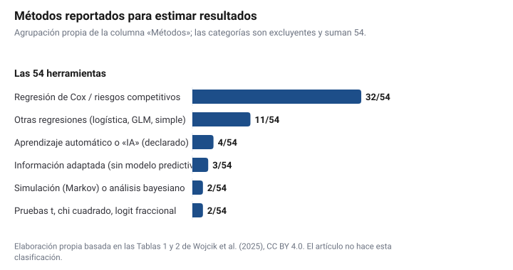

<nav class="dst-lang" aria-label="Idioma del artículo">
<a href="./" lang="es" hreflang="es" aria-current="page">Español</a>
<span class="dst-lang__sep" aria-hidden="true">|</span>
<a href="en/" lang="en" hreflang="en">English</a>
</nav>

<section class="dst-hero">
<div class="dst-hero__eyebrow">Reseña científica · Oncología y apoyo a la decisión</div>
<h1 class="dst-hero__title">Herramientas digitales para decisiones clínicas en cáncer de mama</h1>
<p class="dst-hero__subtitle">Qué investigaron Wojcik y colaboradores, qué encontraron, qué limitaciones tiene la evidencia y por qué importa para la IA en oncología.</p>
<div class="dst-hero__meta">Juan Sebastián Laverde Chunza · 19 de noviembre de 2026 · 6 minutos de lectura</div>
<div class="dst-stats">
<div class="dst-stat"><div class="dst-stat__value">54</div><div class="dst-stat__label">herramientas web personalizadas (11 de tratamiento, 43 de otros resultados)</div></div>
<div class="dst-stat"><div class="dst-stat__value">45</div><div class="dst-stat__label">con alguna validación reportada (interna y/o externa)</div></div>
<div class="dst-stat"><div class="dst-stat__value">9</div><div class="dst-stat__label">con pruebas de usabilidad, factibilidad o aceptabilidad (2 aún en curso)</div></div>
<div class="dst-stat"><div class="dst-stat__value">16<span class="dst-stat__unit">/63</span></div><div class="dst-stat__label">puntuación IPDAS media (51 herramientas evaluadas)</div></div>
</div>
</section>

::: {.dst-callout}
**Aviso.** Esta es una reseña académica. No recomienda ninguna herramienta ni sustituye la consulta con el equipo oncológico.
:::

## 1. ¿De qué trata el artículo?

El tratamiento del cáncer de mama está lleno de decisiones sin una única respuesta correcta, como añadir o no quimioterapia o indicar radioterapia a una paciente mayor. Cada vez más **herramientas web** prometen personalizarlas: con la edad, las características del tumor u otros datos, devuelven una probabilidad de recurrencia o de supervivencia, o ayudan a ordenar preferencias.

Según los autores, médicos y pacientes conocen poco esas herramientas y aún menos su validez. Wojcik y colaboradores (NIH, Georgetown y Stanford) se propusieron **mapearlas** para el tratamiento y la supervivencia en cáncer de mama: qué datos usan, cómo se validaron, si se probaron con usuarios y qué calidad tienen.

Importa porque una herramienta que estima mal un beneficio, o que funciona solo en ciertos grupos, puede orientar mal las decisiones o ampliar las desigualdades.

## 2. ¿Cómo se realizó la investigación?

Es una **revisión de alcance** (*scoping review*): mapea qué existe, sin estimar si una intervención funciona. Siguió **PRISMA-ScR** (Tricco et al., 2018) y se registró en Open Science Framework.

- **Búsqueda:** PubMed, PsycInfo, Embase, Scopus, Web of Science y Cochrane, más listas de referencias; herramientas de 2013 a 2023 en inglés, con última búsqueda el 12 de mayo de 2023.
- **Selección:** cuatro integrantes del equipo cribaron títulos y resúmenes en Covidence; una segunda ronda aplicó los mismos criterios al texto completo y los desacuerdos se resolvieron por discusión. El artículo no reporta cuántas personas revisaron cada registro.
- **Extracción:** los autores probaron cada herramienta en su sitio web con pacientes ficticias; sin acceso público, usaron capturas, los métodos publicados o la consulta a los autores.
- **Calidad:** aplicaron la lista **IPDAS** (*International Patient Decision Aid Standards*; Elwyn et al., 2006), con un punto por cada ítem presente y un máximo de 63. Mide la calidad de la ayuda a la decisión, **no la exactitud del modelo predictivo**.

<figure class="dst-figure dst-figure--prisma">
<a href="images/prisma-es.svg" class="dst-figure__zoom" title="Abrir la figura a tamaño completo"></a>
<figcaption><strong>Figura 1.</strong> Proceso de identificación de artículos. Traducción y redibujo de la Figura 1 de Wojcik et al. (2025), <a href="https://doi.org/10.1007/s11764-024-01567-6">doi:10.1007/s11764-024-01567-6</a>, licencia <a href="https://creativecommons.org/licenses/by/4.0/deed.es">CC BY 4.0</a>; plantilla PRISMA 2020 de Page et al., <em>BMJ</em> 2021;372:n71. Cambios: traducción al español, redibujo vectorial y viñeta añadida a «Web of Science». Todas las cifras, bloques y flechas se conservan. Los asteriscos (<code>*</code> y <code>**</code>) son llamadas de la plantilla PRISMA 2020 cuyas notas no se reproducen en la leyenda original. Toca o haz clic en la figura para verla a tamaño completo.</figcaption>
</figure>

Tras eliminar duplicados y cribar, se evaluaron 371 informes a texto completo y se incluyeron **46 estudios más 8 de validación**; 24 informes se excluyeron porque la herramienta estaba inaccesible, rota o sin enlace.

## 3. ¿Cuáles fueron los resultados principales?

Los artículos describían **54 herramientas** en dos grupos:

- **11 para resultados personalizados del tratamiento** (Tabla 1): estiman qué pasaría *con y sin* un tratamiento, como la quimioterapia adyuvante o la radioterapia.
- **43 para otros resultados** (Tabla 2): sobre todo pronósticos de supervivencia, metástasis o complicaciones, en su mayoría nomogramas para médicos.

**Validación.** **45** herramientas reportan alguna validación: 38 interna y solo **21** externa (14 ambas). Así, 24 de las 45 «validadas» solo tienen validación interna, y 9 no reportan ninguna.

<figure class="dst-figure">
<a href="images/fig-validacion-es.svg" class="dst-figure__zoom" title="Abrir la figura a tamaño completo"></a>
<figcaption><strong>Figura 2.</strong> Tipo de validación reportada por herramienta. Elaboración propia basada en las Tablas 1 y 2 de Wojcik et al. (2025). Las herramientas con validación interna y externa se muestran por separado para no presentar ambas categorías como excluyentes.</figcaption>
</figure>

**Usabilidad.** Solo **9 de 54** reportan pruebas de usabilidad, factibilidad o aceptabilidad, con instrumentos no comparables; en dos (BTxChoice y Radiotherapy for Older Women) aún estaban en curso, sin resultados.

**Calidad.** La puntuación IPDAS media fue de **16 sobre 63** (15,6 sin redondear, sobre 51 herramientas; tres no pudieron evaluarse por falta de acceso completo). Ninguna alcanza la mitad de la escala (máximo 46, BreastCHOICE). Las de tratamiento puntúan más (media 25,7) que las de otros resultados (13,1), muchas de ellas calculadoras para médicos sin opciones ni valores.

<figure class="dst-figure">
<a href="images/fig-ipdas-es.svg" class="dst-figure__zoom" title="Abrir la figura a tamaño completo"></a>
<figcaption><strong>Figura 3.</strong> Distribución de las puntuaciones IPDAS de las 51 herramientas evaluadas. Elaboración propia basada en las Tablas 1 y 2 de Wojcik et al. (2025). RSClin, Graetz et al. 2018 y REACH se excluyeron de la evaluación porque los autores no pudieron acceder a la herramienta completa.</figcaption>
</figure>

**Métodos.** La «personalización» es casi siempre estadística clásica: 32 herramientas usan regresión de Cox y solo 4 declaran aprendizaje automático o IA. La fuente dominante es el registro estadounidense **SEER** (28 de 54).

<figure class="dst-figure">
<a href="images/fig-metodos-es.svg" class="dst-figure__zoom" title="Abrir la figura a tamaño completo"></a>
<figcaption><strong>Figura 4.</strong> Métodos reportados para estimar resultados, en una agrupación propia de la columna «Métodos» de las Tablas 1 y 2 de Wojcik et al. (2025). El artículo no hace esta clasificación.</figcaption>
</figure>

Las tablas originales, completas:





## 4. ¿Qué limitaciones encontraron?

- **Validación externa escasa.** Solo 21 de 54 se probaron en datos independientes, y muchas dependen de un mismo registro, SEER.
- **Calidad baja y desigual.** Con una media IPDAS de 16/63, la mayoría no presenta bien opciones ni valores; solo seis declaran financiación o conflictos de interés.
- **Representatividad.** Las muestras de validación y prueba fueron sobre todo de personas blancas, casadas y aseguradas (68,2–83,9 % blancas en las herramientas de tratamiento); para 18 herramientas no hubo datos. Ninguna herramienta de tratamiento incorpora factores contextuales como el seguro.
- **Aplicación clínica.** Pocas pruebas con usuarios reales, 24 herramientas con disponibilidad limitada y ninguna evidencia documentada de que su uso mejore resultados de salud.

Los autores reconocen además que solo incluyeron herramientas en inglés desde 2013 y que 23 no pudieron evaluarse por completo por muros de pago o información incompleta.

## 5. ¿Qué podemos aprender para la inteligencia artificial en oncología?

Cada conclusión distingue lo que muestra el estudio de mi interpretación como investigador.

```{=html}
<div class="dst-lessons">
<div class="dst-lesson">
<h3>1. «Validada» no significa «lista para la clínica»</h3>
<p><span class="dst-tag dst-tag--study">El estudio</span> 45 herramientas reportan validación, pero solo 21 externa, y la revisión no recoge métricas de rendimiento.</p>
<p><span class="dst-tag dst-tag--mine">Mi interpretación</span> Un modelo puede ordenar bien los riesgos (discriminación) y aun así dar probabilidades erróneas en otra población (calibración; Van Calster et al., 2019). Antes de usarlo hacen falta validación externa, recalibración local y una evaluación de utilidad clínica, por ejemplo con curvas de decisión (Vickers y Elkin, 2006).</p>
</div>
<div class="dst-lesson">
<h3>2. El cuello de botella no es el algoritmo</h3>
<p><span class="dst-tag dst-tag--study">El estudio</span> Solo 4 de las 54 herramientas declaran aprendizaje automático o IA; las demás son sobre todo regresiones.</p>
<p><span class="dst-tag dst-tag--mine">Mi interpretación</span> Falta evidencia de transportabilidad, usabilidad e implementación, no complejidad algorítmica; en modelos clínicos, el aprendizaje automático no ha mostrado ventaja sistemática sobre la regresión logística (Christodoulou et al., 2019). Reportar con TRIPOD+AI (Collins et al., 2024) y evaluar el sesgo con PROBAST (Wolff et al., 2019) aporta más que cambiar de algoritmo.</p>
</div>
<div class="dst-lesson">
<h3>3. Predecir no es estimar el efecto de un tratamiento</h3>
<p><span class="dst-tag dst-tag--study">El estudio</span> Según las tablas, 28 de las 54 herramientas usan datos de SEER, un registro poblacional.</p>
<p><span class="dst-tag dst-tag--mine">Mi interpretación</span> Un modelo pronóstico estima el riesgo de quien recibió cierto tratamiento en la práctica, no lo que ocurriría si cambiara la decisión, y los datos de tratamiento de SEER tienen limitaciones conocidas (Noone et al., 2016). Comparar opciones exige supuestos causales explícitos.</p>
</div>
<div class="dst-lesson">
<h3>4. Quien falta en los datos falta en la predicción</h3>
<p><span class="dst-tag dst-tag--study">El estudio</span> Las muestras fueron poco diversas, y los autores advierten que estas herramientas podrían perpetuar las disparidades.</p>
<p><span class="dst-tag dst-tag--mine">Mi interpretación</span> Ninguna herramienta procede de América Latina o África. Aplicarlas en otros sistemas de salud exige validación externa en esas poblaciones (Ramspek et al., 2021) y un rendimiento informado por subgrupos.</p>
</div>
</div>
```

En síntesis, la revisión no demuestra que estas herramientas sean dañinas ni inútiles: muestra que **aún no sabemos lo suficiente** para recomendar su uso generalizado sin una evaluación crítica previa.

```{=html}
<details class="dst-details dst-details--note">
<summary>Nota de verificación: discrepancias documentadas en el artículo</summary>
<p>Todas las cifras se contrastaron con el PDF publicado, y las Tablas 1 y 2 se auditaron carácter por carácter frente al original. Los puntos siguientes se documentan <strong>sin corregir el estudio</strong>; varias diferencias se explican por definiciones o denominadores y no son errores científicos.</p>
<div class="dst-table-scroll" role="region" aria-label="Discrepancias y puntos documentados, con su clasificación" tabindex="0">
<table class="dst-table dst-table--disc"><caption>Discrepancias y puntos documentados, con su clasificación</caption>
<thead><tr><th scope="col">#</th><th scope="col">Punto</th><th scope="col">Qué dice el artículo</th><th scope="col">Qué muestran sus propios datos</th><th scope="col">Clasificación</th></tr></thead><tbody>
<tr><th scope="row" class="dst-num">1</th><td data-label="Punto">Figura 1</td><td data-label="Qué dice el artículo">371 informes evaluados, 319 excluidos; 46 estudios incluidos (+ 8 de validación)</td><td data-label="Qué muestran sus propios datos">371 − 319 = 52 informes. PRISMA 2020 distingue informes de estudios, pero el artículo no documenta esa correspondencia ni el origen de los 8 estudios de validación</td><td data-label="Clasificación">Requiere verificación adicional</td></tr>
<tr><th scope="row" class="dst-num">2</th><td data-label="Punto">Usuarios, Tabla 1 (texto)</td><td data-label="Qué dice el artículo">2 solo pacientes, 4 solo médicos y «nueve» para ambos</td><td data-label="Qué muestran sus propios datos">La Tabla 1 indica 5 para ambos; la suma del texto (15) supera las 11 herramientas</td><td data-label="Clasificación">Inconsistencia demostrable (probable errata: «nine» por «five»)</td></tr>
<tr><th scope="row" class="dst-num">3</th><td data-label="Punto">Sin validación, Tabla 1 (texto)</td><td data-label="Qué dice el artículo">«Tres herramientas» [17, 45, 49]</td><td data-label="Qué muestran sus propios datos">La Tabla 1 muestra cuatro: la referencia 49 describe dos herramientas</td><td data-label="Clasificación">Diferencia explicable (conteo por referencias)</td></tr>
<tr><th scope="row" class="dst-num">4</th><td data-label="Punto">Variables, Tabla 1 (texto)</td><td data-label="Qué dice el artículo">Todas usan características individuales y clínicas</td><td data-label="Qué muestran sus propios datos">BRECONDA figura con «—» en esa columna</td><td data-label="Clasificación">Inconsistencia menor; requiere verificación</td></tr>
<tr><th scope="row" class="dst-num">5</th><td data-label="Punto">Usabilidad</td><td data-label="Qué dice el artículo">«Sí» para BTxChoice y Radiotherapy for Older Women</td><td data-label="Qué muestran sus propios datos">El texto aclara que no reportaron resultados (pruebas en curso)</td><td data-label="Clasificación">Explicable por criterio: registra la existencia de pruebas</td></tr>
<tr><th scope="row" class="dst-num">6</th><td data-label="Punto">Accesibilidad</td><td data-label="Qué dice el artículo">23 herramientas no evaluables por pago o capturas incompletas</td><td data-label="Qué muestran sus propios datos">24 figuran con «disponibilidad limitada», una categoría más amplia</td><td data-label="Clasificación">Explicable por criterios; no es una discrepancia</td></tr>
<tr><th scope="row" class="dst-num">7</th><td data-label="Punto">Países</td><td data-label="Qué dice el artículo">EE. UU., Europa, Australia, Japón y Corea</td><td data-label="Qué muestran sus propios datos">La Tabla 2 incluye una herramienta con datos de Harbin (China)</td><td data-label="Clasificación">Requiere verificación adicional</td></tr>
<tr><th scope="row" class="dst-num">8</th><td data-label="Punto">Abreviaturas, Tabla 2</td><td data-label="Qué dice el artículo">«AT aromatase inhibitor»</td><td data-label="Qué muestran sus propios datos">La tabla usa «AI»</td><td data-label="Clasificación">Posible errata editorial</td></tr>
<tr><th scope="row" class="dst-num">9</th><td data-label="Punto">Celdas de las tablas</td><td data-label="Qué dice el artículo">«PMR», «breast reduction», «Rocket Mountain», «2 of more», «mellitus»</td><td data-label="Qué muestran sus propios datos">Aparentes erratas tipográficas, conservadas y marcadas</td><td data-label="Clasificación">Posible errata editorial</td></tr>
<tr><th scope="row" class="dst-num">10</th><td data-label="Punto">Figura 1</td><td data-label="Qué dice el artículo"><span>Asteriscos <code>*</code> y <code>**</code></span></td><td data-label="Qué muestran sus propios datos">Llamadas de la plantilla PRISMA 2020 cuyas notas no se reproducen</td><td data-label="Clasificación">Posible errata editorial</td></tr>
</tbody></table></div>
<p><strong>No son discrepancias:</strong> la media IPDAS de 15,57 sobre 51 herramientas se redondea correctamente a 16; las 20 herramientas de supervivencia global de la Tabla 2 cuadran al incluir las referencias 85 y 86; los recuentos de validación, usuarios, raza y factores contextuales de la Tabla 2 coinciden con la tabla.</p>
</details>
```

## Referencias

<div class="dst-references">

<p class="dst-reference dst-reference--main">Wojcik, K. M., Kamil, D., Zhang, J., Wilson, O. W. A., Smith, L., Butera, G., Isaacs, C., Kurian, A., &amp; Jayasekera, J. (2025). A scoping review of web-based, interactive, personalized decision-making tools available to support breast cancer treatment and survivorship care. <em>Journal of Cancer Survivorship, 19</em>, 1496–1524. <a href="https://doi.org/10.1007/s11764-024-01567-6">https://doi.org/10.1007/s11764-024-01567-6</a> (publicado en línea el 28 de marzo de 2024).</p>

<p class="dst-reference">Christodoulou, E., Ma, J., Collins, G. S., Steyerberg, E. W., Verbakel, J. Y., &amp; Van Calster, B. (2019). A systematic review shows no performance benefit of machine learning over logistic regression for clinical prediction models. <em>Journal of Clinical Epidemiology, 110</em>, 12–22. <a href="https://doi.org/10.1016/j.jclinepi.2019.02.004">https://doi.org/10.1016/j.jclinepi.2019.02.004</a></p>

<p class="dst-reference">Collins, G. S., Moons, K. G. M., Dhiman, P., et al. (2024). TRIPOD+AI statement: updated guidance for reporting clinical prediction models that use regression or machine learning methods. <em>BMJ, 385</em>, e078378. <a href="https://doi.org/10.1136/bmj-2023-078378">https://doi.org/10.1136/bmj-2023-078378</a></p>

<p class="dst-reference">Elwyn, G., O'Connor, A., Stacey, D., et al. (2006). Developing a quality criteria framework for patient decision aids: online international Delphi consensus process. <em>BMJ, 333</em>(7565), 417. <a href="https://doi.org/10.1136/bmj.38926.629329.AE">https://doi.org/10.1136/bmj.38926.629329.AE</a></p>

<p class="dst-reference">Noone, A.-M., Lund, J. L., Mariotto, A., Cronin, K., McNeel, T., Deapen, D., &amp; Warren, J. L. (2016). Comparison of SEER treatment data with Medicare claims. <em>Medical Care, 54</em>(9), e55–e64. <a href="https://doi.org/10.1097/MLR.0000000000000073">https://doi.org/10.1097/MLR.0000000000000073</a></p>

<p class="dst-reference">Page, M. J., McKenzie, J. E., Bossuyt, P. M., et al. (2021). The PRISMA 2020 statement: an updated guideline for reporting systematic reviews. <em>BMJ, 372</em>, n71. <a href="https://doi.org/10.1136/bmj.n71">https://doi.org/10.1136/bmj.n71</a></p>

<p class="dst-reference">Ramspek, C. L., Jager, K. J., Dekker, F. W., Zoccali, C., &amp; van Diepen, M. (2021). External validation of prognostic models: what, why, how, when and where? <em>Clinical Kidney Journal, 14</em>(1), 49–58. <a href="https://doi.org/10.1093/ckj/sfaa188">https://doi.org/10.1093/ckj/sfaa188</a></p>

<p class="dst-reference">Tricco, A. C., Lillie, E., Zarin, W., et al. (2018). PRISMA Extension for Scoping Reviews (PRISMA-ScR): checklist and explanation. <em>Annals of Internal Medicine, 169</em>(7), 467–473. <a href="https://doi.org/10.7326/M18-0850">https://doi.org/10.7326/M18-0850</a></p>

<p class="dst-reference">Van Calster, B., McLernon, D. J., van Smeden, M., Wynants, L., &amp; Steyerberg, E. W. (2019). Calibration: the Achilles heel of predictive analytics. <em>BMC Medicine, 17</em>, 230. <a href="https://doi.org/10.1186/s12916-019-1466-7">https://doi.org/10.1186/s12916-019-1466-7</a></p>

<p class="dst-reference">Vickers, A. J., &amp; Elkin, E. B. (2006). Decision curve analysis: a novel method for evaluating prediction models. <em>Medical Decision Making, 26</em>(6), 565–574. <a href="https://doi.org/10.1177/0272989X06295361">https://doi.org/10.1177/0272989X06295361</a></p>

<p class="dst-reference">Wolff, R. F., Moons, K. G. M., Riley, R. D., Whiting, P. F., Westwood, M., Collins, G. S., Reitsma, J. B., Kleijnen, J., Mallett, S., &amp; PROBAST Group. (2019). PROBAST: a tool to assess the risk of bias and applicability of prediction model studies. <em>Annals of Internal Medicine, 170</em>(1), 51–58. <a href="https://doi.org/10.7326/M18-1376">https://doi.org/10.7326/M18-1376</a></p>

</div>

<p class="dst-note">Los DOI se comprobaron en Crossref. Los números entre corchetes de las tablas remiten a la lista de 156 referencias del artículo original. Las obras de Christodoulou, Collins, Noone, Ramspek, Van Calster, Vickers y Wolff no forman parte de la revisión; se citan solo como apoyo de la interpretación propia de la sección 5.</p>

<div class="dst-links">
<a class="dst-links__primary" href="https://doi.org/10.1007/s11764-024-01567-6">Leer el artículo original (DOI)</a>
<a href="https://osf.io/6kdsv">Registro en Open Science Framework</a>
<a href="en/">Read this review in English</a>
</div>

::: {.dst-credits}
**Créditos y licencia.** El artículo de Wojcik et al. es de acceso abierto bajo licencia [CC BY 4.0](https://creativecommons.org/licenses/by/4.0/deed.es). Es además un trabajo del Gobierno de EE. UU., no sujeto a derechos de autor en ese país. La Figura 1 y las Tablas 1 y 2 son adaptaciones (traducción, redibujo y reorganización) de los originales; la Figura 1 se basa a su vez en la plantilla PRISMA 2020 de Page et al. (*BMJ*, CC BY 4.0). Las Figuras 2 a 4 y la imagen de portada son elaboración propia a partir de los datos de las tablas. Ninguna de estas adaptaciones implica respaldo de los autores originales.

**Uso de inteligencia artificial.** Esta reseña se preparó con el apoyo de Claude (Anthropic), un asistente de IA generativa, en la extracción y verificación de las tablas y cifras del PDF, la comprobación de referencias en Crossref, la redacción de los borradores en español e inglés, la elaboración de las figuras y tablas, una auditoría de verificación y la condensación de una versión extensa anterior en esta reseña breve. El autor definió el encargo, los criterios de rigor y la estructura de la versión breve. La responsabilidad final del contenido corresponde al autor.
:::
