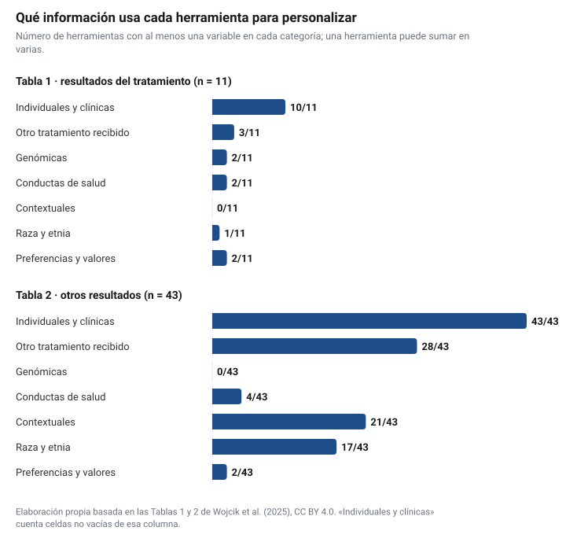
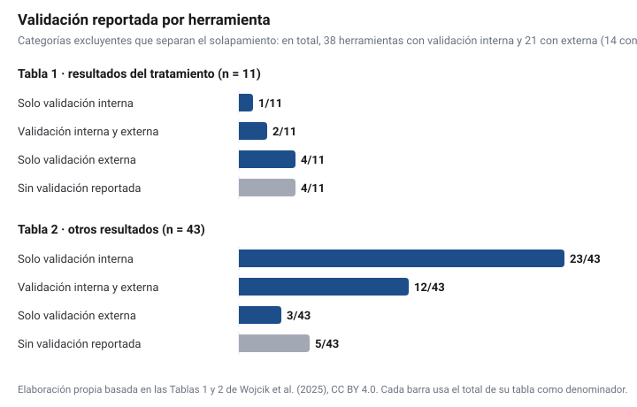
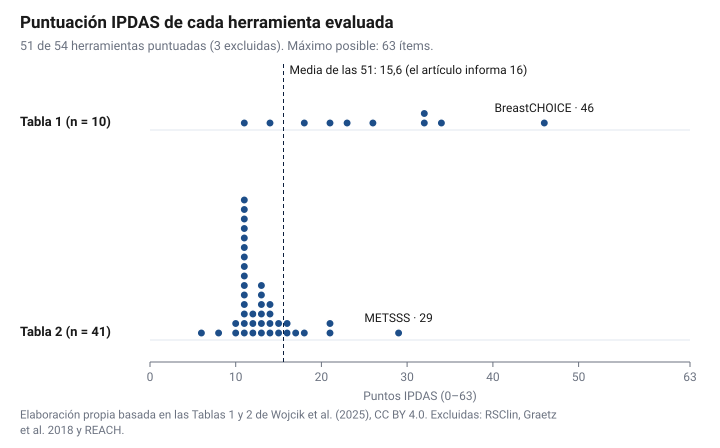

<nav class="dst-lang" aria-label="Idioma del artículo">
<a href="./" lang="es" hreflang="es" aria-current="page">Español</a>
<span class="dst-lang__sep" aria-hidden="true">|</span>
<a href="en/" lang="en" hreflang="en">English</a>
</nav>

<section class="dst-hero">
<div class="dst-hero__eyebrow">Revisión crítica · Oncología y apoyo a la decisión</div>
<h1 class="dst-hero__title">Herramientas digitales para decisiones clínicas en cáncer de mama</h1>
<p class="dst-hero__subtitle">Evidencia, validación y desafíos de la medicina personalizada: una lectura crítica de la revisión de alcance de Wojcik y colaboradores.</p>
<div class="dst-hero__meta">Juan Sebastián Laverde Chunza · 19 de noviembre de 2026 · 35 minutos de lectura</div>
<div class="dst-stats">
<div class="dst-stat"><div class="dst-stat__value">54</div><div class="dst-stat__label">herramientas web personalizadas (11 de tratamiento, 43 de otros resultados)</div></div>
<div class="dst-stat"><div class="dst-stat__value">45</div><div class="dst-stat__label">con alguna validación reportada (interna y/o externa)</div></div>
<div class="dst-stat"><div class="dst-stat__value">9</div><div class="dst-stat__label">con pruebas de usabilidad, factibilidad o aceptabilidad reportadas (2 aún en curso)</div></div>
<div class="dst-stat"><div class="dst-stat__value">16<span class="dst-stat__unit">/63</span></div><div class="dst-stat__label">puntuación IPDAS media (rango 6–46; 51 evaluadas)</div></div>
</div>
</section>

::: {.dst-abstract}
[Resumen]{.dst-label}

Wojcik y colaboradores (Instituto Nacional sobre la Salud de las Minorías y las Disparidades en Salud de los NIH, con coautores de Georgetown y Stanford) revisaron la literatura de 2013 a 2023 en busca de herramientas web, interactivas y personalizadas para apoyar decisiones de tratamiento y supervivencia en cáncer de mama. Encontraron **54 herramientas**: casi todas son modelos estadísticos de pronóstico, sobre todo regresiones de Cox entrenadas con el registro estadounidense SEER. **45** reportan alguna validación, pero solo **21** se probaron en una cohorte externa; **9** pasaron por pruebas de usabilidad, factibilidad o aceptabilidad, y la calidad media según la lista IPDAS fue de **16 sobre 63**. Las muestras de validación y de prueba fueron mayoritariamente de personas blancas, casadas y aseguradas. Esta reseña reconstruye los métodos y los resultados, reproduce íntegramente las dos tablas del artículo, señala discrepancias internas del texto y explica por qué una herramienta con buen rendimiento estadístico todavía puede no estar preparada para orientar decisiones clínicas.
:::

::: {.dst-callout}
**Aviso.** Esta es una reseña académica. No recomienda ninguna herramienta ni sustituye la consulta con el equipo oncológico. Ninguna de las herramientas descritas debe usarse para tomar decisiones personales de tratamiento sin acompañamiento profesional.
:::

## 1. Introducción: decidir con incertidumbre

El tratamiento del cáncer de mama está lleno de decisiones que no tienen una única respuesta correcta. ¿Conviene añadir quimioterapia a la terapia endocrina en un tumor con receptores hormonales positivos y sin ganglios afectados? ¿Una mujer de 75 años gana algo con la radioterapia tras una cirugía conservadora? ¿Reconstrucción mamaria inmediata, diferida o ninguna? En cada caso, el beneficio esperado depende de las características del tumor, de la edad y las comorbilidades, del contexto social y de lo que cada paciente valora más: vivir más años, evitar efectos adversos o conservar su imagen corporal.

La **medicina personalizada** intenta que esas decisiones dejen de basarse en promedios poblacionales. En lugar de decir «la quimioterapia reduce la recurrencia un X % en este grupo», busca responder «para *esta* paciente, con *este* tumor, el beneficio absoluto esperado es de tantos puntos porcentuales». Para eso hacen falta modelos que traduzcan datos individuales en probabilidades, y formas de comunicarlas que el clínico y la paciente puedan comprender y discutir.

Las **herramientas digitales de apoyo a la decisión** ocupan precisamente ese lugar. Una calculadora web donde el oncólogo introduce edad, tamaño tumoral, grado y puntuación genómica, y obtiene la probabilidad de recurrencia a distancia con y sin quimioterapia, es una de ellas. También lo es un sitio interactivo que ayuda a una paciente a ordenar sus preferencias antes de decidir sobre la reconstrucción. Wojcik y colaboradores se preguntaron cuántas de estas herramientas existen, qué hacen, con qué datos se construyeron y, sobre todo, cuánto sabemos realmente de su validez, su usabilidad y su calidad.

::: {.dst-concept}
[Concepto clave]{.dst-label}

**Herramienta de apoyo a la decisión.** Es cualquier instrumento que ayude a personas a decidir sobre su atención en salud (definición de la colaboración IPDAS que usa el artículo). Puede **predecir** (estimar una probabilidad), **informar** (presentar opciones y consecuencias) o **clarificar valores** (ayudar a que la paciente exprese qué le importa). Las tres funciones son distintas, y pocas herramientas las combinan.
:::

## 2. ¿Qué investigaron Wojcik y colaboradores?

### El problema

Los autores parten de dos observaciones. La primera es que existen herramientas web que prometen personalizar la atención del cáncer de mama según variables demográficas, clínicas, genómicas, conductuales y contextuales, y que, según la literatura que citan, las herramientas de decisión personalizadas pueden aumentar el conocimiento, reducir la ansiedad y mejorar la calidad de vida. La segunda es que tanto médicos como pacientes conocen poco esas herramientas y su validez, lo que reduce la motivación para usarlas. A esto añaden un contexto regulatorio: mencionan que la FDA de Estados Unidos emitió orientaciones para regular herramientas de decisión como dispositivos médicos (lo citan a través de un comentario publicado en el *New England Journal of Medicine*).

### La pregunta

El objetivo declarado fue **revisar críticamente las características de las herramientas web interactivas y personalizadas, en inglés, disponibles para apoyar la atención del cáncer de mama**, con atención especial a su calidad, validez, usabilidad, factibilidad y aceptabilidad, y a qué poblaciones participaron en su desarrollo y evaluación.

### ¿Qué es una revisión de alcance?

Una **revisión de alcance** (*scoping review*) mapea la evidencia disponible sobre un tema amplio: qué existe, cómo se ha estudiado y dónde están los vacíos. No pregunta «¿funciona la intervención X?» sino «¿qué se ha hecho sobre X y con qué características?».

<div class="dst-compare" role="table" aria-label="Comparación entre tipos de revisión">
<div class="dst-compare__row dst-compare__head" role="row"><div role="columnheader">Tipo</div><div role="columnheader">Pregunta típica</div><div role="columnheader">Evaluación del riesgo de sesgo</div><div role="columnheader">Síntesis cuantitativa</div></div>
<div class="dst-compare__row" role="row"><div role="cell"><strong>Revisión de alcance</strong></div><div role="cell" data-label="Pregunta típica">¿Qué existe y cómo se ha estudiado?</div><div role="cell" data-label="Evaluación del riesgo de sesgo">Opcional (aquí, se evaluó la calidad con IPDAS)</div><div role="cell" data-label="Síntesis cuantitativa">No; conteos y descripciones</div></div>
<div class="dst-compare__row" role="row"><div role="cell"><strong>Revisión sistemática</strong></div><div role="cell" data-label="Pregunta típica">¿Cuál es el efecto de X sobre Y?</div><div role="cell" data-label="Evaluación del riesgo de sesgo">Obligatoria, por estudio</div><div role="cell" data-label="Síntesis cuantitativa">Opcional</div></div>
<div class="dst-compare__row" role="row"><div role="cell"><strong>Metaanálisis</strong></div><div role="cell" data-label="Pregunta típica">¿Cuál es el efecto combinado y su precisión?</div><div role="cell" data-label="Evaluación del riesgo de sesgo">Obligatoria</div><div role="cell" data-label="Síntesis cuantitativa">Sí; combina estimaciones con modelos estadísticos</div></div>
</div>
<p class="dst-figcaption">Comparación conceptual elaborada para esta reseña.</p>

La distinción importa al leer los resultados. Una revisión de alcance puede decir que 45 herramientas reportan validación, pero no compara su exactitud ni concluye cuál funciona mejor. Pedirle eso sería pedirle algo que su diseño no promete.

### La contribución

Según los autores, revisiones anteriores habían examinado hasta 21 herramientas para decisiones de tratamiento. Esta amplía el inventario a 54, incluye la etapa de supervivencia y añade dos dimensiones poco estudiadas: **qué factores conductuales y contextuales** usan las herramientas para personalizar y **qué poblaciones** participaron en su validación y en sus pruebas de uso.

## 3. ¿Cómo realizaron la revisión?

### Marco y registro

La revisión siguió el marco de Arksey y O'Malley, ampliado por Levac y colaboradores y por el Joanna Briggs Institute, con seis etapas: definir la pregunta, identificar literatura, seleccionar estudios, mapear datos, sintetizar resultados y consultar a expertos. Se reportó según la lista **PRISMA-ScR** (la extensión de PRISMA para revisiones de alcance) y se registró en Open Science Framework. Al no usar datos individuales, no requirió aprobación ética.

### Búsqueda

- **Bases de datos:** PubMed, PsycInfo, Embase, Scopus, Web of Science y Cochrane Database of Systematic Reviews, además de una revisión de las listas de referencias de los artículos incluidos.
- **Estrategia:** combinación de palabras clave, sinónimos, términos MeSH y Emtree sobre herramientas de decisión clínica, supervivencia, tratamiento, web, personalización y cáncer de mama. Una persona bibliotecaria de los NIH la probó con 50 artículos y la refinó. La estrategia completa está en la Tabla Suplementaria 2, que no se revisó para esta reseña.
- **Periodo:** herramientas desarrolladas entre 2013 y 2023; la última búsqueda fue el **12 de mayo de 2023**.

### Criterios de inclusión

Los artículos debían cumplir cinco condiciones: (1) adultos (≥ 18 años), mujeres u hombres, con diagnóstico de cáncer de mama; (2) tratamiento o supervivencia; (3) modelos de predicción de riesgo en línea o herramientas interactivas personalizadas desarrolladas entre 2013 y 2023; (4) investigación empírica primaria, y (5) idioma inglés. Los criterios detallados están en la Tabla Suplementaria 3.

### Selección y extracción

Cuatro integrantes del equipo (KW, DK, JZ, LS) cribaron títulos y resúmenes en Covidence; una segunda ronda aplicó los mismos criterios al texto completo, y los desacuerdos se resolvieron por discusión. El artículo no reporta cuántas personas revisaron cada registro ni una medida de concordancia. Un detalle metodológico valioso: **los autores visitaron cada sitio web y probaron las herramientas con pacientes ficticias** para identificar qué entradas usaban y qué resultados devolvían. Cuando no había sitio público, recurrieron a capturas de pantalla y a la sección de métodos de los artículos, y escribieron a los autores correspondientes para pedir la información faltante.

Para cada herramienta extrajeron nombre y propósito, población objetivo, intervención, fuente de datos y métodos, variables de entrada (individuales, clínicas, genómicas, conductuales, contextuales), resultados, usuarios destinatarios y fecha de la última actualización. De los estudios de validación y de prueba extrajeron la distribución por raza y etnia, educación, ingresos, estado civil y seguro médico.

### Definiciones operativas

<div class="dst-defs">
<dl>
<dt>Validación externa</dt><dd>Prueba del modelo en muestras independientes, distintas de las de desarrollo, para evaluar rendimiento y generalización. Es la única forma de validación definida explícitamente en el texto.</dd>
<dt>Validación interna</dt><dd>La tabla la reporta, pero el artículo no la define. En la literatura metodológica suele referirse a remuestreo (bootstrap, validación cruzada) o a una partición de la misma fuente de datos.</dd>
<dt>Usabilidad</dt><dd>Experiencia y comprensión de la persona usuaria al manejar la herramienta.</dd>
<dt>Factibilidad</dt><dd>Probabilidad de que la herramienta se use realmente para mejorar la interacción médico-paciente.</dd>
<dt>Aceptabilidad</dt><dd>Satisfacción de las personas usuarias con la herramienta.</dd>
</dl>
</div>

### Evaluación de calidad con IPDAS

Los autores aplicaron la lista de verificación de los **International Patient Decision Aid Standards (IPDAS)**, un marco consensuado internacionalmente para juzgar ayudas a la decisión. Esa lista evalúa cómo se presenta la información y las probabilidades, si se clarifican los valores de la paciente, cómo se desarrolló la herramienta, el uso de historias y el efecto sobre el proceso y la calidad de la decisión. Cada herramienta recibió **un punto por cada ítem presente, con un máximo de 63**. Es importante entender qué mide esa escala: **cuántos ítems de la lista cumple la herramienta, no su exactitud predictiva ni su beneficio clínico**. Tampoco se reporta si la puntuación la hizo una persona o dos de forma independiente.

### Figura 1. Selección de estudios

<figure class="dst-figure dst-figure--prisma">
<a href="images/prisma-es.svg" class="dst-figure__zoom" title="Abrir la figura a tamaño completo"></a>
<figcaption><strong>Figura 1.</strong> Proceso de identificación de artículos. Traducción y redibujo de la Figura 1 de Wojcik et al. (2025), <a href="https://doi.org/10.1007/s11764-024-01567-6">doi:10.1007/s11764-024-01567-6</a>, licencia <a href="https://creativecommons.org/licenses/by/4.0/deed.es">CC BY 4.0</a>; la plantilla original procede de Page et al., <em>BMJ</em> 2021;372:n71 (PRISMA 2020). Cambios: traducción al español, redibujo vectorial y viñeta añadida a «Web of Science», que en el original aparece sin ella. Todas las cifras, bloques y flechas se conservan. Los asteriscos (<code>*</code> y <code>**</code>) son llamadas de la plantilla PRISMA 2020 cuyas notas no se reproducen en la leyenda original. Toca o haz clic en la figura para verla a tamaño completo.</figcaption>
</figure>

::: {.dst-interpret}
[Cómo leer la figura]{.dst-label}

El embudo es enorme: de más de 5.000 registros, solo 46 artículos (más 8 de validación) llegaron al final. La mayor fuente de exclusión en texto completo fue el «contexto no aplicable» (98), y 24 informes se descartaron porque la herramienta en línea estaba **inaccesible, rota o sin enlace**. Ese último dato ya dice algo sobre el problema que la revisión quiere iluminar: muchas herramientas publicadas desaparecen o no se mantienen.

Las cuentas casan en casi todo el diagrama: 5.237 + 72 − 2.292 = 3.017, y 3.017 − 2.646 = 371. El último paso pide una lectura cuidadosa: 371 − 319 = **52 informes** elegibles, mientras que la casilla final cuenta **46 estudios** (y el texto, «46 artículos») más 8 estudios de validación. PRISMA 2020 distingue entre *registros* (lo que devuelven las bases), *informes* (documentos evaluados) y *estudios* (investigaciones, que pueden tener varios informes). Que 52 informes correspondan a 46 estudios es, por tanto, posible, pero el artículo no lo documenta ni aclara de dónde proceden los 8 estudios de validación. Por eso esta diferencia **no se presenta como un error, sino como un punto que requiere verificación** con los autores o con el material suplementario.

Conviene distinguir además tres unidades que el artículo usa a la vez: **artículos** (46 incluidos), **estudios de validación** (8 adicionales) y **herramientas** (54). Un mismo artículo puede describir varias herramientas (por ejemplo, la referencia 73 describe tres nomogramas) y una herramienta puede validarse en otro artículo.
:::

## 4. ¿Qué encontraron?

Los 46 artículos describían **54 herramientas**, que los autores dividieron en dos grupos:

- **11 herramientas para resultados personalizados del tratamiento** (Tabla 1): estiman qué pasaría *con y sin* un tratamiento concreto, por ejemplo el riesgo de recurrencia con y sin radioterapia posmastectomía.
- **43 herramientas para otros resultados** (Tabla 2): estiman pronósticos (supervivencia global, supervivencia específica, metástasis), riesgos quirúrgicos o apoyan el seguimiento, pero sin dar resultados específicos por opción de tratamiento.

### Herramientas para resultados del tratamiento (N = 11)

Todas se desarrollaron para mujeres adultas con cáncer de mama temprano o con carcinoma ductal *in situ* (CDIS). Las decisiones que abordan son la quimioterapia adyuvante (BTxChoice, RSClin, Age Gap 2), la terapia endocrina primaria frente a cirugía (Age Gap 1), la radioterapia (Radiotherapy for Older Women, el predictor posmastectomía N1), la cirugía axilar (LinfoNeo), la reconstrucción (BreastCHOICE, BRECONDA), el dolor persistente tras la cirugía (Meretoja et al.) y las opciones ante un CDIS. Dos herramientas se diseñaron específicamente para mujeres mayores.

Según la tabla, todas menos BRECONDA usan variables individuales y clínicas; **solo dos usan información genómica** (la puntuación de recurrencia de 21 genes, en BTxChoice y RSClin); dos incluyen conductas de salud; **ninguna incorpora factores contextuales** como el seguro médico o el acceso a un centro de tratamiento; una considera la raza (la herramienta para CDIS) y dos clarifican preferencias (BreastCHOICE y BRECONDA).



### Herramientas para otros resultados (N = 43)

Aquí el patrón cambia. **31 de las 43 herramientas están dirigidas solo a médicos**; 8 a médicos y pacientes, y 4 solo a pacientes. Los resultados más frecuentes son la supervivencia global (20 herramientas, según el texto), la supervivencia específica por cáncer de mama (7) y el riesgo de metástasis ósea (3). Hay subgrupos poco habituales en la literatura: diez herramientas para pacientes con metástasis óseas o pulmonares, cuatro para pacientes jóvenes, tres para personas mayores y tres específicas para **hombres** con cáncer de mama y metástasis óseas. Solo una, ACESO, se diseñó para la etapa de supervivencia: genera alertas de salud y recomendaciones de seguimiento.

Este grupo sí incorpora contexto: **21 herramientas** usan factores contextuales (el estado civil en 20, el seguro médico en 4, y educación, empleo y situación financiera en una, YES). **17 consideran la raza** y una distingue la etnia hispana. Solo dos incluyen preferencias o valores.



### Lo que usan para personalizar

<figure class="dst-figure">
<a href="images/fig-variables-es.svg" class="dst-figure__zoom" title="Abrir la figura a tamaño completo"></a>
<figcaption><strong>Figura 2.</strong> Categorías de variables de entrada por grupo de herramientas. Elaboración propia basada en las Tablas 1 y 2 de Wojcik et al. (2025). Los paneles usan denominadores distintos (11 y 43), y una herramienta puede contar en varias categorías.</figcaption>
</figure>

El gráfico muestra una asimetría que el texto del artículo menciona solo de pasada: las herramientas que estiman **beneficios de tratamiento** son las que menos contexto incorporan (0 de 11), mientras que las de **pronóstico**, muchas construidas con SEER, son las que más (21 de 43), sobre todo por el estado civil, una variable disponible en ese registro. Que una herramienta «incluya contexto» puede depender más de qué columnas trae la base de datos que de una decisión deliberada de diseño.

### Validación

<figure class="dst-figure">
<a href="images/fig-validacion-es.svg" class="dst-figure__zoom" title="Abrir la figura a tamaño completo"></a>
<figcaption><strong>Figura 3.</strong> Tipo de validación reportada por herramienta. Elaboración propia basada en las Tablas 1 y 2 de Wojcik et al. (2025). Para no presentar «interna» y «externa» como categorías excluyentes, el gráfico separa explícitamente las herramientas que tienen ambas.</figcaption>
</figure>

| | Tabla 1 (n = 11) | Tabla 2 (n = 43) | Total (n = 54) |
|---|---:|---:|---:|
| Validación interna (con o sin externa) | 3 | 35 | 38 |
| Validación externa (con o sin interna) | 6 | 15 | 21 |
| Ambas | 2 | 12 | 14 |
| Alguna validación | 7 | 38 | **45** |
| Sin validación reportada | 4 | 5 | 9 |

: Validación reportada, contada directamente en las Tablas 1 y 2 del artículo. {.dst-small-table}

La cifra del resumen, **45 herramientas validadas**, es correcta según las tablas. Hay que leerla con cuidado: **24 de esas 45 solo tienen validación interna**. Dicho de otro modo, menos de la mitad de las 54 herramientas (21) se probaron en datos independientes de los de su desarrollo. El artículo tampoco reporta métricas de rendimiento (discriminación, calibración) ni cómo se hizo cada validación: el campo solo dice si la hubo.

### Usabilidad, factibilidad y aceptabilidad

Solo **9 de 54** herramientas tienen pruebas de este tipo (5 en la Tabla 1 y 4 en la Tabla 2), con instrumentos tan heterogéneos que los autores no pudieron compararlas:

- **BreastCHOICE**: puntuación media de usabilidad de 6,3 sobre 7 en el *Computer System Usability Questionnaire*.
- **«Which treatment for DCIS is right for you?»**: media de 3,7 sobre 5 con la *System Usability Scale* y la *Preparation for Decision-Making Scale*.
- **BRECONDA**: utilidad 4,8 y relevancia 4,4 en escalas Likert de 1 a 5; estudios posteriores confirmaron su aceptabilidad.
- **ACESO**: consistencia 1,2, estrés 1,2 y simplicidad 1,4 en una escala donde 1 es lo más positivo y 7 lo más negativo.
- **REACH**: superó sus metas de factibilidad (85,4 % de inscripción y 83,7 % de participantes con al menos una sesión, frente a metas del 80 %), con aceptabilidad media de 3,0 (escala 1–4) y 3,4 (escala 1–5).
- **Graetz et al. 2018**: los profesionales informaron que era fácil de implementar y no alteraba significativamente el flujo de trabajo.
- **BTxChoice** y **Radiotherapy for Older Women** figuran con «Sí» en la tabla y entran en el recuento de 9, pero según el texto **no reportaron resultados**: sus autores indicaron que las pruebas estaban en curso. La columna registra, por tanto, la *existencia* de pruebas (incluidas las que estaban en marcha), no la publicación de resultados. Por eso la frase del resumen («nueve habían pasado por pruebas de usabilidad») debe leerse con esa salvedad.
- **YES** figura con «Sí» en la Tabla 2, pero el texto no describe sus resultados.

### Calidad IPDAS

<figure class="dst-figure">
<a href="images/fig-ipdas-es.svg" class="dst-figure__zoom" title="Abrir la figura a tamaño completo"></a>
<figcaption><strong>Figura 4.</strong> Distribución de las puntuaciones IPDAS de las 51 herramientas evaluadas. Elaboración propia basada en las Tablas 1 y 2 de Wojcik et al. (2025). RSClin, Graetz et al. 2018 y REACH se excluyeron de la evaluación porque los autores no pudieron acceder a la herramienta completa.</figcaption>
</figure>

La media de las 51 herramientas puntuadas es **15,6** (el artículo la redondea a 16), con mediana de 13 y rango de 6 a 46. **Ninguna supera la mitad de la puntuación posible**, y BreastCHOICE (46) es la única que se acerca. La diferencia entre grupos es marcada: media de 25,7 en las herramientas de tratamiento frente a 13,1 en las de otros resultados. Es coherente con su diseño: muchas de las 43 son nomogramas pensados para médicos, que calculan una probabilidad sin presentar opciones, valores ni proceso de desarrollo, que es justo lo que IPDAS premia.

Los autores destacan que la mayoría de las herramientas presentan opciones (48) y probabilidades de resultados (48), usan lenguaje sencillo (49) y son fáciles de navegar (51). En cambio, **solo seis declaran financiación o conflictos de interés**, y solo dos usan historias de pacientes.

### Quién participó en las pruebas

Según la Tabla Suplementaria 5, que esta reseña conoce solo a través del texto, en las herramientas de tratamiento la mayoría de las personas incluidas en la validación y en las pruebas de uso eran blancas (68,2–83,9 %) y casadas (71,1–86,0 %). En las de otros resultados, la proporción de personas blancas varió entre el 0 y el 93,0 %, la de casadas entre el 41,4 y el 94,0 %, y la de aseguradas entre el 93,7 y el 94,9 %. Para 18 herramientas no hubo datos de la muestra. BTxChoice, por ejemplo, se validó en dos poblaciones de mayoría blanca (73,0–83,9 %).

## 5. Herramientas representativas y cómo funcionan

No es posible ordenar las 54 herramientas de mejor a peor: evalúan resultados distintos, en poblaciones distintas, con validaciones no comparables. Lo que sí se puede hacer es elegir ejemplos que muestren **enfoques diferentes** para convertir datos de una paciente en información para decidir. Todo lo que sigue procede de las tablas del artículo; no se evaluó ninguna herramienta directamente.

<div class="dst-cards">

<article class="dst-card">
<h3>BTxChoice</h3>
<p class="dst-card__kind">Simulación + análisis bayesiano · beneficio de la quimioterapia</p>
<p><strong>Para quién:</strong> mujeres de 40 a 74 años con cáncer de mama invasivo, ganglios negativos, receptores hormonales positivos y HER2 negativo.</p>
<p><strong>Cómo funciona:</strong> integra metaanálisis, ensayos clínicos y datos observacionales en un modelo de simulación. Con la edad, las comorbilidades, el grado, el tamaño y la puntuación de 21 genes estima el riesgo de recurrencia a distancia a 10 años, los años de vida ganados con y sin quimioterapia, e incluso predice la puntuación genómica si aún no se conoce.</p>
<p><strong>Evidencia:</strong> validación interna y externa; usabilidad «en curso»; IPDAS 14.</p>
<p class="dst-card__lesson">Lección: un modelo sofisticado y validado puede puntuar bajo en IPDAS si no presenta opciones ni clarifica valores.</p>
</article>

<article class="dst-card">
<h3>RSClin</h3>
<p class="dst-card__kind">Regresión de Cox · beneficio de la quimioterapia</p>
<p><strong>Para quién:</strong> pacientes con receptores hormonales positivos, HER2 negativo y ganglios negativos.</p>
<p><strong>Cómo funciona:</strong> combina la puntuación de recurrencia de 21 genes con la edad, el grado y el tamaño tumoral, y tiene en cuenta la terapia endocrina planificada, la radioterapia y el tipo de cirugía. Con datos de los ensayos NSABP y TAILORx estima el riesgo de recurrencia a distancia a 10 años.</p>
<p><strong>Evidencia:</strong> validación interna y externa; <strong>excluida de IPDAS</strong> porque un muro de pago impidió evaluarla completa.</p>
<p class="dst-card__lesson">Lección: la accesibilidad limita la evaluación independiente, incluso en herramientas construidas con ensayos de alta calidad.</p>
</article>

<article class="dst-card">
<h3>BreastCHOICE</h3>
<p class="dst-card__kind">Modelos lineales generalizados + clarificación de valores · reconstrucción</p>
<p><strong>Para quién:</strong> mujeres con cáncer de mama en estadio 0–3 que consideran una reconstrucción posmastectomía.</p>
<p><strong>Cómo funciona:</strong> estima el riesgo de complicaciones a partir de la estatura, el peso, los antecedentes, el tabaquismo y la radioterapia previa, y pregunta a la paciente qué le importa, qué le preocupa y cómo se siente ante cada opción.</p>
<p><strong>Evidencia:</strong> validación externa; usabilidad 6,3/7; <strong>IPDAS 46, la puntuación más alta</strong>.</p>
<p class="dst-card__lesson">Lección: combina predicción y deliberación, que es lo que IPDAS mide.</p>
</article>

<article class="dst-card">
<h3>BRECONDA</h3>
<p class="dst-card__kind">Información adaptada · reconstrucción</p>
<p><strong>Para quién:</strong> mujeres con cáncer invasivo o CDIS candidatas a reconstrucción, alfabetizadas en inglés y con acceso a computador.</p>
<p><strong>Cómo funciona:</strong> no predice riesgos; ofrece información adaptada a las preferencias individuales para ayudar a decidir si reconstruir y cómo.</p>
<p><strong>Evidencia:</strong> sin validación (no hay modelo predictivo que validar); aceptabilidad alta (4,8 y 4,4 sobre 5); IPDAS 34.</p>
<p class="dst-card__lesson">Lección: «no validada» no siempre significa deficiente; depende de si la herramienta predice algo.</p>
</article>

<article class="dst-card">
<h3>ACESO</h3>
<p class="dst-card__kind">Información adaptada · supervivencia</p>
<p><strong>Para quién:</strong> mujeres que completaron la terapia adyuvante y están libres de cáncer.</p>
<p><strong>Cómo funciona:</strong> con síntomas, medicación, pruebas realizadas, estado de ánimo, sueño o función sexual genera alertas de salud y recomendaciones de seguimiento. Es la única herramienta centrada en la etapa de supervivencia.</p>
<p><strong>Evidencia:</strong> validación externa; usabilidad y aceptabilidad muy positivas; IPDAS 14.</p>
<p class="dst-card__lesson">Lección: la supervivencia, foco del título de la revisión, es la etapa con menos herramientas.</p>
</article>

<article class="dst-card">
<h3>Herramientas con aprendizaje automático</h3>
<p class="dst-card__kind">ADTree (2) · modelos de aprendizaje automático (1) · «inteligencia artificial» (1)</p>
<p><strong>Qué predicen:</strong> metástasis axilar y respuesta patológica completa (modelos ADTree, datos de dos hospitales japoneses), metástasis óseas (datos SEER) y supervivencia a 5 años en estadio IV a partir de medidas de masa muscular (registro coreano).</p>
<p><strong>Evidencia:</strong> validación interna y externa en tres de ellas; ninguna con pruebas de usabilidad; IPDAS 11–13.</p>
<p class="dst-card__lesson">Lección: son solo 4 de 54, y no destacan ni por validación ni por calidad comunicativa.</p>
</article>

</div>

### ¿Qué hace adecuada a una herramienta para apoyar decisiones?

A partir de los criterios del artículo y de la literatura metodológica, propongo seis preguntas que un clínico o investigador puede hacerse ante cualquiera de estas herramientas (es una síntesis propia, no un instrumento validado):

1. **¿Responde a una decisión real?** ¿Estima resultados *con y sin* una opción concreta, o solo un pronóstico general?
2. **¿Mi paciente se parece a la población de desarrollo?** Edad, estadio, subtipo, país, sistema de salud, época.
3. **¿Hay validación externa con métricas reportadas?** No solo «validada», sino dónde, con quién y con qué discriminación y calibración.
4. **¿Comunica incertidumbre?** Intervalos, escenarios, frecuencias naturales.
5. **¿Integra preferencias?** ¿Ayuda a deliberar o solo entrega un número?
6. **¿Es accesible, está mantenida y es transparente?** Enlace activo, fecha de actualización, autoría, financiación y conflictos de interés.

## 6. El papel de la estadística y del aprendizaje automático

Un hallazgo que el artículo no subraya, pero que se desprende de sus tablas, es que **casi toda la «personalización» descrita es estadística clásica**.

<figure class="dst-figure">
<a href="images/fig-metodos-es.svg" class="dst-figure__zoom" title="Abrir la figura a tamaño completo"></a>
<figcaption><strong>Figura 5.</strong> Métodos reportados para estimar resultados, en una agrupación propia de la columna «Métodos» de las Tablas 1 y 2 de Wojcik et al. (2025). El artículo no hace esta clasificación.</figcaption>
</figure>

- **Regresión de Cox y variantes (32 herramientas).** Modela el tiempo hasta un evento (muerte, recurrencia) y supone que el efecto de cada variable multiplica el riesgo de forma constante en el tiempo. Los «nomogramas» que abundan en la Tabla 2 son, en su mayoría, representaciones gráficas de estos modelos. Seis usan LASSO para seleccionar variables y dos modelan riesgos competitivos, es decir, que la paciente puede morir por otra causa antes de recaer.
- **Regresión logística y modelos lineales generalizados (11).** Estiman la probabilidad de un evento binario (complicación, metástasis ganglionar, puntuación genómica alta).
- **Simulación (2).** BTxChoice integra evidencia de varias fuentes con métodos bayesianos, y Radiotherapy for Older Women usa un modelo de Markov. Simulan trayectorias en lugar de ajustar una regresión directa.
- **Aprendizaje automático o «IA» declarado (4).** Dos árboles de decisión alternantes (ADTree), un estudio que compara modelos de aprendizaje automático con regresión logística y un modelo descrito como «inteligencia artificial».
- **Sin modelo predictivo (5).** Herramientas que adaptan información (BRECONDA, ACESO, YES) o que se evaluaron con pruebas de comparación de grupos (Graetz, REACH).

### Lo que esta diferencia significa (y lo que no)

Que predominen los métodos estadísticos **no es un defecto**. Para datos tabulares con una decena de variables clínicas, una revisión sistemática no encontró ventaja de rendimiento del aprendizaje automático sobre la regresión logística en modelos de predicción clínica (Christodoulou et al., 2019). La regresión bien especificada ofrece además ventajas de interpretabilidad y de estabilidad con muestras moderadas. Los riesgos que importan son otros y afectan a ambos enfoques:

- **Sobreajuste y optimismo.** Seleccionar variables y estimar coeficientes con los mismos datos infla el rendimiento aparente. LASSO lo mitiga; la validación interna corrige parte del optimismo; solo la externa lo pone realmente a prueba.
- **Dependencia de una fuente.** 28 de las 54 herramientas usan SEER. Un registro poblacional grande da potencia, pero también comparte sesgos: no recoge comorbilidades detalladas, sus variables de quimioterapia y radioterapia tienen sensibilidad limitada frente a otras fuentes (Noone et al., 2016) y refleja la práctica estadounidense.
- **Interpretabilidad.** Un nomograma muestra cuánto pesa cada variable; un ADTree también es relativamente legible. Un modelo opaco exige explicar a la paciente por qué su riesgo es el que es, y la tabla no indica que alguna herramienta de aprendizaje automático lo haga.
- **Causalidad.** Las herramientas de la Tabla 1 estiman resultados «con y sin tratamiento». Si esos contrastes se derivan de datos observacionales y no de ensayos, pueden reflejar quién recibió el tratamiento y no su efecto. El artículo no discute este punto.

::: {.dst-callout}
**Qué es del artículo y qué no.** La revisión describe los métodos de cada herramienta, pero no evalúa su rendimiento ni compara enfoques. La agrupación de la Figura 5 y los riesgos listados arriba son análisis míos. Desarrollos posteriores, como los modelos de lenguaje o la integración multimodal de imagen y genómica, **no formaron parte de la revisión**.
:::

## 7. Validación, calidad y usabilidad

### Conceptos para evaluar un modelo predictivo

Esta sección es explicativa: resume conceptos metodológicos estándar que **el artículo de Wojcik et al. no aplica ni reporta**, pero que hacen falta para entender qué significa que una herramienta esté «validada».

<div class="dst-defs">
<dl>
<dt>Discriminación</dt><dd>¿Ordena bien el modelo a las pacientes? Se mide con el índice C (o el área bajo la curva ROC): 0,5 equivale al azar y 1 a una separación perfecta. No dice nada de si las probabilidades son correctas.</dd>
<dt>Calibración</dt><dd>¿Coinciden las probabilidades con lo observado? Se examina con la calibración global (riesgo medio predicho frente a observado), la pendiente de calibración (una pendiente &lt; 1 indica predicciones demasiado extremas, típicas del sobreajuste) y la curva de calibración. Es lo que más importa cuando se comunica un número a una paciente (Van Calster et al., 2019).</dd>
<dt>Validación interna</dt><dd>Estima cuánto optimismo tiene el rendimiento medido en los datos de desarrollo (bootstrap, validación cruzada). Corrige el sobreajuste, pero no dice cómo funcionará el modelo en otro lugar.</dd>
<dt>Validación externa</dt><dd>Prueba en datos independientes: de otra época (temporal), de otros centros o países (geográfica) o de otro contexto clínico (de dominio). Es la que informa sobre la <em>transportabilidad</em> (Ramspek et al., 2021). Si falla la calibración, el modelo puede recalibrarse localmente antes de usarse.</dd>
<dt>Incertidumbre</dt><dd>Toda predicción individual tiene un margen de error que depende del tamaño de la muestra, del número de variables y de lo atípica que sea la paciente. Una herramienta que solo muestra «23 %» oculta esa incertidumbre.</dd>
<dt>Interpretabilidad</dt><dd>Capacidad de explicar por qué el modelo asigna un riesgo. Un nomograma la ofrece por construcción; un modelo complejo necesita explicaciones añadidas, que también deben validarse.</dd>
<dt>Utilidad clínica</dt><dd>¿Mejora las decisiones? El análisis de curvas de decisión calcula el beneficio neto de actuar según el modelo frente a tratar a todas o a ninguna (Vickers y Elkin, 2006). Los estudios de impacto comprueban si cambia la práctica y los resultados.</dd>
<dt>Riesgo de sesgo</dt><dd>PROBAST evalúa sistemáticamente el riesgo de sesgo y la aplicabilidad de los estudios de modelos predictivos: participantes, predictores, resultado y análisis (Wolff et al., 2019).</dd>
</dl>
</div>

::: {.dst-concept}
[Predicción frente a causalidad]{.dst-label}

Un modelo **pronóstico** responde a «¿qué le pasará probablemente a una paciente como esta?». Una herramienta de **decisión de tratamiento** pretende responder a otra pregunta: «¿qué le pasaría *si* recibe el tratamiento A frente a si recibe el B?». Esa segunda pregunta es causal. Si el efecto del tratamiento se estima con datos observacionales, como un registro, quienes recibieron quimioterapia pueden diferir sistemáticamente de quienes no la recibieron (más jóvenes, con tumores más agresivos, con mejor acceso), y el modelo atribuirá al tratamiento diferencias que se deben a esas características. Por eso importa de dónde salen los contrastes «con y sin tratamiento»: de ensayos aleatorizados o metaanálisis, o de comparaciones observacionales que requieren métodos causales explícitos. Según las tablas, RSClin usa datos de ensayos (NSABP y TAILORx) y BTxChoice combina metaanálisis, ensayos y datos observacionales; para las demás, la tabla indica unidades hospitalarias, bases de datos clínicas o registros, y en Radiotherapy for Older Women, un comité asesor. El artículo de Wojcik et al. no distingue entre ambos casos; **esta lectura es mía**.
:::

### ¿Por qué una herramienta con buen rendimiento estadístico puede no estar lista para la clínica?

Esta es la pregunta central de esta reseña, y la respuesta tiene varias capas. Para cada una se indica si la revisión aporta evidencia directa.

1. **Discriminar no es calibrar.** Un modelo puede ordenar bien a las pacientes (un índice C alto: quien recae suele tener más riesgo que quien no) y aun así equivocarse en las probabilidades absolutas, por ejemplo prediciendo un 10 % donde el riesgo real es del 20 %. Las decisiones clínicas dependen del número absoluto. *El artículo no reporta métricas, así que no sabemos cuántas herramientas comunican la calibración.*
2. **La validación interna mide estabilidad, no transportabilidad.** Comprobar el modelo en otra parte de los mismos datos dice poco sobre su comportamiento en otro hospital, país o década. *Dato del artículo: 24 de las 45 herramientas validadas solo tienen validación interna.*
3. **El rendimiento depende de la población.** Los autores lo dicen: sensibilidad y especificidad cambian con la distribución de características de la cohorte. *Dato del artículo: las muestras de validación fueron mayoritariamente de personas blancas, casadas y aseguradas.*
4. **Precisión no es utilidad.** Una predicción exacta solo sirve si cambia una decisión hacia un resultado mejor. Para saberlo hacen falta análisis de utilidad clínica (como el análisis de curvas de decisión) o, idealmente, estudios de impacto. *El artículo no reporta ninguno de los dos para estas herramientas.*
5. **Sin usabilidad no hay uso.** Una herramienta que nadie entiende, o que no encaja en la consulta, no tendrá efecto. *Dato del artículo: solo 9 de 54 tuvieron pruebas de este tipo.*
6. **Comunicar no es predecir.** Una puntuación correcta mal presentada puede asustar o tranquilizar de más. *Dato del artículo: la media IPDAS es de 16/63, y solo dos herramientas usan historias.*
7. **Los modelos envejecen.** Los tratamientos cambian (nuevas terapias anti-HER2, inhibidores de CDK4/6), y un modelo entrenado con pacientes de hace una década puede sobreestimar riesgos actuales. *El artículo extrajo la fecha de la última actualización, pero solo la reporta para METSSS (enero de 2023).*

::: {.dst-example}
[Ejemplo hipotético]{.dst-label}

Supongamos un nomograma de supervivencia entrenado con SEER que alcanza un índice C de 0,78 en una validación interna. Un hospital de Bogotá lo aplica a sus pacientes. Ocurren tres cosas. El estado civil, que en el modelo funciona como sustituto del apoyo social, puede tener otro significado en otra sociedad. La distribución de subtipos y estadios al diagnóstico es distinta (por ejemplo, más diagnósticos tardíos). Y el acceso a tratamientos difiere del estadounidense. El modelo podría seguir ordenando bien a las pacientes y, a la vez, sobreestimar la supervivencia de todas. Sin una validación local de la calibración, el número que ve la paciente podría ser engañosamente optimista. *Este ejemplo es ilustrativo y no procede del artículo.*
:::

### Calidad IPDAS: qué mide y qué no

IPDAS fue diseñado para **ayudas a la decisión dirigidas a pacientes**. Aplicarlo a nomogramas pensados para médicos es útil para mostrar lo que les falta (opciones, valores, transparencia), pero **penaliza por diseño a herramientas que nunca pretendieron ser ayudas para pacientes**. Por eso la media de 16/63 no debe leerse como «las herramientas son malas»; describe que la mayoría son calculadoras de riesgo, no instrumentos de decisión compartida. Además, IPDAS no evalúa la exactitud del modelo, y los propios autores señalan que tampoco considera los factores contextuales.

::: {.dst-callout}
**Validación ≠ beneficio clínico.** Ninguna de las 54 herramientas aparece en la revisión con evidencia de que su uso mejore resultados de salud. Los estudios aleatorizados citados, como el de BREASTChoice o el de Age Gap, aparecen como fuentes de las herramientas, pero la revisión no sintetiza sus resultados clínicos.
:::

## 8. Sesgos, equidad y generalización

### Representatividad

La revisión documenta un problema conocido: las poblaciones con las que se validan y prueban las herramientas no representan a todas las pacientes. Los autores lo vinculan con un estudio previo según el cual solo el 14 % de las ayudas a la decisión se probaron con representación significativa de grupos desatendidos. Su advertencia central es que, si una herramienta no estima bien en ciertos subgrupos, usarla **podría perpetuar las disparidades** en lugar de reducirlas.

### Raza, etnia y contexto

El artículo plantea con prudencia el debate sobre incluir la raza en los modelos: tiene una historia problemática y sus categorías cambian con el tiempo. Los autores describen la tendencia a usarla solo cuando se relaciona directamente con el racismo y los factores contextuales, y proponen incorporar variables como el seguro, los ingresos, la inseguridad alimentaria o el acceso a centros de tratamiento. En las herramientas revisadas, la raza aparece en 18 y casi siempre con categorías gruesas («negra, blanca, otra»), heredadas de SEER.

Que el estado civil sea el factor contextual dominante (20 herramientas) merece una lectura crítica. Los autores lo justifican con la «teoría de la protección del matrimonio». Pero en un modelo predictivo el estado civil es un **marcador**, no un mecanismo: puede reflejar apoyo social, ingresos, seguro o acceso, y su significado varía entre países y generaciones.

### Generalización geográfica y lingüística

La revisión incluyó solo herramientas en inglés y, según los autores, desarrolladas en Estados Unidos, Europa, Australia, Japón y Corea. La Tabla 2 incluye además una herramienta construida con pacientes de un hospital de Harbin (China), que esa enumeración no recoge. En cualquier caso, **ninguna herramienta procede de América Latina ni de África**, y la exclusión de otros idiomas deja fuera, por diseño, herramientas desarrolladas en español, portugués o chino. Para un lector latinoamericano la conclusión es directa: ninguna de estas herramientas debería aplicarse localmente sin validación externa y recalibración.

### Acceso a la tecnología

Hay también un sesgo de acceso a la propia herramienta. BRECONDA exigía, como criterio de su población, estar alfabetizada en inglés y tener acceso a un computador. **24 herramientas** figuran en las tablas con disponibilidad limitada (solo a través del investigador principal, de capturas de pantalla o de la sección de resultados del artículo). Una herramienta que no se puede abrir no puede usarse ni auditarse.

## 9. ¿Qué significa esto para la IA aplicada a la oncología?

::: {.dst-two-col}

::: {.dst-col}
[Lo que el estudio muestra]{.dst-label}

- Hay muchas herramientas web personalizadas para el cáncer de mama (54), pero con calidad, validez y usabilidad muy variables.
- La mayoría reporta alguna validación, pocas tienen pruebas de usabilidad y ninguna alcanza la mitad de la puntuación IPDAS.
- Las muestras de validación y prueba son poco diversas.
- La lista IPDAS no considera factores contextuales.
- Pacientes y médicos deben valorar la calidad, validez y usabilidad de una herramienta antes de usarla.
:::

::: {.dst-col}
[Mi interpretación]{.dst-label}

- El cuello de botella no es el algoritmo, sino la **evidencia de transportabilidad, utilidad e implementación**. Más complejidad algorítmica no lo resuelve.
- Las pocas herramientas de aprendizaje automático no muestran ventaja visible en validación ni en comunicación.
- La calidad comunicativa (opciones, valores, incertidumbre) separa a las herramientas de pacientes de las de médicos, y debería diseñarse desde el principio.
- Para países de ingresos medios, el camino realista pasa por validar y recalibrar localmente antes que por desarrollar desde cero.
:::

:::

### Propuestas para quien diseñe herramientas clínicas con IA

Lo que sigue son **propuestas propias**, apoyadas en guías metodológicas reconocidas y no en el artículo:

1. **Informar según TRIPOD+AI** (Collins et al., 2024), que extiende las normas de reporte a modelos de regresión y de aprendizaje automático.
2. **Reportar discriminación y calibración** en cada validación, con intervalos de confianza y por subgrupos (edad, raza/etnia, nivel socioeconómico, subtipo tumoral). La calibración, como recuerdan Van Calster et al. (2019), es el «talón de Aquiles» de la analítica predictiva.
3. **Evaluar la utilidad clínica** con análisis de curvas de decisión (Vickers y Elkin, 2006) antes de afirmar que una herramienta mejora decisiones.
4. **Validar externamente en entornos distintos** de los de desarrollo (Ramspek et al., 2021), incluyendo poblaciones subrepresentadas y otros sistemas de salud.
5. **Comunicar la incertidumbre**, no solo un punto estimado.
6. **Diseñar para la decisión compartida**: presentar opciones, clarificar valores y aplicar IPDAS desde el desarrollo, no como auditoría posterior.
7. **Mantener la herramienta**: versionarla, fecharla, conservar el enlace activo y recalibrarla cuando cambien los tratamientos.

## 10. Limitaciones y preguntas abiertas

### Limitaciones reconocidas por los autores

- Solo herramientas desde 2013 y en inglés, por lo que la búsqueda probablemente no abarcó todas las existentes.
- Solo herramientas de Estados Unidos, Europa, Australia, Japón y Corea, con generalización limitada.
- 23 herramientas inaccesibles por pago o por información incompleta, cuya calidad no pudo evaluarse por completo.
- Sin datos de las muestras de validación o prueba para 18 herramientas.

### Limitaciones adicionales (evaluación propia)

- **La unidad de análisis mezcla cosas distintas.** Una calculadora de riesgo para médicos y una intervención web de adherencia se cuentan igual como «herramientas». Los porcentajes agregados ocultan esa heterogeneidad.
- **La validación se registra como presencia o ausencia.** Sin métricas ni diseño, no se puede distinguir una validación robusta de una mínima.
- **IPDAS como medida única de calidad.** Es adecuado para ayudas a la decisión de pacientes, pero no para juzgar modelos predictivos. Faltó un instrumento complementario de riesgo de sesgo de modelos de predicción, como PROBAST (Wolff et al., 2019).
- **Fiabilidad de la extracción.** No se reportan la doble extracción independiente, la concordancia entre evaluadores ni el número de personas que puntuaron IPDAS.
- **Inconsistencias internas** (detalladas en la nota de verificación al final). No cambian las conclusiones generales, pero sí afectan la precisión de algunas frases del texto.
- **Material suplementario.** Las estrategias de búsqueda, los criterios detallados, la lista IPDAS completa y las tablas demográficas están en suplementos que esta reseña no revisó.

### Preguntas que el artículo deja abiertas

1. ¿Qué rendimiento (calibración incluida) tienen estas herramientas en poblaciones distintas de las de desarrollo?
2. ¿Su uso cambia decisiones y mejora resultados clínicos o de calidad de la decisión?
3. ¿Cuántas siguen disponibles y actualizadas tres años después de la búsqueda?
4. ¿Cómo deberían integrarse los factores contextuales sin convertir variables sustitutas, como el estado civil, en fuentes de sesgo?
5. ¿Qué marco de calidad combinaría la evaluación del modelo predictivo (exactitud, sesgo) con la de la comunicación (IPDAS)?
6. ¿Qué herramientas existen en otros idiomas y regiones, especialmente en América Latina?

## 11. Conclusiones

Wojcik y colaboradores ofrecen el inventario más amplio hasta la fecha de herramientas web personalizadas para decisiones de tratamiento y supervivencia en cáncer de mama. Su principal aporte es **mostrar el desajuste entre abundancia y evidencia**: hay muchas herramientas, pero la mayoría son calculadoras pronósticas construidas con un mismo registro, validadas de forma interna, poco probadas con usuarios reales y con muestras poco diversas. La revisión no demuestra que estas herramientas sean dañinas ni inútiles; muestra que **no sabemos lo suficiente** para recomendar su uso generalizado sin una evaluación crítica previa.

### Siete conclusiones esenciales

1. **54 herramientas, dos familias.** 11 estiman resultados con y sin un tratamiento concreto; 43 ofrecen pronósticos u otros resultados.
2. **«Validada» casi siempre significa validación interna.** 45 reportan alguna validación, pero solo 21 la tienen externa.
3. **La usabilidad es la gran ausente.** Solo 9 de 54 reportan pruebas de usabilidad, factibilidad o aceptabilidad (dos de ellas aún en curso y sin resultados), con instrumentos no comparables.
4. **La calidad comunicativa es baja.** La media IPDAS es de 16/63; solo BreastCHOICE se acerca a 46.
5. **La personalización es sobre todo estadística clásica.** 32 herramientas usan regresión de Cox; solo 4 declaran aprendizaje automático o IA.
6. **La equidad no está garantizada.** Las muestras fueron mayoritariamente blancas, casadas y aseguradas, y ninguna herramienta procede de América Latina o África.
7. **Validación no es beneficio clínico.** Ninguna herramienta aparece con evidencia de que su uso mejore resultados de salud.

## 12. Glosario

<div class="dst-defs dst-defs--glossary">
<dl>
<dt>Calibración</dt><dd>Concordancia entre las probabilidades predichas y las frecuencias observadas.</dd>
<dt>CDIS</dt><dd>Carcinoma ductal <em>in situ</em>: proliferación de células malignas dentro de los conductos mamarios, sin invasión del tejido circundante.</dd>
<dt>Decisión compartida</dt><dd>Proceso en el que profesional y paciente deliberan juntos sobre opciones, evidencia y preferencias.</dd>
<dt>Discriminación (índice C)</dt><dd>Capacidad del modelo para asignar mayor riesgo a quien presenta el evento que a quien no.</dd>
<dt>IPDAS</dt><dd>International Patient Decision Aid Standards: criterios internacionales de calidad para ayudas a la decisión. Aquí se usaron como lista de 63 ítems.</dd>
<dt>LASSO</dt><dd>Regresión penalizada que reduce a cero los coeficientes poco informativos y así selecciona variables.</dd>
<dt>Nomograma</dt><dd>Representación gráfica de un modelo de regresión que permite calcular un riesgo sumando puntos por variable.</dd>
<dt>PRISMA-ScR</dt><dd>Lista de verificación para reportar revisiones de alcance (Tricco et al., 2018).</dd>
<dt>Puntuación de recurrencia de 21 genes</dt><dd>Ensayo genómico (Oncotype DX) que estima el riesgo de recurrencia y orienta el beneficio de la quimioterapia en tumores con receptores hormonales positivos.</dd>
<dt>Regresión de Cox</dt><dd>Modelo de supervivencia que relaciona variables con el riesgo instantáneo de un evento, bajo el supuesto de riesgos proporcionales.</dd>
<dt>Riesgos competitivos</dt><dd>Situación en la que otro evento (por ejemplo, la muerte por otra causa) impide observar el evento de interés.</dd>
<dt>SEER</dt><dd>Surveillance, Epidemiology, and End Results Program: registro poblacional de cáncer de Estados Unidos.</dd>
<dt>Usabilidad, factibilidad, aceptabilidad</dt><dd>Facilidad de uso y comprensión; probabilidad de uso real en la consulta; satisfacción de las personas usuarias.</dd>
<dt>Validación interna / externa</dt><dd>Evaluación del modelo en los mismos datos de desarrollo (remuestreo o partición) frente a datos independientes.</dd>
</dl>
</div>

## Nota de verificación

Todas las cifras de esta reseña se contrastaron con el PDF publicado (29 páginas). Las Tablas 1 y 2 se transcribieron celda por celda desde el texto del PDF, se compararon visualmente con las páginas originales y se auditaron carácter por carácter: ningún carácter de las tablas del PDF falta en la transcripción. Los puntos siguientes se documentan **sin corregir el estudio** y se clasifican con prudencia: varias diferencias se explican por definiciones, unidades de conteo o denominadores, y no son errores científicos.

```{=html}
<div class="dst-table-scroll" role="region" aria-label="Discrepancias y puntos documentados, con su clasificación" tabindex="0">
<table class="dst-table dst-table--disc"><caption>Discrepancias y puntos documentados, con su clasificación</caption>
<thead><tr><th scope="col">#</th><th scope="col">Punto</th><th scope="col">Qué dice el artículo</th><th scope="col">Qué muestran sus propios datos</th><th scope="col">Clasificación</th></tr></thead><tbody>
<tr><th scope="row" class="dst-num">1</th><td data-label="Punto">Figura 1</td><td data-label="Qué dice el artículo">371 informes evaluados, 319 excluidos; 46 estudios incluidos (+ 8 de validación)</td><td data-label="Qué muestran sus propios datos">371 − 319 = 52 informes. PRISMA 2020 distingue informes de estudios, y un estudio puede tener varios informes, pero el artículo no documenta esa correspondencia ni el origen de los 8 estudios de validación</td><td data-label="Clasificación">Requiere verificación adicional</td></tr>
<tr><th scope="row" class="dst-num">2</th><td data-label="Punto">Usuarios, Tabla 1 (texto)</td><td data-label="Qué dice el artículo">2 solo pacientes, 4 solo médicos y «nueve» para ambos [13, 14, 44–46]</td><td data-label="Qué muestran sus propios datos">La Tabla 1 y las cinco referencias citadas indican 5 para ambos; la suma del texto (15) supera las 11 herramientas</td><td data-label="Clasificación">Inconsistencia demostrable (probable errata: «nine» por «five»)</td></tr>
<tr><th scope="row" class="dst-num">3</th><td data-label="Punto">Sin validación, Tabla 1 (texto)</td><td data-label="Qué dice el artículo">«Tres herramientas» [17, 45, 49]</td><td data-label="Qué muestran sus propios datos">La Tabla 1 muestra cuatro: la referencia 49 describe dos herramientas (Age Gap 1 y 2). El total del resumen (45 validadas) concuerda con las tablas</td><td data-label="Clasificación">Diferencia explicable (conteo por referencias, no por herramientas)</td></tr>
<tr><th scope="row" class="dst-num">4</th><td data-label="Punto">Variables, Tabla 1 (texto)</td><td data-label="Qué dice el artículo">Todas las herramientas usan características individuales y clínicas</td><td data-label="Qué muestran sus propios datos">BRECONDA figura con «—» en esa columna: adapta información a preferencias</td><td data-label="Clasificación">Inconsistencia menor entre texto y tabla; requiere verificación</td></tr>
<tr><th scope="row" class="dst-num">5</th><td data-label="Punto">Usabilidad</td><td data-label="Qué dice el artículo">Tabla: «Sí» para BTxChoice y Radiotherapy for Older Women; resumen: nueve herramientas «habían pasado» por pruebas</td><td data-label="Qué muestran sus propios datos">El texto aclara que esas dos no reportaron resultados (pruebas en curso)</td><td data-label="Clasificación">Diferencia explicable por criterio: la columna registra la existencia de pruebas, no resultados publicados</td></tr>
<tr><th scope="row" class="dst-num">6</th><td data-label="Punto">Accesibilidad</td><td data-label="Qué dice el artículo">23 herramientas no se pudieron evaluar por pago o por capturas incompletas</td><td data-label="Qué muestran sus propios datos">24 figuran con «disponibilidad limitada», categoría más amplia que incluye el acceso a través del investigador principal, de suplementos o de la sección de resultados</td><td data-label="Clasificación">Diferencia explicable por criterios; no es una discrepancia</td></tr>
<tr><th scope="row" class="dst-num">7</th><td data-label="Punto">Países</td><td data-label="Qué dice el artículo">Herramientas de EE. UU., Europa, Australia, Japón y Corea</td><td data-label="Qué muestran sus propios datos">La Tabla 2 incluye una herramienta con datos del Harbin Medical University Cancer Hospital (China)</td><td data-label="Clasificación">Requiere verificación adicional (el criterio de «país» no está definido)</td></tr>
<tr><th scope="row" class="dst-num">8</th><td data-label="Punto">Abreviaturas, Tabla 2</td><td data-label="Qué dice el artículo">«AT aromatase inhibitor»</td><td data-label="Qué muestran sus propios datos">La tabla usa «AI»</td><td data-label="Clasificación">Posible errata editorial</td></tr>
<tr><th scope="row" class="dst-num">9</th><td data-label="Punto">Celdas de las tablas</td><td data-label="Qué dice el artículo">«PMR», «breast reduction», «Rocket Mountain», «2 of more», «mellitus»</td><td data-label="Qué muestran sus propios datos">Aparentes erratas tipográficas, conservadas y marcadas</td><td data-label="Clasificación">Posible errata editorial</td></tr>
<tr><th scope="row" class="dst-num">10</th><td data-label="Punto">Figura 1</td><td data-label="Qué dice el artículo"><span>Asteriscos <code>*</code> y <code>**</code></span></td><td data-label="Qué muestran sus propios datos">Son llamadas de la plantilla PRISMA 2020 cuyas notas no se reproducen en la leyenda</td><td data-label="Clasificación">Posible errata editorial</td></tr>
</tbody></table></div>
```

**Puntos verificados que no son discrepancias:**

- **Media IPDAS.** La media de las 51 herramientas puntuadas es 15,57; el artículo informa 16, un redondeo correcto. Solo falta explicitar que el denominador es 51, no 54, porque tres herramientas se excluyeron.
- **Supervivencia global (20 herramientas en la Tabla 2).** 18 mencionan explícitamente la supervivencia global; las otras dos que cita el texto (referencias 85 y 86) estiman escenarios de supervivencia y supervivencia a 5 años. El recuento es coherente con ese criterio.
- **Validación en la Tabla 2** (15 externas, 35 internas, 5 sin validación), **usuarios** (4, 31 y 8), **raza** (17), **factores contextuales** (21; estado civil 20, seguro 4) y **metástasis óseas o pulmonares** (10): coinciden con la tabla.
- **Cita sobre la FDA.** La afirmación sobre la regulación de la FDA se apoya en un comentario del *NEJM* (referencia 26), no en el documento regulatorio. Es una cita indirecta, no un error.

## Referencias

<div class="dst-references">

<p class="dst-reference dst-reference--main">Wojcik, K. M., Kamil, D., Zhang, J., Wilson, O. W. A., Smith, L., Butera, G., Isaacs, C., Kurian, A., &amp; Jayasekera, J. (2025). A scoping review of web-based, interactive, personalized decision-making tools available to support breast cancer treatment and survivorship care. <em>Journal of Cancer Survivorship, 19</em>, 1496–1524. <a href="https://doi.org/10.1007/s11764-024-01567-6">https://doi.org/10.1007/s11764-024-01567-6</a> (publicado en línea el 28 de marzo de 2024).</p>

<p class="dst-reference">Christodoulou, E., Ma, J., Collins, G. S., Steyerberg, E. W., Verbakel, J. Y., &amp; Van Calster, B. (2019). A systematic review shows no performance benefit of machine learning over logistic regression for clinical prediction models. <em>Journal of Clinical Epidemiology, 110</em>, 12–22. <a href="https://doi.org/10.1016/j.jclinepi.2019.02.004">https://doi.org/10.1016/j.jclinepi.2019.02.004</a></p>

<p class="dst-reference">Collins, G. S., Moons, K. G. M., Dhiman, P., et al. (2024). TRIPOD+AI statement: updated guidance for reporting clinical prediction models that use regression or machine learning methods. <em>BMJ, 385</em>, e078378. <a href="https://doi.org/10.1136/bmj-2023-078378">https://doi.org/10.1136/bmj-2023-078378</a></p>

<p class="dst-reference">Elwyn, G., O'Connor, A., Stacey, D., et al. (2006). Developing a quality criteria framework for patient decision aids: online international Delphi consensus process. <em>BMJ, 333</em>(7565), 417. <a href="https://doi.org/10.1136/bmj.38926.629329.AE">https://doi.org/10.1136/bmj.38926.629329.AE</a></p>

<p class="dst-reference">Noone, A.-M., Lund, J. L., Mariotto, A., Cronin, K., McNeel, T., Deapen, D., &amp; Warren, J. L. (2016). Comparison of SEER treatment data with Medicare claims. <em>Medical Care, 54</em>(9), e55–e64. <a href="https://doi.org/10.1097/MLR.0000000000000073">https://doi.org/10.1097/MLR.0000000000000073</a></p>

<p class="dst-reference">Page, M. J., McKenzie, J. E., Bossuyt, P. M., et al. (2021). The PRISMA 2020 statement: an updated guideline for reporting systematic reviews. <em>BMJ, 372</em>, n71. <a href="https://doi.org/10.1136/bmj.n71">https://doi.org/10.1136/bmj.n71</a></p>

<p class="dst-reference">Ramspek, C. L., Jager, K. J., Dekker, F. W., Zoccali, C., &amp; van Diepen, M. (2021). External validation of prognostic models: what, why, how, when and where? <em>Clinical Kidney Journal, 14</em>(1), 49–58. <a href="https://doi.org/10.1093/ckj/sfaa188">https://doi.org/10.1093/ckj/sfaa188</a></p>

<p class="dst-reference">Tricco, A. C., Lillie, E., Zarin, W., et al. (2018). PRISMA Extension for Scoping Reviews (PRISMA-ScR): checklist and explanation. <em>Annals of Internal Medicine, 169</em>(7), 467–473. <a href="https://doi.org/10.7326/M18-0850">https://doi.org/10.7326/M18-0850</a></p>

<p class="dst-reference">Van Calster, B., McLernon, D. J., van Smeden, M., Wynants, L., &amp; Steyerberg, E. W. (2019). Calibration: the Achilles heel of predictive analytics. <em>BMC Medicine, 17</em>, 230. <a href="https://doi.org/10.1186/s12916-019-1466-7">https://doi.org/10.1186/s12916-019-1466-7</a></p>

<p class="dst-reference">Vickers, A. J., &amp; Elkin, E. B. (2006). Decision curve analysis: a novel method for evaluating prediction models. <em>Medical Decision Making, 26</em>(6), 565–574. <a href="https://doi.org/10.1177/0272989X06295361">https://doi.org/10.1177/0272989X06295361</a></p>


<p class="dst-reference">Wolff, R. F., Moons, K. G. M., Riley, R. D., Whiting, P. F., Westwood, M., Collins, G. S., Reitsma, J. B., Kleijnen, J., Mallett, S., &amp; PROBAST Group. (2019). PROBAST: a tool to assess the risk of bias and applicability of prediction model studies. <em>Annals of Internal Medicine, 170</em>(1), 51–58. <a href="https://doi.org/10.7326/M18-1376">https://doi.org/10.7326/M18-1376</a></p>

</div>

<p class="dst-note">Los DOI se comprobaron en Crossref. Las referencias de las herramientas (números entre corchetes en las tablas) remiten a la lista de 156 referencias del artículo original. Las obras de Christodoulou, Collins, Noone, Ramspek, Van Calster, Vickers y Wolff no forman parte de la revisión; se citan solo como apoyo metodológico de los análisis propios (secciones 6, 7, 9 y 10).</p>

<div class="dst-links">
<a class="dst-links__primary" href="https://doi.org/10.1007/s11764-024-01567-6">Leer el artículo original (DOI)</a>
<a href="https://osf.io/6kdsv">Registro en Open Science Framework</a>
<a href="en/">Read this review in English</a>
</div>

::: {.dst-credits}
**Créditos y licencia.** El artículo de Wojcik et al. es de acceso abierto bajo licencia [CC BY 4.0](https://creativecommons.org/licenses/by/4.0/deed.es). Es además un trabajo del Gobierno de EE. UU., no sujeto a derechos de autor en ese país. La Figura 1 y las Tablas 1 y 2 son adaptaciones (traducción, redibujo y reorganización) de los originales; la Figura 1 se basa a su vez en la plantilla PRISMA 2020 de Page et al. (*BMJ*, CC BY 4.0). Las Figuras 2 a 5 y la imagen de portada son elaboración propia a partir de los datos de las tablas. Ninguna de estas adaptaciones implica respaldo de los autores originales.

**Uso de inteligencia artificial.** Esta reseña se preparó con el apoyo de Claude (Anthropic), un asistente de IA generativa, en la extracción y verificación de las tablas y cifras del PDF, la comprobación de referencias en Crossref, la redacción de los borradores en español e inglés, la elaboración de las figuras y tablas y una auditoría posterior de verificación (comparación de las tablas con el PDF, consistencia de los gráficos y equivalencia entre idiomas). El autor definió el encargo, los criterios de rigor y los ajustes metodológicos, y solicitó la auditoría. La responsabilidad final del contenido corresponde al autor.
:::
